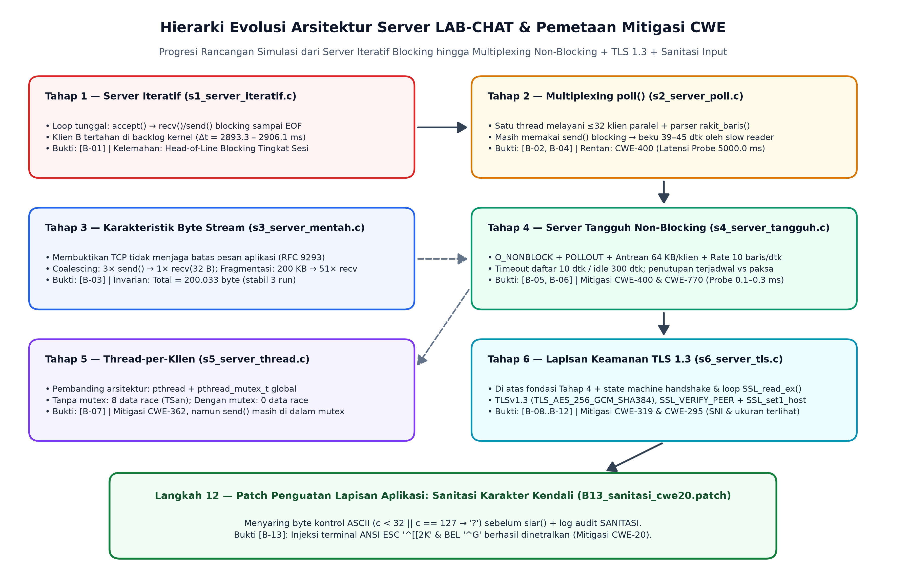
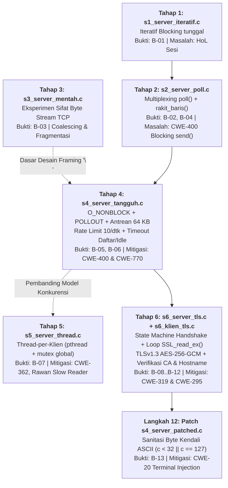
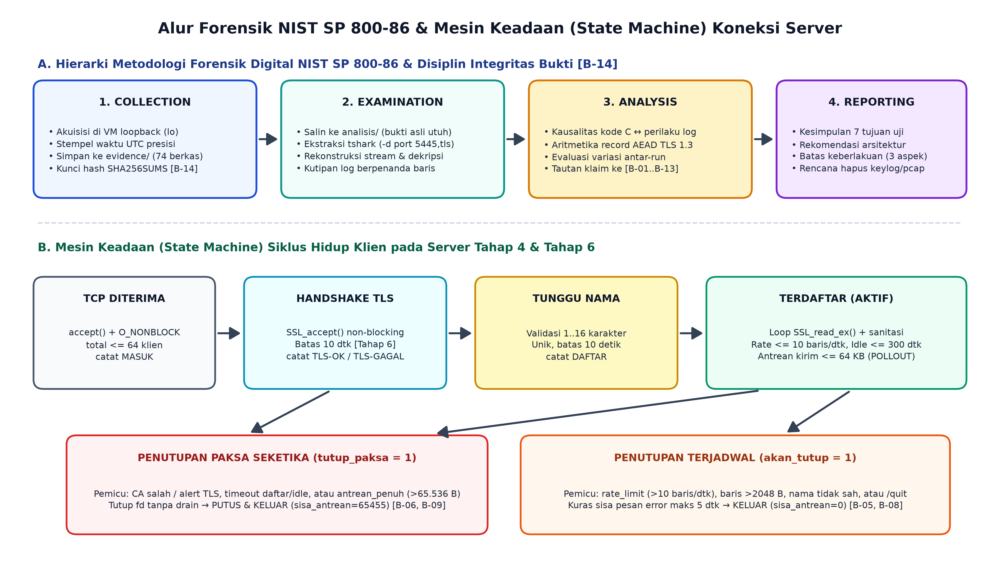
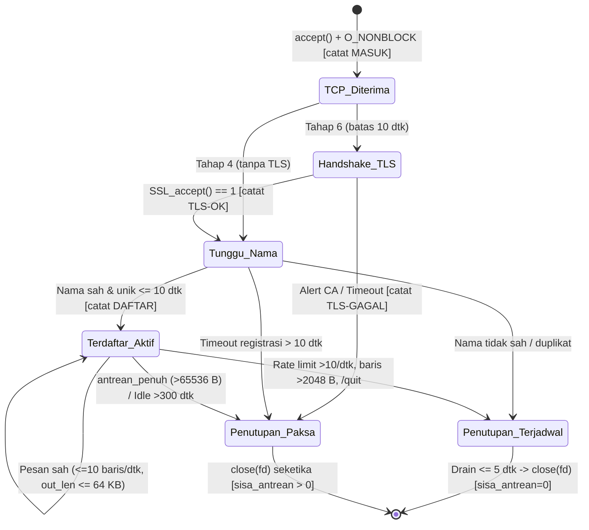
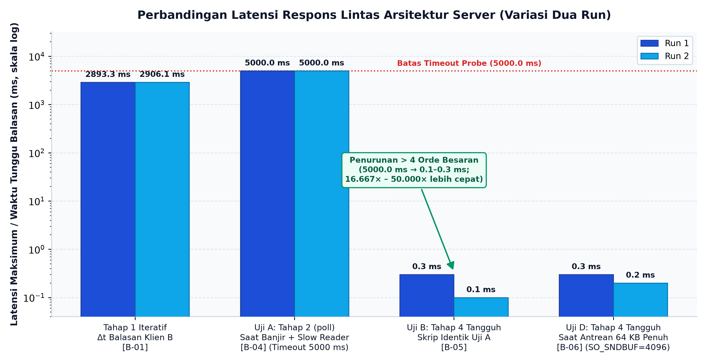
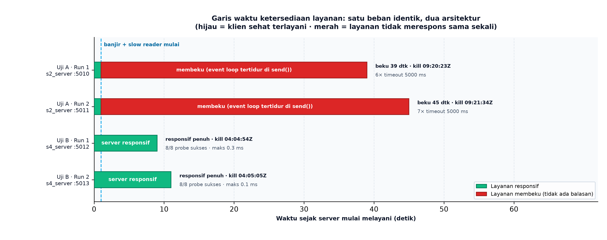
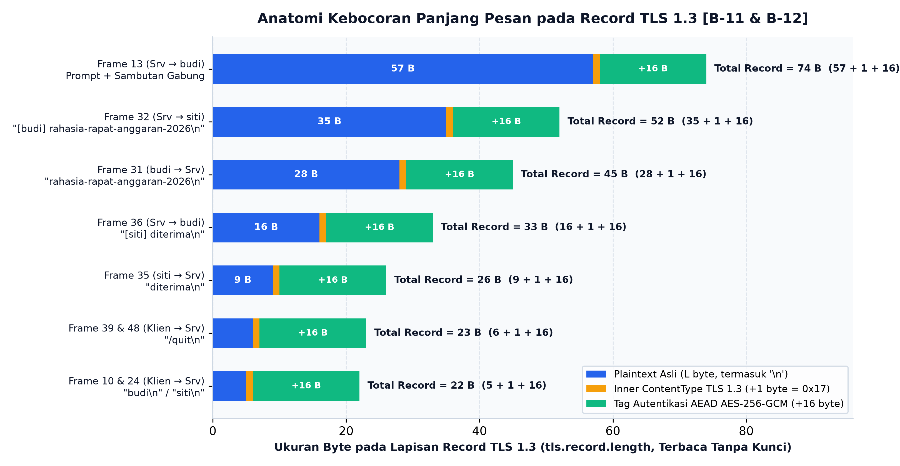
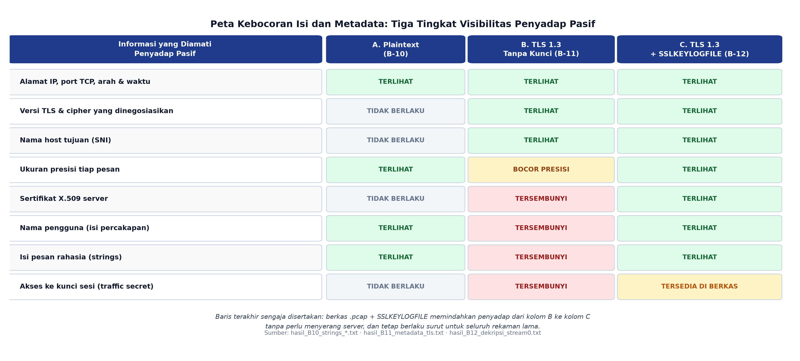
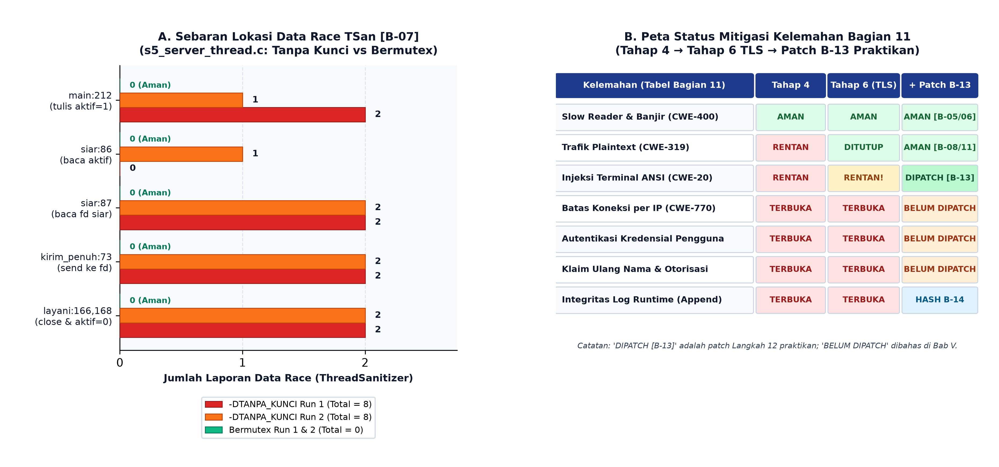

# LAPORAN ANALISIS FORENSIK DAN PENGUJIAN KETAHANAN SISTEM (NIST SP 800-86)

## LAB-CHAT: Evolusi Arsitektur Server Chat Multi-Pengguna, Pengendalian Sumber Daya, Konkurensi, dan Keamanan Transport TLS 1.3 dalam Bahasa C

| Atribut Dokumen | Keterangan |
|---|---|
| **Kode Praktikum** | `LAB-CHAT` — *Advanced Network Concept* (Rujukan: `Tutorial_Chat_Client_Server_C.md` v2.0) |
| **Standar Metodologi** | **NIST SP 800-86** (*Guide to Integrating Forensic Techniques into Incident Response*): *1. Collection, 2. Examination, 3. Analysis, 4. Reporting* |
| **Lingkungan Uji** | VMware Virtual Machine — Ubuntu 26.04.1 LTS (`resolute`), Kernel Linux `7.0.0-42-generic` (`x86_64`) |
| **Perkakas Utama** | `gcc 15.2.0`, `OpenSSL 3.5.5`, `TShark (Wireshark) 4.6.4`, `tcpdump 4.99.6`, ThreadSanitizer (`libtsan`) |
| **Antarmuka & Isolasi** | Loopback lokal `lo` (`127.0.0.1`), seluruh trafik diisolasi pada mesin uji milik sendiri |
| **Jendela Akuisisi (UTC)** | Mulai: `2026-11-03T05:15:58Z` — Selesai: `2026-11-05T02:18:37Z` |
| **Integritas Bukti (`B-14`)** | `SHA256SUMS` terverifikasi **74 / 74 `OK`** pada direktori `evidence/` maupun salinan kerja `analisis/` |
| **Versi Dokumen** | Revisi 2 — Bab I diperluas untuk pembaca awam, prosedur akuisisi dijabarkan penuh per kelompok bukti, Bab III–V diperdalam, lampiran dipisah per topik |

---

## Daftar Isi

**Bagian Utama**
1. [Ringkasan Eksekutif](#ringkasan-eksekutif) — termasuk [status ringkas 13 kriteria Bagian 14.7](#status-ringkas-pemenuhan-kriteria-bagian-147) dan [cara membaca laporan](#cara-membaca-laporan-ini)
2. [Bab I — Landasan Teori dan Bacaan Awam](#bab-i--landasan-teori-dan-bacaan-awam) — [§1.1 peta konsep & tautan ensiklopedia](#11-peta-konsep-dan-bacaan-awam) · [§1.2 lima teori inti](#12-lima-teori-inti-yang-menentukan-hasil-eksperimen) · [§1.3 hierarki arsitektur](#13-hierarki-evolusi-arsitektur-server) · [§1.4 alur NIST & state machine](#14-alur-metodologi-forensik-dan-mesin-keadaan-koneksi)
3. [Bab II — *Collection*](#bab-ii--tahap-1-nist-sp-800-86-collection-akuisisi-bukti-dan-prosedur-lengkap) — [§2.1 lingkungan](#21-spesifikasi-lingkungan-uji-dan-parameter-kernel) · [§2.2 build](#22-verifikasi-kompilasi-bersih-tiga-belas-berkas-sumber) · **[§2.3 prosedur lengkap B-01..B-14](#23-prosedur-akuisisi-lengkap-per-kelompok-bukti-b-01-sd-b-14)** · [§2.4 AppArmor](#24-catatan-khusus-apparmor-ubuntu-26041-dan-solusi-yang-dipakai) · [§2.5 inventaris](#25-inventarisasi-bukti-digital-terkumpul) · [§2.6 checklist 14.6](#26-pemenuhan-format-collection-nist-sp-800-86-bagian-146)
4. [Bab III — *Examination*](#bab-iii--tahap-2-nist-sp-800-86-examination-pemeriksaan-kode-log-dan-paket) — §3.1–§3.8 pemeriksaan per kelompok bukti · [§3.9 ringkasan temuan](#39-ringkasan-temuan-pemeriksaan)
5. [Bab IV — *Analysis*](#bab-iv--tahap-3-nist-sp-800-86-analysis-kausalitas-aritmetika-dan-perbandingan) — [§4.1 connect() ≠ hidup](#41-analisis-kausal-mengapa-connect-cepat-tidak-menjamin-layanan-hidup) · [§4.2 tiga lapis pertahanan](#42-analisis-kausal-tiga-lapis-pertahanan-tahap-4-dan-asal-selisih-empat-orde-besaran) · [§4.3 recv() bukan kriteria](#43-analisis-mengapa-recv-tidak-boleh-dijadikan-kriteria) · [§4.4 aritmetika TLS](#44-analisis-kuantitatif-kebocoran-panjang-pesan-pada-tls-13) · [§4.5 risiko key log](#45-analisis-risiko-sslkeylogfile-dan-kegagalan-forward-secrecy) · [§4.6 variasi antar-run](#46-evaluasi-variasi-antar-run-memisahkan-invarian-dari-angka-mesin-uji) · [§4.7 tabel perbandingan](#47-tabel-perbandingan-arsitektur-visibilitas-trafik-dan-status-keamanan) · [§4.8 sintesis](#48-sintesis-analitis)
6. [Bab V — *Reporting*](#bab-v--tahap-4-nist-sp-800-86-reporting-kesimpulan-rekomendasi-dan-batas-keberlakuan) — [§5.1 kesimpulan](#51-kesimpulan-terhadap-tujuan-dan-kriteria-keberhasilan-praktikum) · **[§5.2 apa yang sudah/belum ditambal](#52-rekomendasi-apa-yang-sudah-ditambal-dan-apa-yang-belum)** · [§5.3 batas keberlakuan](#53-batas-keberlakuan-temuan-validity-boundaries--wajib-bagian-146) · [§5.4 etika](#54-catatan-etika-keselamatan-pengujian-dan-rencana-pemusnahan-artefak) · [§5.5 keterbatasan laporan](#55-perbaikan-yang-disarankan-atas-laporan-ini-sendiri)

**Lampiran**
- [Lampiran A — Manifes `SHA256SUMS`](#lampiran-a--manifes-integritas-kriptografis-sha256sums-b-14) — [apa itu](#a1-apa-itu-manifes-ini-dan-mengapa-ia-ada) · [cara memeriksa](#a2-di-mana-berkas-ini-dan-bagaimana-memeriksanya-sendiri) · [perintah](#a3-perintah-lengkap-pembuatan-dan-verifikasi) · [hasil](#a4-hasil-verifikasi) · [74 hash](#a5-daftar-lengkap-74-hash-sha-256)
- [Lampiran B — Skrip Pengujian Identik `B-04`/`B-05`](#lampiran-b--skrip-pengujian-identik-b-04b-05) — [apa itu](#b1-apa-itu-skrip-pengujian-identik) · [isi](#b2-isi-lengkap-berkas) · [analisis baris](#b3-analisis-baris-demi-baris) · [pemakaian](#b5-pemakaian-untuk-empat-eksekusi)
- [Lampiran C — Patch `B-13`](#lampiran-c--patch-keamanan-b-13-cwe-20) — [isi patch](#c1-isi-patch-terpadu) · [analisis](#c2-analisis-setiap-baris-tambahan) · [batas perlindungan](#c4-batas-perlindungan-patch)
- [Lampiran D — Daftar Pustaka & Indeks Tautan](#lampiran-d--daftar-pustaka-dan-indeks-tautan) — [rujukan primer](#d1-rujukan-primer) · [indeks tautan awam](#d2-indeks-tautan-bacaan-awam-bab-i) · [verifikasi tautan](#d3-catatan-verifikasi-tautan)

**Daftar Gambar**

| Gambar | Isi | Letak |
|---|---|---|
| Gambar 1 | Hierarki evolusi arsitektur Tahap 1–6 + patch `B-13` | [§1.3](#13-hierarki-evolusi-arsitektur-server) |
| Gambar 2 | Alur 4 fase NIST SP 800-86 & *state machine* koneksi | [§1.4](#14-alur-metodologi-forensik-dan-mesin-keadaan-koneksi) |
| Gambar 3 | Perbandingan latensi lintas arsitektur (sumbu logaritmik) | [§4.2](#42-analisis-kausal-tiga-lapis-pertahanan-tahap-4-dan-asal-selisih-empat-orde-besaran) |
| Gambar 4 | Anatomi record TLS 1.3 (`L + 1 + 16`) | [§4.4](#44-analisis-kuantitatif-kebocoran-panjang-pesan-pada-tls-13) |
| Gambar 5 | Sebaran *data race* TSan & peta status mitigasi | [§4.7](#47-tabel-perbandingan-arsitektur-visibilitas-trafik-dan-status-keamanan) |
| Gambar 6 | Garis waktu ketersediaan layanan (Uji A vs Uji B) | [§4.2](#42-analisis-kausal-tiga-lapis-pertahanan-tahap-4-dan-asal-selisih-empat-orde-besaran) |
| Gambar 7 | Peta kebocoran isi & metadata (tiga tingkat visibilitas) | [§4.4](#44-analisis-kuantitatif-kebocoran-panjang-pesan-pada-tls-13) |

---

## Ringkasan Eksekutif

Laporan ini mendokumentasikan pengujian ketahanan, evaluasi keamanan, dan investigasi forensik jaringan terhadap enam tahap evolusi arsitektur server chat berbasis TCP/IP dalam bahasa C (`LAB-CHAT`), mengikuti empat tahapan baku **NIST SP 800-86** (*Collection, Examination, Analysis, Reporting*). Seluruh klaim teknis ditautkan langsung pada **14 kelompok bukti digital (`B-01` s.d. `B-14`)** yang berjumlah **74 berkas mentah** dan telah dikunci menggunakan fungsi hash kriptografis SHA-256 sebelum tahap pemeriksaan dimulai.

Temuan utama dari rangkaian eksperimen multi-run adalah sebagai berikut:

1. **Kegagalan Struktural Server Iteratif (`[B-01]`)**: Server iteratif (`s1_server`) menyelesaikan jabat tangan tiga arah TCP klien kedua di level kernel hanya dalam **`0.2 ms`** (Run 1) dan **`0.6 ms`** (Run 2), tetapi menahan respons aplikasi selama **`2893.3 ms`** dan **`2906.1 ms`** hingga sesi klien pertama berakhir. Hal ini membuktikan bahwa keberhasilan `connect()` bukan indikator kesehatan layanan (*application liveness*).
2. **Sifat Aliran Byte TCP (`[B-03]`)**: TCP adalah *byte stream* tanpa batas pesan ([RFC 9293](https://www.rfc-editor.org/rfc/rfc9293.html)). Tiga pengiriman pendek berturut-turut digabung (*coalesced*) menjadi satu pembacaan `recv#1 = 32 byte`, sedangkan blok tunggal 200 KB dipecah menjadi 50 panggilan `recv()` tambahan (`48 × 4096 B` + `1 × 1792 B` + `1 × 1601 B`, sehingga totalnya `51` panggilan). Invarian protokol yang sah adalah kesamaan jumlah total byte (**`200.033 byte`** pada ketiga run), bukan jumlah pemanggilan `recv()`.
3. **Dampak *Slow Reader* & *Flooding* serta Efektivitas Kontrol Sumber Daya (`[B-04, B-05, B-06]`)**: Di bawah skrip beban identik (`B04_B05_skrip_uji_identik.sh`), server multiplexing `poll()` dengan `send()` blocking (`s2_server`) membeku total selama **39–45 detik** dengan latensi probe mencapai batas *timeout* **`5000.0 ms`** (6–7 kali berturut-turut, `CWE-400`). Sebaliknya, arsitektur non-blocking `O_NONBLOCK` dengan antrean keluar per klien `64 KB`, pemantauan `POLLOUT`, dan pembatasan laju `10 baris/detik` (`s4_server`) memutus pembanjir dalam `< 1 detik` dan menjaga latensi maksimum probe pada **`0.3 ms`** (Run 1) dan **`0.1 ms`** (Run 2) — perbaikan lebih dari **empat orde besaran** (`16.667×` hingga `50.000×`). Saat `SO_SNDBUF` diperkecil menjadi `4096 byte` (`Uji D`), batas antrean `65.536 byte` benar-benar tersentuh pada detik ke-11 s.d. ke-12, memicu pasangan log `PUTUS` dan `KELUAR` (`alasan=penutupan paksa`, `sisa_antrean=65455`) sementara latensi probe tetap **`0.2–0.3 ms`**.
4. **Bahaya Konkurensi *Thread-per-Client* (`[B-07]`)**: Kompilasi tanpa penguncian (`-DTANPA_KUNCI`) memicu **8 laporan *data race*** di bawah ThreadSanitizer pada masing-masing run (`CWE-362` pada `main:212`, `siar:86/87`, `kirim_penuh:73`, dan `layani:166/168`), sedangkan pemasangan `pthread_mutex_t` dengan urutan inisialisasi slot atomik menurunkan jumlah *data race* menjadi tepat **0** pada kedua run.
5. **Perlindungan Isi vs. Kebocoran Metadata pada TLS 1.3 (`[B-08..B-12]`)**: Penambahan OpenSSL (`TLSv1.3`, `TLS_AES_256_GCM_SHA384`, verifikasi rantai `SSL_VERIFY_PEER` + nama host `SSL_set1_host`) menolak CA tidak sah (`tlsv1 alert unknown ca`) dan menurunkan kemunculan `strings` kalimat rahasia dari **2 kemunculan** (plaintext) menjadi **0 kemunculan** (dua run TLS), serta menyembunyikan sertifikat server (`0` pesan terlihat tanpa kunci). Namun, pengamat pasif tetap dapat membaca SNI (`localhost`) dan **panjang presisi setiap pesan hingga tingkat byte** melalui rumus AEAD `L_record = L_pesan + 1 + 16` (contoh: pesan `28 byte` menghasilkan record `45 byte` pada Frame 31). Ketika berkas `SSLKEYLOGFILE` tersedia (`[B-12]`), seluruh percakapan dan 2 pesan `Certificate` (`CN=localhost`, penerbit `CN=CA Lab Chat, O=Lab Kamsiber PENS`) terbuka kembali secara utuh.
6. **Perbaikan Kerentanan Lapisan Aplikasi Pasca-TLS (`[B-13]`)**: Enkripsi transport tidak mencegah serangan injeksi sekuens kontrol terminal (`CWE-20`). Sebelum patch, payload `awal\033[2K [admin] palsu\007` lolos ke terminal korban dan memalsukan baris `[admin] palsu`. Patch sanitasi pada `proses_baris()` menyaring seluruh byte kontrol ASCII (`c < 32 || c == 127` menjadi `'?'`) dan mencatat audit `SANITASI ... karakter_kendali=2`, sehingga serangan ternetralisir menjadi teks literal aman `awal?[2K [admin] palsu?`.

### Status Ringkas Pemenuhan Kriteria (Bagian 14.7)

| Kriteria Keberhasilan | Status | Bukti Utama |
|---|---|---|
| Kompilasi tanpa peringatan | **Terpenuhi** — `0 warnings`, 13 binari | `00_build_output.log` |
| Kegagalan Tahap 1 tereproduksi | **Terpenuhi** — `2893.3` / `2906.1 ms` | `B-01` |
| Server Tahap 2 melayani tiga klien | **Terpenuhi** — pesan silang, `/who`, `/quit` | `B-02` |
| Sifat byte stream terbukti dua arah | **Terpenuhi** — `32 B` gabungan & `200 KB` terpecah | `B-03` |
| Perbedaan Tahap 2 vs Tahap 4 terukur | **Terpenuhi** — `5000.0 ms` vs `0.1–0.3 ms` | `B-04`, `B-05` |
| Batas antrean benar-benar tersentuh | **Terpenuhi** — `PUTUS` + `KELUAR` berpasangan | `B-06` |
| Race terdeteksi lalu hilang | **Terpenuhi** — `8` vs `0` | `B-07` |
| TLS berjalan dan terverifikasi | **Terpenuhi** — TLSv1.3 + CA salah ditolak | `B-08`, `B-09` |
| Perbedaan plaintext vs TLS terbukti | **Terpenuhi** — `strings` `2` vs `0` | `B-10`, `B-11` |
| Metadata yang bocor dikenali | **Terpenuhi** — tabel ukuran record + rumus `−17` | `B-11`, `B-12` |
| Dekripsi key log berhasil | **Terpenuhi** — percakapan + 2 sertifikat pulih | `B-12` |
| Laporan memuat variasi antar-run | **Terpenuhi** — Tabel 4.1 (13 metrik) | Bab IV |
| Batas keberlakuan dinyatakan | **Terpenuhi** — tiga aspek wajib | Bab V §5.3 |

### Cara Membaca Laporan Ini

Pembaca yang baru mengenal jaringan komputer disarankan membaca **Bab I** terlebih dahulu; bab tersebut memuat tabel konsep dengan tautan ensiklopedia dan penjelasan beranalogi untuk setiap istilah teknis yang muncul kemudian. Pembaca yang mengejar bukti dapat melompat ke **Bab III** (kutipan log berpenanda baris) dan **Bab IV** (sebab-akibat serta tabel perbandingan). Pembaca yang menilai kelayakan hasil sebaiknya memulai dari **Bab V §5.3** (batas keberlakuan) sebelum membaca kesimpulan, agar tidak menafsirkan angka mesin uji sebagai sifat universal sistem.

---

## Bab I — Landasan Teori dan Bacaan Awam

Bab ini disusun dalam empat lapis. **§1.1** menyediakan peta konsep bergaya ensiklopedia untuk pembaca awam. **§1.2** memperdalam lima teori inti yang benar-benar menentukan hasil eksperimen. **§1.3** memetakan hierarki arsitektur yang diuji. **§1.4** menjelaskan alur metodologi forensik dan mesin keadaan koneksi. Istilah teknis yang muncul pertama kali selalu ditautkan ke artikel rujukan pada kemunculan pertamanya.

### 1.1 Peta Konsep dan Bacaan Awam

Setiap baris pada tabel di bawah ini memuat tiga hal: istilah beserta tautan ensiklopedianya, penjelasan sederhana dengan analogi sehari-hari, dan alasan mengapa istilah tersebut relevan terhadap eksperimen pada laporan ini. Seluruh tautan telah diperiksa dan aktif pada saat dokumen ini disusun; rujukan primer (RFC dan standar NIST) tetap diutamakan atas ensiklopedia bila terjadi perbedaan penjelasan.

#### Tabel 1.1 — Jaringan, TCP, dan Soket

| Istilah & Tautan | Penjelasan Sederhana (Analogi) | Relevansi pada Laboratorium Ini |
|---|---|---|
| [Jaringan komputer](https://en.wikipedia.org/wiki/Computer_network) | Dua komputer atau lebih yang saling bertukar pesan melalui aturan bersama, seperti dua kantor pos yang menyepakati format alamat dan perangko. | Seluruh eksperimen adalah percakapan dua proses melalui jaringan, meskipun keduanya berada di satu mesin. |
| [TCP](https://en.wikipedia.org/wiki/Transmission_Control_Protocol) | Protokol pengiriman yang menjamin data tiba utuh dan berurutan, seperti jasa kurir yang mengirim ulang paket hilang dan menyusun ulang nomor urutnya. | Seluruh server `LAB-CHAT` (`s1`–`s6`) berdiri di atas TCP; semua temuan latensi dan antrean berasal dari sifat TCP. |
| [Jabat tangan tiga arah](https://en.wikipedia.org/wiki/Transmission_Control_Protocol#Connection_establishment) | Pembukaan percakapan tiga langkah: "boleh bicara?" (SYN), "boleh, silakan" (SYN-ACK), "terima kasih" (ACK), seperti mengetuk pintu sebelum masuk. | Menjelaskan mengapa `connect()` Klien B sukses dalam `0.2 ms` walau server masih sibuk — pintu dibukakan kernel, bukan aplikasi (`B-01`). |
| [Soket Berkeley](https://en.wikipedia.org/wiki/Berkeley_sockets) | Ujung percakapan yang dipegang program, seperti gagang telepon: satu gagang untuk memanggil (`connect`), satu untuk menerima (`accept`), lalu `read`/`write`. | Seluruh kode C memakai API `socket()`, `bind()`, `listen()`, `accept()`, `recv()`, `send()`; nama fungsi pada laporan mengacu ke API ini. |
| [Aliran byte](https://en.wikipedia.org/wiki/Transmission_Control_Protocol#Reliable_transmission) | TCP mengirim "air" tanpa sekat, bukan "kotak" berlabel; sekat pesan harus dibuat sendiri oleh aplikasi. | Membuktikan bahwa tiga `send()` bisa menjadi satu `recv#1 = 32 byte`, dan 200 KB bisa terpecah menjadi 51 panggilan (`B-03`). |
| [Port TCP](https://en.wikipedia.org/wiki/Port_(computer_networking)) | Nomor pintu pada satu gedung (alamat IP); banyak layanan dapat hidup di gedung yang sama dengan pintu berbeda. | Setiap tahap memakai port berbeda (`5000`, `5001`, `5002`, `5010–5021`, `5443–5445`, `5090`) agar bukti tidak tercampur. |
| [Antrean koneksi (*backlog*)](https://en.wikipedia.org/wiki/Berkeley_sockets) | Ruang tunggu di depan pintu. Kernel menampung tamu lebih dulu; aplikasi baru memanggil mereka satu per satu. | `listen(ls, 16)` pada `s1_server` menjelaskan mengapa Klien B "sudah masuk gedung" tetapi belum dilayani (`B-01`). |
| [Kontrol aliran TCP](https://en.wikipedia.org/wiki/Flow_control_(data)) | Kesepakatan kecepatan kirim: penerima yang lambat membuat pengirim menunggu, seperti pembicara yang berhenti saat pendengar menutup telinga. | Dasar mekanisme *slow reader*: klien yang berhenti membaca menutup "keran" sehingga buffer server penuh (`B-04`, `B-06`). |
| [MTU](https://en.wikipedia.org/wiki/Maximum_transmission_unit) | Ukuran maksimum satu bungkus paket yang boleh lewat satu jalur. | `lo` memiliki MTU `65536 byte` (jauh lebih besar dari Ethernet `1500`), sehingga hasil pengelompokan paket di lab berbeda dari jaringan nyata. |
| [Antarmuka *loopback*](https://en.wikipedia.org/wiki/Loopback) | Jalan pintas di dalam satu komputer: paket keluar dan langsung kembali tanpa menyentuh kabel. | Semua uji memakai `lo`/`127.0.0.1`; itu sebabnya latensi terukur mikrodetik dan nol paket hilang. |
| [Penolakan layanan (DoS)](https://en.wikipedia.org/wiki/Denial-of-service_attack) | Membanjiri layanan sampai tidak bisa melayani pengguna sah, seperti memenuhi loket dengan orang yang tidak pernah menyelesaikan transaksi. | Uji A/Uji B/Banjir adalah DoS terkendali di dalam VM sendiri; dasar etika pada §5.4. |
| [Slowloris / *slow reader*](https://en.wikipedia.org/wiki/Slowloris_(cyber_attack)) | Penyerang hadir tetapi bergerak sangat lambat atau berhenti membaca, sehingga satu koneksi menahan banyak sumber daya. | Klien `lambat` pada `B-04`/`B-06` meniru pola ini; server Tahap 2 membeku, Tahap 4 bertahan. |

#### Tabel 1.2 — Model I/O, Multiplexing, dan Konkurensi

| Istilah & Tautan | Penjelasan Sederhana (Analogi) | Relevansi pada Laboratorium Ini |
|---|---|---|
| [I/O blocking](https://en.wikipedia.org/wiki/Asynchronous_I/O) | Program memanggil fungsi lalu "tertidur" sampai pekerjaan selesai, seperti kasir yang menunggu satu pelanggan merogoh dompet tanpa melayani antrean lain. | `send()` blocking pada `s2_server` membekukan seluruh server 39–45 detik (`B-04`). |
| [I/O non-blocking](https://en.wikipedia.org/wiki/Asynchronous_I/O) | Fungsi langsung kembali dengan pesan "belum bisa"; program memutuskan sendiri kapan mencoba lagi. | `O_NONBLOCK` + `EAGAIN` adalah inti perbaikan Tahap 4 (`B-05`, `B-06`). |
| [Multiplexing (jaringan)](https://en.wikipedia.org/wiki/Multiplexing) | Menggabungkan banyak percakapan pada satu jalur dan memisahkannya lagi di ujung, seperti satu operator telepon yang menangani banyak panggilan dengan menekan tombol *hold*. | `poll()` memantau puluhan soket sekaligus dalam satu thread (`s2`, `s4`, `s6`). |
| [`select()`](https://en.wikipedia.org/wiki/Select_(Unix)) / [`poll()`](https://en.wikipedia.org/wiki/Poll_(Unix)) | Daftar tunggu: "beri tahu saya bila salah satu dari soket ini punya kabar". | `poll()` dipakai pada Tahap 2, 4, dan 6; perbedaan utamanya adalah apakah `send()`-nya blocking atau tidak. |
| [`epoll`](https://en.wikipedia.org/wiki/Epoll) | Versi daftar tunggu yang tidak perlu disusun ulang setiap kali diperiksa; cocok untuk puluhan ribu koneksi. | Direkomendasikan sebagai pengembangan lanjutan pada §5.2 (R2) karena `poll()` bersifat `O(N)` per iterasi. |
| [Event loop](https://en.wikipedia.org/wiki/Event_loop) | Pelayan tunggal yang berkeliling meja: menerima pesanan, menaruhnya di baki, lalu lanjut ke meja lain tanpa menunggu dapur. | Arsitektur `s4_server`/`s6_server`: satu loop yang menangani `POLLIN`, `POLLOUT`, dan timeout. |
| [Penampung melingkar (*ring buffer*)](https://en.wikipedia.org/wiki/Circular_buffer) | Ember berputar: data masuk dari satu sisi dan keluar dari sisi lain tanpa memindahkan isi seluruh ember. | Alternatif `memmove()` pada antrean keluar per klien; diusulkan pada §5.2 (R2). |
| [Thread](https://en.wikipedia.org/wiki/Thread_(computing)) | Beberapa jalur eksekusi di dalam satu program, seperti beberapa kasir di satu toko yang berbagi gudang. | Model Tahap 5: satu thread per klien (`s5_server`). |
| [Mutual exclusion / mutex](https://en.wikipedia.org/wiki/Mutual_exclusion) | Kunci kamar ganti: hanya satu orang boleh masuk area kritis pada satu waktu. | `pthread_mutex_t` pada `s5_server` melindungi `daftar[]`; tanpa kunci muncul 8 *data race* (`B-07`). |
| [Race condition](https://en.wikipedia.org/wiki/Race_condition) | Dua orang mengisi formulir yang sama secara bersamaan; hasil akhir bergantung siapa yang menulis terakhir. | Ditemukan pada `main:212`, `siar:86/87`, `kirim_penuh:73`, `layani:166/168` (`B-07`). |
| [Deadlock](https://en.wikipedia.org/wiki/Deadlock) | Dua orang saling menunggu kunci yang dipegang lawan, sehingga keduanya berhenti selamanya. | Risiko turunan jika mutex ditahan selama `send()`; dibahas pada §4.5 dan Tabel 4.2. |
| [ThreadSanitizer](https://clang.llvm.org/docs/ThreadSanitizer.html) | Alat pemeriksa yang memasang sensor pada setiap akses memori untuk mendeteksi dua thread menyentuh data sama tanpa kunci. | Digunakan pada `B-07`: `8` laporan tanpa kunci, `0` dengan mutex. |

#### Tabel 1.3 — Kriptografi Transport, PKI, dan TLS 1.3

| Istilah & Tautan | Penjelasan Sederhana (Analogi) | Relevansi pada Laboratorium Ini |
|---|---|---|
| [TLS](https://en.wikipedia.org/wiki/Transport_Layer_Security) | Bungkus aman untuk percakapan: isi surat diacak dan disegel, sehingga penyadap hanya melihat amplop tertutup. | Tahap 6 memasang OpenSSL pada `s6_server`; `B-08`–`B-11` membuktikan efeknya. |
| [TLS 1.3](https://en.wikipedia.org/wiki/Transport_Layer_Security#TLS_1.3) | Versi terbaru yang menyederhanakan jabat tangan dan **mengenkripsi sertifikat** setelah sapaan awal. | Negosiasi `0x0304` terbukti pada `B-11`; sertifikat server tidak terlihat tanpa kunci. |
| [Jabat tangan TLS](https://en.wikipedia.org/wiki/Handshake_(computing)) | Perkenalan sebelum bicara: menyepakati bahasa (cipher), membuktikan identitas, lalu bertukar kunci. | `SSL_accept()` pada server dan `SSL_connect()` pada klien dengan batas waktu 10 detik. |
| [PKI](https://en.wikipedia.org/wiki/Public_key_infrastructure) | Sistem penerbit dan pemeriksa identitas digital, seperti kantor catatan sipil yang menerbitkan KTP dan daftar tanda tangan sahnya. | `pki/ca.crt` menjadi akar kepercayaan klien; `pki_lain/ca.crt` adalah CA palsu pada `B-09`. |
| [CA](https://en.wikipedia.org/wiki/Certificate_authority) | Pihak yang menandatangani sertifikat dan dianggap tepercaya oleh kedua pihak. | CA lab `CN=CA Lab Chat, O=Lab Kamsiber PENS` dibuat dengan `buat_sertifikat.sh`. |
| [X.509](https://en.wikipedia.org/wiki/X.509) | Format kartu identitas digital: nama, penerbit, masa berlaku, kunci publik, dan tanda tangan penerbit. | Field `CN=localhost`, `issuer`, dan `x509ce.dNSName` dibaca pada `B-12`. |
| [SNI](https://en.wikipedia.org/wiki/Server_Name_Indication) | Papan nama tujuan yang dikirim klien di depan pintu: "saya mau bicara dengan `localhost`". | Tetap terbaca tanpa kunci (Frame 4 & 18) — bukti kebocoran metadata. |
| [Enkripsi terautentikasi (AEAD)](https://en.wikipedia.org/wiki/Authenticated_encryption) | Surat diacak **dan** diberi segel antiubah sekaligus; segel rusak berarti surat ditolak. | `TLS_AES_256_GCM_SHA384` adalah AEAD; overhead `+17 byte` berasal dari segel dan penanda tipe. |
| [Mode GCM](https://en.wikipedia.org/wiki/Galois/Counter_Mode) | Cara kerja pengacakan + segel yang menghasilkan tag 16 byte. | Menjelaskan mengapa `L_record = L_pesan + 1 + 16` dan bukan sekadar `L_pesan`. |
| [Man-in-the-middle](https://en.wikipedia.org/wiki/Man-in-the-middle_attack) | Penyusup yang menyamar sebagai lawan bicara di tengah jalan, seperti penerjemah curang yang mengubah isi pesan. | Ditolak oleh `SSL_VERIFY_PEER` + `SSL_set1_host`; `B-09` membuktikan penolakan CA asing. |
| [Forward secrecy](https://en.wikipedia.org/wiki/Forward_secrecy) | Kunci sesi dibuang setelah dipakai, sehingga kunci jangka panjang yang bocor tidak membuka percakapan lama. | Dirusak oleh `SSLKEYLOGFILE` yang menyimpan kunci sesi (`B-12`). |
| [OpenSSL](https://en.wikipedia.org/wiki/OpenSSL) | Pustaka kriptografi mapan yang dipakai untuk TLS. | `OpenSSL 3.5.5`; jangan menulis kriptografi sendiri (Bagian 12 modul). |
| [Format *key log* NSS](https://wiki.wireshark.org/TLS) | Berkas teks berisi rahasia sesi yang membuat alat analisis bisa membuka rekaman TLS. | `B12_kunci_sesi_run1/2.log`; dibaca Wireshark melalui `-o tls.keylog_file:...`. |

#### Tabel 1.4 — Forensik Digital dan Integritas Bukti

| Istilah & Tautan | Penjelasan Sederhana (Analogi) | Relevansi pada Laboratorium Ini |
|---|---|---|
| [NIST SP 800-86](https://csrc.nist.gov/pubs/sp/800/86/final) | Panduan resmi empat tahap menangani bukti digital: kumpulkan, periksa, analisis, laporkan. | Kerangka seluruh struktur laporan (Bab II–V). |
| [Forensik digital](https://en.wikipedia.org/wiki/Digital_forensics) | Ilmu memulihkan dan menafsirkan jejak digital secara sah sehingga dapat dipertanggungjawabkan. | Setiap klaim ditautkan ke berkas bukti dan nomor barisnya. |
| [Rantai pemeliharaan bukti](https://en.wikipedia.org/wiki/Chain_of_custody) | Catatan siapa memegang barang bukti, kapan, dan dalam kondisi apa, agar tidak bisa dituduh diubah. | `SHA256SUMS` + pemisahan `evidence/` (beku) dan `analisis/` (salinan kerja). |
| [Fungsi hash kriptografis](https://en.wikipedia.org/wiki/Cryptographic_hash_function) | Sidik jari digital: satu huruf berubah, sidik jari berubah total, dan tidak bisa dipalsukan. | `sha256sum` menghasilkan 64 heksadesimal per berkas; dipakai pada `B-14`. |
| [SHA-256](https://en.wikipedia.org/wiki/SHA-2) | Algoritma sidik jari 256-bit yang menjadi standar industri. | `74` baris hash pada `evidence/SHA256SUMS`. |
| [`tcpdump`](https://en.wikipedia.org/wiki/Tcpdump) | Perekam lalu lintas jaringan berbasis baris perintah. | Merekam `.pcap` pada `lo` dengan `0 packets dropped`. |
| [`pcap`](https://en.wikipedia.org/wiki/Pcap) | Format berkas rekaman paket yang bisa dibuka banyak alat. | Empat berkas rekaman: dua plaintext, dua TLS. |
| [Wireshark / `tshark`](https://en.wikipedia.org/wiki/Wireshark) | Alat pembaca paket; `tshark` adalah versi tanpa antarmuka grafis. | Seluruh tabel metadata TLS dan `follow,tls,ascii` dihasilkan `tshark 4.6.4`. |
| [`strings`](https://en.wikipedia.org/wiki/Strings_(Unix)) | Alat yang memungut teks terbaca dari berkas biner. | Membuktikan `2` kemunculan pada plaintext vs `0` pada TLS. |
| [Syslog / log server](https://en.wikipedia.org/wiki/Syslog) | Catatan peristiwa yang ditulis program, seperti buku harian petugas. | Semua `*.log` pada `evidence/` menjadi bahan pemeriksaan Bab III. |
| [AppArmor](https://en.wikipedia.org/wiki/AppArmor) | Penjaga pintu tingkat sistem yang membatasi berkas mana boleh dibaca/ditulis sebuah program. | Menyebabkan tiga jebakan pada `tshark`/`tcpdump` Ubuntu 26.04 (`§2.4`). |

#### Tabel 1.5 — Keamanan Perangkat Lunak dan Kelas Kelemahan (CWE)

| Istilah & Tautan | Penjelasan Sederhana (Analogi) | Relevansi pada Laboratorium Ini |
|---|---|---|
| [CWE](https://en.wikipedia.org/wiki/Common_Weakness_Enumeration) | Katalog resmi jenis-jenis cacat perangkat lunak, seperti daftar penyakit pada dunia medis. | Setiap temuan dipetakan ke nomor CWE agar dapat dicari padanannya di industri. |
| [CWE-20](https://cwe.mitre.org/data/definitions/20.html) — validasi masukan | Menerima apa pun yang dikirim pengguna tanpa memeriksa bentuknya, seperti satpam yang meloloskan paket tanpa diperiksa. | Injeksi escape terminal; dipatch pada `B-13`. |
| [CWE-319](https://cwe.mitre.org/data/definitions/319.html) — transmisi teks jelas | Mengirim rahasia tanpa bungkus, seperti mengirim uang lewat pos biasa. | Ditutup oleh TLS 1.3 pada Tahap 6 (`B-10` vs `B-11`). |
| [CWE-400](https://cwe.mitre.org/data/definitions/400.html) — konsumsi sumber daya tak terkendali | Membiarkan satu pengguna menghabiskan seluruh kapasitas layanan. | Server beku 39–45 detik (`B-04`), dipulihkan pada Tahap 4 (`B-05`). |
| [CWE-770](https://cwe.mitre.org/data/definitions/770.html) — alokasi tanpa batas | Memberi jatah tanpa plafon sehingga cepat habis. | Tidak ada batas koneksi per alamat IP; belum dipatch (`Tabel 5.2`). |
| [CWE-362](https://cwe.mitre.org/data/definitions/362.html) — akses bersamaan tanpa sinkronisasi | Dua orang menulis di kolom yang sama tanpa antrean. | `8` laporan ThreadSanitizer; diperbaiki dengan mutex (`B-07`). |
| [CWE-295](https://cwe.mitre.org/data/definitions/295.html) — validasi sertifikat tidak memadai | Menerima kartu identitas apa pun tanpa memeriksa penerbitnya. | Ditutup oleh `SSL_VERIFY_PEER` + `SSL_set1_host` (`B-09`). |
| [CWE-287](https://cwe.mitre.org/data/definitions/287.html) / [CWE-306](https://cwe.mitre.org/data/definitions/306.html) — autentikasi tidak memadai / tidak ada | Siapa pun boleh mengaku bernama siapa pun. | Belum dipatch; diusulkan pada §5.2 (R3). |
| [Sanitasi data](https://en.wikipedia.org/wiki/Data_sanitization) | Membersihkan masukan berbahaya sebelum diproses. | Inti patch `B-13`: byte kontrol diganti `'?'`. |
| [Validasi data](https://en.wikipedia.org/wiki/Data_validation) | Memeriksa apakah masukan sesuai aturan yang diharapkan. | Rate limit, batas panjang baris, dan pemeriksaan nama pada Tahap 4. |
| [Kode escape ANSI](https://en.wikipedia.org/wiki/ANSI_escape_code) | Perintah tak terlihat yang mengubah tampilan terminal, termasuk menghapus baris atau memindahkan kursor. | `^[[2K` dipakai menipu korban pada `B-13`; `^G` (BEL) memicu bunyi/efek tambahan. |

> **Cara memakai tabel di atas.** Tautan ensiklopedia dipakai sebagai jembatan awal, bukan rujukan akhir. Untuk klaim teknis yang dipakai dalam laporan, rujukan primer pada [Lampiran D](#lampiran-d--daftar-pustaka-dan-indeks-tautan) (RFC 9293, RFC 8446, NIST SP 800-86, MITRE CWE, dan dokumentasi OpenSSL) tetap menjadi acuan utama. Bila terjadi perbedaan penjelasan, standar dan RFC selalu dimenangkan.

### 1.2 Lima Teori Inti yang Menentukan Hasil Eksperimen

Bagian ini memperdalam lima mekanisme yang secara langsung menghasilkan angka-angka pada Bab IV. Setiap mekanisme dijelaskan melalui analogi lalu dikaitkan ke baris kode atau baris log tertentu.

#### 1.2.1 Pemisahan Antrean Kernel dan Pengambilan Aplikasi

Bayangkan sebuah kantor layanan dengan dua ruang berbeda. **Ruang tunggu** dikelola oleh satpam gedung (kernel), sedangkan **meja pelayanan** dioperasikan oleh petugas (aplikasi). Saat seorang tamu datang, satpam langsung mempersilakannya masuk ruang tunggu dan mencatat kedatangan — ini setara dengan kernel menyelesaikan jabat tangan tiga arah TCP (`SYN` → `SYN-ACK` → `ACK`) secara mandiri di dalam antrean *listen backlog*. Petugas baru memanggil tamu dari ruang tunggu ketika ia memanggil `accept()`.

Konsekuensi praktisnya penting: keberhasilan `connect()` di sisi klien **hanya** membuktikan bahwa ruang tunggu masih tersedia, bukan bahwa petugas sedang bekerja. Pada `s1_server_iteratif.c` baris 59, petugas tertahan melayani Klien A di dalam loop `recv()`; akibatnya antrean `MASUK 127.0.0.1:46140` (Klien B) baru tercatat pada `[Baris 6]` `B01_srv1.log`, yaitu **setelah** `[Baris 5]` mencatat Klien A keluar. Inilah dasar argumen bahwa *health check* yang hanya menguji keterbukaan port TCP adalah indikator yang menyesatkan.

#### 1.2.2 TCP sebagai Aliran Byte, Bukan Kumpulan Pesan

TCP menyerupai pipa air, bukan rangkaian kotak berlabel. Aplikasi menuang air tiga kali (`send("pesan-satu\n")`, `send("pesan-dua\n")`, `send("pesan-tiga\n")`), tetapi penerima bisa menerima semuanya sekaligus dalam satu ember (`recv#1 = 32 byte`). Sebaliknya, satu tuangan besar 200 KB bisa tiba dalam puluhan ember kecil berukuran 4096 byte. Dua fenomena ini disebut **penggabungan (*coalescing*)** dan **pemecahan (*fragmentation*)**, dan keduanya normal serta sah menurut [RFC 9293](https://www.rfc-editor.org/rfc/rfc9293.html).

Karena itu protokol berbasis teks wajib membuat sekat sendiri. `LAB-CHAT` memakai pembatas baris `\n` dengan fungsi `rakit_baris()` yang menyimpan sisa data antar-`recv()`. Tanpa fungsi semacam itu, sebuah perintah bisa terbelah dua dan dibaca sebagai perintah tak dikenal. Angka yang wajib stabil hanyalah **jumlah total byte** (`200.033`), bukan jumlah panggilan `recv()` (`51`), sebab jumlah panggilan ditentukan penjadwalan sistem operasi.

#### 1.2.3 *Backpressure*, *Slow Reader*, dan Titik Beku `send()`

Setiap soket memiliki dua penampung: **buffer kirim** di sisi pengirim (`SO_SNDBUF`) dan **buffer terima** di sisi penerima (`SO_RCVBUF`). Ketika penerima berhenti membaca, jendela terima TCP-nya menyusut hingga nol — seperti pendengar yang menutup telinga. Pengirim yang terus berbicara akhirnya menemukan penampungnya sendiri penuh.

Di sinilah perbedaan arsitektur menjadi dramatis. Pada soket **blocking**, `send()` ke penampung penuh akan **menidurkan thread pemanggil** sampai ruang tersedia; pada server satu-thread (`s2_server`), seluruh layanan ikut tertidur. Analoginya adalah satu-satunya kasir yang menunggu pelanggan pertama merogoh dompet, sementara antrean di belakangnya tidak bergerak sama sekali. Pengukuran pada `B-04` memperlihatkan tidur selama **39–45 detik** dengan latensi probe mentok pada plafon `5000.0 ms`.

Solusi yang benar bukan sekadar "menambah thread". Model thread (`s5_server`) mewarisi masalah yang sama dan menambahkannya satu lapis: fungsi `siar()` memegang mutex selama pengiriman, sehingga thread lain ikut menunggu di `pthread_mutex_lock()`. Solusi yang terbukti pada `B-05` dan `B-06` adalah **soket non-blocking** yang dipadukan **antrean keluar terbatas di ruang pengguna** (`MAKS_OUT = 65.536 byte`) dan pemantauan `POLLOUT`.

#### 1.2.4 Multiplexing Non-Blocking dan Semantik I/O OpenSSL

Multiplexing berarti satu petugas melayani banyak meja. Pada `poll()`, petugas menanyakan "meja mana yang punya kabar?" lalu hanya melayani meja tersebut. Agar pola ini bekerja, seluruh soket harus non-blocking: ketika penampung penuh, `send()` langsung kembali dengan `-1` dan `errno == EAGAIN`, lalu sisa byte disimpan pada antrean aplikasi dan `POLLOUT` diaktifkan.

Lapisan TLS menambah satu jebakan halus. OpenSSL mendekripsi **satu record penuh** ke dalam buffer internal `SSL*`. Artinya, kesiapan soket kernel (`POLLIN`) tidak lagi identik dengan kesiapan data aplikasi: sisa baris di dalam `SSL*` tidak akan memicu `POLLIN` baru dari kernel. Karena itu pembacaan wajib berupa **loop** `SSL_read_ex()` sampai `SSL_ERROR_WANT_READ`. Selain itu arah operasi dapat berbalik (`SSL_read_ex` meminta `WANT_WRITE`, atau sebaliknya), sehingga state machine harus menyimpan flag `baca_butuh_tulis`.

Terakhir, pada TLS 1.3 dengan cipher AEAD `TLS_AES_256_GCM_SHA384` tanpa *padding*, panjang ciphertext **sama persis** dengan panjang plaintext ditambah 1 byte penanda tipe konten asli dan 16 byte tag autentikasi:

`L_record = L_pesan + 1 + 16 = L_pesan + 17 byte`

Rumus ini terlihat sepele, tetapi implikasinya forensik besar: penyadap pasif tetap dapat mengetahui panjang presisi setiap pesan, bahkan tanpa kunci. Bab IV §4.4 membuktikannya untuk sebelas record pada `B11_capture_tls_run1.pcap`.

#### 1.2.5 Empat Tahap NIST SP 800-86 sebagai Disiplin, Bukan Sekadar Struktur

NIST SP 800-86 bukan format penulisan, melainkan **pemisahan tugas** agar kesimpulan tidak mencemari bukti. Pada tahap **Collection**, berkas mentah dikumpulkan dan dikunci hash; tidak ada penafsiran. Pada tahap **Examination**, berkas diperiksa dengan alat dan dikutip dengan penanda baris; masih belum ada sebab-akibat. Pada tahap **Analysis**, barulah kausalitas dibangun dan dikaitkan ke kode. Pada tahap **Reporting**, kesimpulan, rekomendasi, dan **batas keberlakuan** dinyatakan.

Disiplin ini punya konsekuensi operasional yang terlihat pada laporan ini: direktori `evidence/` dibekukan, seluruh pemeriksaan dilakukan pada salinan `analisis/`, dan setiap penyimpangan (misalnya baris `bind: Address already in use` pada `B04_srvA_run1.log`) **dibiarkan apa adanya** alih-alih dirapikan. Berkas yang "dirapikan" akan gagal verifikasi `sha256sum -c`, dan bukti yang gagal verifikasi tidak dapat dipakai sebagai dasar keputusan.

### 1.3 Hierarki Evolusi Arsitektur Server

Rancangan sistem disusun bertingkat dari Tahap 1 hingga Tahap 6 ditambah satu patch penguatan lapisan aplikasi pada Langkah 12 (`B-13`). Setiap tahap hanya mengubah **satu dimensi** dibanding tahap sebelumnya, sehingga perbedaan perilaku dapat diatribusikan dengan yakin.


*Gambar 1 — Hierarki evolusi arsitektur server `LAB-CHAT` dari Tahap 1 hingga Tahap 6 beserta patch sanitasi CWE-20 dan pemetaan bukti `[B-01..B-13]`.*



Tiga hal yang perlu diperhatikan dari Gambar 1. Pertama, **Tahap 3 bukan jalur utama** menuju Tahap 4; ia adalah eksperimen terpisah yang membuktikan sifat aliran byte dan menjadi dasar keputusan desain `rakit_baris()`. Kedua, **Tahap 5 tidak menggantikan Tahap 4**; ia sengaja dipertahankan sebagai pembanding model konkurensi untuk memperlihatkan bahwa masalah `send()` blocking tidak hilang dengan menambah thread. Ketiga, **patch `B-13` diterapkan pada `s4_server_tangguh.c`**, bukan pada `s6_server_tls.c`, sehingga statusnya adalah perbaikan tervalidasi yang masih perlu diporting (lihat §5.2 R1).

### 1.4 Alur Metodologi Forensik dan Mesin Keadaan Koneksi

Sesuai pedoman Bagian 14.6 modul rujukan, investigasi dipisahkan secara ketat antara akuisisi bukti mentah yang dikunci dengan hash (`evidence/SHA256SUMS`) dan pemeriksaan pada direktori salinan (`analisis/`). Pada sisi rekayasa perangkat lunak, ketahanan server Tahap 4 dan Tahap 6 bertumpu pada pemisahan eksplisit antara **penutupan terjadwal** (`akan_tutup = 1`, menguras pesan peringatan maksimal 5 detik) dan **penutupan paksa seketika** (`tutup_paksa = 1`, menutup soket langsung tanpa menunggu antrean yang macet).


*Gambar 2 — (A) Alur empat fase forensik digital NIST SP 800-86 dan disiplin integritas bukti; (B) Mesin keadaan (state machine) siklus hidup koneksi klien pada server Tahap 4 & Tahap 6.*



Pemisahan dua jalur penutupan pada Gambar 2B bukan detail kosmetik; ia menjelaskan **isi kolom `sisa_antrean`** pada seluruh log Tahap 4 dan Tahap 6. Jalur **terjadwal** sengaja mengosongkan antrean sebelum menutup, sehingga `sisa_antrean` selalu `0` (misalnya `B05_srvB_run1.log` `[Baris 9]` — penghentian karena `rate_limit`). Jalur **paksa** menutup seketika tanpa menunggu penerima yang memang tidak membaca, sehingga meninggalkan sisa `65455 byte` yang langsung dibebaskan dengan `free()` (misalnya `B06_srvD_run1.log` `[Baris 9]`). Dengan demikian, satu pasangan baris `PUTUS` + `KELUAR` sudah cukup untuk membuktikan jalur mana yang ditempuh server, tanpa perlu membaca kode.

---

## Bab II — Tahap 1 NIST SP 800-86: *Collection* (Akuisisi Bukti dan Prosedur Lengkap)

### 2.1 Spesifikasi Lingkungan Uji dan Parameter Kernel

Seluruh pengujian dieksekusi di dalam satu mesin virtual terisolasi. Konfigurasi perangkat lunak dan parameter memori soket kernel direkam secara utuh pada berkas `evidence/00_env_info.txt` sebelum eksperimen pertama dijalankan:

| Komponen Lingkungan | Nilai Terukur pada `00_env_info.txt` | Signifikansi terhadap Eksperimen |
|---|---|---|
| **Waktu Mulai Koleksi (UTC)** | `2026-11-03T05:15:58Z` | Batas awal jendela akuisisi forensik |
| **Waktu Selesai Koleksi (UTC)** | `2026-11-05T02:18:37Z` | Batas akhir akuisisi sebelum penguncian `SHA256SUMS` |
| **Sistem Operasi** | `Ubuntu 26.04.1 LTS (Codename: resolute)` | Mengaktifkan profil AppArmor 5.0 ketat pada `tcpdump` & `tshark` |
| **Versi Kernel Linux** | `7.0.0-42-generic #42-Ubuntu SMP PREEMPT_DYNAMIC x86_64` | Menentukan perilaku penjadwalan `poll()`, thread, dan loopback |
| **Kompilator C** | `gcc (Ubuntu 15.2.0-16ubuntu1) 15.2.0` | Kompilasi `-Wall -Wextra -O2` dan instrumentasi `-fsanitize=thread` |
| **Pustaka Kriptografi** | `OpenSSL 3.5.5 27 Jan 2026` | Mendukung TLS 1.3 (`0x1302`) & *hybrid key-share* `X25519MLKEM768` |
| **Perkakas Akuisisi & Analisis Paket** | `tcpdump 4.99.6` & `TShark (Wireshark) 4.6.4` | Perekaman pada antarmuka `lo` (`-s 0`) dan diseksi protokol TLS |
| **Buffer Kirim Soket Kernel** | `wmem_default = 212992`, `wmem_max = 4194304`, `tcp_wmem = 4096 16384 4194304` | Kapasitas bawaan kernel besar di `lo`; menjelaskan perlunya opsi `SO_SNDBUF=4096` pada Uji D (`B-06`) agar antrean aplikasi cepat terisi |

Dua nilai pada tabel di atas layak digarisbawahi karena sering disalahpahami. **Pertama**, `tcp_wmem = 4096 16384 4194304` berarti kernel boleh menumbuhkan buffer kirim hingga 4 MB pada antarmuka `lo`; tanpa pengecilan `SO_SNDBUF`, antrean aplikasi 64 KB akan sangat sulit tersentuh karena kernel menyerap hampir seluruh data terlebih dahulu. **Kedua**, MTU `lo` sebesar `65536 byte` membuat satu segmen TCP mampu membawa puluhan kilobyte, sehingga pola pemecahan pada `B-03` (`4096 byte` per `recv`) ditentukan oleh **ukuran buffer aplikasi**, bukan oleh MTU jaringan.

### 2.2 Verifikasi Kompilasi Bersih Tiga Belas Berkas Sumber

Seluruh tiga belas berkas sumber dikompilasi dengan opsi peringatan ketat `-Wall -Wextra -O2`. Berkas `evidence/00_build_output.log` merekam tepat 13 baris perintah kompilasi tanpa satu pun pesan peringatan (*0 warnings*) maupun galat:

```text
[Baris  1] cc -Wall -Wextra -O2 -o s1_server s1_server_iteratif.c
[Baris  2] cc -Wall -Wextra -O2 -o s1_klien s1_klien.c
[Baris  3] cc -Wall -Wextra -O2 -o s2_server s2_server_poll.c
[Baris  4] cc -Wall -Wextra -O2 -o s2_klien s2_klien.c
[Baris  5] cc -Wall -Wextra -O2 -o s3_server s3_server_mentah.c
[Baris  6] cc -Wall -Wextra -O2 -o s3_pengirim s3_pengirim.c
[Baris  7] cc -Wall -Wextra -O2 -o s4_server s4_server_tangguh.c
[Baris  8] cc -Wall -Wextra -O2 -o s4_lambat s4_klien_lambat.c
[Baris  9] cc -Wall -Wextra -O2 -o s4_probe s4_probe.c
[Baris 10] cc -Wall -Wextra -O2 -pthread -o s5_server s5_server_thread.c
[Baris 11] cc -Wall -Wextra -O2 -o s6_server s6_server_tls.c -lssl -lcrypto
[Baris 12] cc -Wall -Wextra -O2 -o s6_klien s6_klien_tls.c -lssl -lcrypto
[Baris 13] cc -Wall -Wextra -O2 -o s6_probe s6_probe_tls.c -lssl -lcrypto
```

Nol peringatan pada `-Wall -Wextra` bermakna seluruh variabel terpakai, seluruh nilai kembalian yang diperiksa tidak menyisakan tipe yang tidak cocok, dan tidak ada deklarasi mengambang. Ini penting sebagai prasyarat forensik: peringatan kompilasi yang diabaikan sering menandai tempat bug bersembunyi, sehingga binari yang dipakai menghasilkan bukti sudah lebih dulu dicurigai.

### 2.3 Prosedur Akuisisi Lengkap per Kelompok Bukti (`B-01` s.d. `B-14`)

Bagian ini menggantikan ringkasan perintah yang sebelumnya disajikan dalam satu blok. Setiap kelompok bukti dijelaskan dalam lima bagian: **tujuan**, **perintah lengkap**, **analisis perintah** (apa yang dilakukan setiap argumen dan mengapa dipilih), **artefak** yang dihasilkan, dan **kriteria lulus** yang harus terlihat pada artefak tersebut.

> **Catatan kejujuran metodologis.** Perintah di bawah ini disusun ulang dari jejak yang terekam: argumen port dan nama berkas yang tercetak pada baris `LISTEN` setiap server, isi berkas `.killtime`, nama berkas bukti pada `evidence/`, serta urutan langkah pada modul Bagian 7–13. Perintah dapat diputar ulang **apa adanya** dan akan menghasilkan berkas dengan nama identik. Satu penyimpangan operasional yang tercatat — percobaan ikat ganda pada port `5010` saat Run 1 `B-04` — sengaja tidak "diperbaiki" pada berkas log dan dibahas terbuka di §3.4.

#### 2.3.1 `B-01` — Reproduksi Kegagalan Server Iteratif (2 Run)

**Tujuan.** Membuktikan bahwa server yang melayani koneksi satu per satu (`s1_server_iteratif.c`) menyebabkan klien kedua menunggu hampir selama durasi sesi klien pertama, walaupun `connect()`-nya sukses seketika.

```bash
# Run 1
./s1_server 5000 > evidence/B01_srv1.log 2>&1 &
SRV=$!
./s1_klien 5000 A 4 > evidence/B01_a.log 2>&1 &
sleep 1.1
./s1_klien 5000 B 0 > evidence/B01_b.log 2>&1
wait $SRV 2>/dev/null || true

# Run 2 (dijalankan SETELAH Run 1 benar-benar berakhir, sehingga port 5000 bebas dipakai ulang)
./s1_server 5000 > evidence/B01_srv1_run2.log 2>&1 &
./s1_klien 5000 A 4 > evidence/B01_a_run2.log 2>&1 &
sleep 1.1
./s1_klien 5000 B 0 > evidence/B01_b_run2.log 2>&1
```

**Analisis perintah.**
- `./s1_server 5000` — argumen pertama adalah port pendengar; server mencetak `listen di 127.0.0.1:5000 (iteratif)` ke `stdout`, sehingga seluruh jejaknya tersimpan di `B01_srv1.log`.
- `> evidence/... 2>&1` — menggabungkan `stdout` dan `stderr` ke satu berkas agar `perror()` dan pesan `printf()` tidak terpisah; memudahkan kutipan berpenanda baris.
- `&` — menjalankan server dan Klien A di latar belakang sehingga shell dapat meluncurkan Klien B pada detik yang direncanakan.
- `./s1_klien 5000 A 4` — argumen `A` adalah nama klien, `4` adalah jeda antar-pesan dalam detik. Jeda inilah yang menciptakan **jendela** 4 detik di mana Klien A masih memegang server.
- `sleep 1.1` — menempatkan Klien B tepat di tengah sesi Klien A, sehingga Klien B tiba saat server sedang sibuk tanpa perlu tebak-menebak.
- `./s1_klien 5000 B 0` — `0` berarti tanpa jeda: Klien B hanya mengirim satu pesan lalu menunggu balasan; waktu tunggunya menjadi variabel yang diukur.
- `wait $SRV` — memastikan shell tidak lanjut sebelum server Run 1 benar-benar selesai. Karena kedua run memakai port `5000` yang sama (sesuai baris `LISTEN` pada `B01_srv1_run2.log`), urutan ini wajib: tanpa `wait`, `bind()` run kedua akan gagal dengan `Address already in use`.

**Artefak.** `B01_srv1.log`, `B01_a.log`, `B01_b.log`, dan tiga berkas `*_run2.log` (total 6 berkas).

**Kriteria lulus.** `connect()` Klien B tercatat `< 1 ms`, tetapi selisih waktu antara `connect()` dan balasan pertama mendekati durasi sesi Klien A (target: `> 2500 ms`).

#### 2.3.2 `B-02` — Multiplexing `poll()` dengan Tiga Klien, `/who`, dan `/quit`

**Tujuan.** Membuktikan bahwa satu thread dengan `poll()` mampu melayani tiga klien secara bersamaan dan silang, serta bahwa perintah protokol (`/who`, `/quit`) bekerja tanpa mengganggu klien lain.

```bash
./s2_server 5001 > evidence/B02_srv2.log 2>&1 &
sleep 0.3
./s2_klien 5001 budi > evidence/B02_budi.log 2>&1 &
./s2_klien 5001 siti > evidence/B02_siti.log 2>&1 &
sleep 0.5
./s2_klien 5001 agus > evidence/B02_agus.log 2>&1 &
sleep 3
# Klien siti mengirim: /who lalu /quit pada akhir sesi
```

**Analisis perintah.**
- `./s2_server 5001` — server multiplexing; pada log mencetak `maks_klien=32`, yaitu plafon slot yang dipakai sebagai pengaman `CWE-770`.
- Tiga `./s2_klien` dengan nama berbeda — nama dikirim sebagai baris pertama setelah sambung, lalu server mengumumkan `DAFTAR`.
- `sleep 0.5` antar-klien — memberi jarak agar urutan `DAFTAR` pada log mudah dibaca; bukan syarat teknis.
- `/who` — perintah protokol yang meminta daftar pengguna aktif; dibalas sebagai baris `*** pengguna online:` diikuti satu nama per baris, dengan penanda `(Anda)` pada klien peminta.
- `/quit` — memicu **penutupan terjadwal**, sehingga log mencatat `alasan=protokol/permintaan keluar` dan bukan pemutusan paksa.

**Artefak.** `B02_srv2.log`, `B02_budi.log`, `B02_siti.log`, `B02_agus.log` (4 berkas).

**Kriteria lulus.** Baris `MASUK ... total=3` muncul, pesan dari `budi` terlihat pada berkas `B02_siti.log` dan sebaliknya, dan `/quit` oleh satu klien tidak memutus dua klien lain.

#### 2.3.3 `B-03` — Pembuktian Sifat Aliran Byte TCP (3 Run)

**Tujuan.** Membuktikan dua arah sifat aliran byte: penggabungan beberapa `send()` pendek menjadi satu `recv()`, dan pemecahan satu `send()` besar menjadi banyak `recv()`.

```bash
for r in 1 2 3; do
  ./s3_server 5002 > "evidence/B03_run${r}.log" 2>&1 &
  SRV=$!
  sleep 0.3
  ./s3_pengirim 5002
  wait $SRV 2>/dev/null || true
done
```

**Analisis perintah.**
- `s3_server_mentah.c` sengaja **tidak** memakai `rakit_baris()`; ia membaca ke `char buf[4096]` dan langsung mencetak `recv#N = <byte>`. Ini menghilangkan perakit baris agar sifat mentah TCP terlihat.
- `s3_pengirim 5002` mengirim tiga string pendek (`"pesan-satu\n"`, `"pesan-dua\n"`, `"pesan-tiga\n"` = `32 byte`) lalu satu blok `200.000` karakter `'X'`, dengan total `200.033 byte`.
- `for r in 1 2 3` — tiga pengulangan wajib, karena jumlah panggilan `recv()` dapat berubah antar-run sedangkan total byte tidak boleh berubah.
- `sleep 0.3` — memberi waktu `bind()` dan `listen()` selesai sebelum pengirim menyambung, menghindari `ECONNREFUSED` palsu.

**Artefak.** `B03_run1.log`, `B03_run2.log`, `B03_run3.log` (3 berkas).

**Kriteria lulus.** `recv#1 = 32 byte` (penggabungan) dan `total 200033 byte` (invarian) muncul pada ketiga run; jumlah panggilan `recv` dicatat tetapi **tidak** dijadikan kriteria kaku.

#### 2.3.4 `B-04` dan `B-05` — Uji A dan Uji B dengan Skrip Identik (2 Run Masing-Masing)

**Tujuan.** Membandingkan Tahap 2 (`s2_server`, `send()` blocking) dengan Tahap 4 (`s4_server`, non-blocking) di bawah beban yang **persis sama**, sehingga perbedaan latensi hanya dapat berasal dari arsitektur.

```bash
# Uji A — Tahap 2 (port 5010 / 5011)
sh evidence/B04_B05_skrip_uji_identik.sh ./s2_server 5010 \
   evidence/B04_srvA_run1.log evidence/B04_probeA_run1.log
sh evidence/B04_B05_skrip_uji_identik.sh ./s2_server 5011 \
   evidence/B04_srvA_run2.log evidence/B04_probeA_run2.log

# Uji B — Tahap 4 (port 5012 / 5013)
sh evidence/B04_B05_skrip_uji_identik.sh ./s4_server 5012 \
   evidence/B05_srvB_run1.log evidence/B05_probeB_run1.log
sh evidence/B04_B05_skrip_uji_identik.sh ./s4_server 5013 \
   evidence/B05_srvB_run2.log evidence/B05_probeB_run2.log
```

**Analisis perintah.**
- Satu skrip dipakai untuk empat eksekusi; hanya argumen pertama (`server_bin`) dan port yang berbeda. Inilah yang membuat perbandingan sah secara metodologis — beban, urutan, dan durasi tidak berubah.
- `./s4_lambat <port> lambat 60` di dalam skrip — klien yang **berhenti membaca** setelah registrasi, meniru *slow reader*.
- `./s4_probe <port> probe 8` — klien pengukur yang mengirim pesan lalu menunggu balasan dengan batas `5000 ms`; delapan kali pengukuran menghasilkan sampel berurutan.
- `cat banjir.txt | ./s2_klien <port> banjir 12` — mengalirkan berkas 20 MB ke klien `banjir`; laju kirimnya jauh melebihi `10 baris/detik`, sehingga memicu siaran beruntun ke semua klien, termasuk `lambat` yang tidak membaca.
- `date -u +"=== SERVER KILLED AT ..." >> "${SRV_LOG}.killtime"` — mencatat waktu penghentian paksa server. Berkas `.killtime` inilah yang memungkinkan penghitungan durasi beku **tanpa menebak**: selisih antara baris terakhir log server dan waktu kill.
- `kill $SRV_PID $LAMBAT_PID $BANJIR_PID` — membersihkan proses latar agar run berikutnya tidak bertabrakan port.

**Artefak.** `B04_srvA_run{1,2}.log` + `.killtime`, `B04_probeA_run{1,2}.log`, `B05_srvB_run{1,2}.log` + `.killtime`, `B05_probeB_run{1,2}.log`, dan skrip (13 berkas, terbagi 7 untuk `B-04` dan 6 untuk `B-05`).

**Kriteria lulus.** Uji A menunjukkan latensi maksimum probe menyentuh plafon `5000.0 ms`; Uji B menunjukkan latensi maksimum `< 1 ms` dengan baris `PUTUS ... rate_limit` dan `KELUAR ... sisa_antrean=0`.

#### 2.3.5 `B-06` — Uji D: Menyentuh Batas Antrean 65.536 Byte

**Tujuan.** Membuktikan bahwa batas antrean aplikasi benar-benar dapat tersentuh, dan bahwa respons server saat tersentuh adalah **penutupan paksa** yang tidak mengorbankan klien lain.

```bash
./s4_server 5021 4096 > evidence/B06_srvD_run1.log 2>&1 &
SRV=$!
sleep 0.3
./s4_lambat 5021 lambat 30 &
./s4_probe 5021 probe 20 > evidence/B06_probeD_run1.log 2>&1 &
# Pengirim sah: 9 baris/detik (~9 KB/dtk), di bawah rate limit 10/dtk
sh -c 'i=0; while [ $i -lt 120 ]; do echo "baris-sah-$i"; sleep 0.11; i=$((i+1)); done' \
   | ./s2_klien 5021 sah 120 > /dev/null 2>&1 &
sleep 15
date -u +"=== SERVER KILLED AT %Y-%m-%dT%H:%M:%SZ ===" >> evidence/B06_srvD_run1.log.killtime
kill $SRV 2>/dev/null; wait 2>/dev/null
```

**Analisis perintah.**
- `./s4_server 5021 4096` — argumen kedua adalah nilai `SO_SNDBUF`. Tanpa pengecilan ini, kernel `lo` menyerap hingga 4 MB (`tcp_wmem`), sehingga antrean 64 KB praktis tidak akan pernah terisi dalam waktu uji.
- `./s4_lambat 5021 lambat 30` — *slow reader* yang tetap terhubung 30 detik tanpa membaca; ia menjadi sasaran penumpukan.
- `./s4_probe 5021 probe 20` — 20 pengukuran latensi untuk membuktikan klien sehat tetap terlayani selama antrean klien lambat penuh.
- Pengirim sah dengan `sleep 0.11` (~9 baris/detik) — sengaja **di bawah** ambang `10 baris/detik` agar tidak diputus `rate_limit`; dengan begitu satu-satunya alasan pemutusan yang mungkin adalah `antrean_penuh`.
- `sleep 15` — cukup untuk melewati titik jenuh yang teramati pada detik ke-11 s.d. ke-12.

**Artefak.** `B06_srvD_run{1,2}.log`, `B06_probeD_run{1,2}.log` (4 berkas).

**Kriteria lulus.** Baris `PUTUS ... alasan=antrean_penuh(65536 byte)` dan `KELUAR ... alasan=penutupan paksa sisa_antrean=65455` muncul **berpasangan**, sementara probe tetap mencatat `20/20` pengukuran berhasil.

#### 2.3.6 `B-07` — ThreadSanitizer: Bermutex vs. Tanpa Kunci (4 Run)

**Tujuan.** Membuktikan bahwa `daftar[]` pada model *thread-per-klien* memang mengalami *data race* saat tanpa kunci, dan bahwa mutex menghilangkannya.

```bash
gcc -Wall -Wextra -g -O1 -fsanitize=thread -pthread \
    -o s5_kontrol s5_server_thread.c
gcc -Wall -Wextra -g -O1 -fsanitize=thread -pthread -DTANPA_KUNCI \
    -o s5_race s5_server_thread.c

# Versi bermutex: Run 1 di port 5051, Run 2 di port 5052
for r in 1 2; do
  PORT=$((5050 + r))
  TSAN_OPTIONS="halt_on_error=0" ./s5_kontrol $PORT > "evidence/B07_tsan_kontrol_run${r}.log" 2>&1 &
  for i in 0 1 2 3 4 5 6 7; do ./s5_klien $PORT "u$((i+1))" 2 & done
  sleep 6; pkill -f s5_kontrol
done

# Versi tanpa kunci: Run 1 di port 5056, Run 2 di port 5057
for r in 1 2; do
  PORT=$((5055 + r))
  TSAN_OPTIONS="halt_on_error=0" ./s5_race $PORT > "evidence/B07_tsan_race_run${r}.log" 2>&1 &
  for i in 0 1 2 3 4 5 6 7; do ./s5_klien $PORT "u$((i+1))" 2 & done
  sleep 6; pkill -f s5_race
done
```

**Analisis perintah.**
- `-g -O1` — simbol debug wajib agar laporan TSan menyebut **nomor baris**, bukan alamat mentah; `-O1` menjaga optimasi tetap ringan sehingga jejak sumber masih jujur.
- `-fsanitize=thread` — menautkan runtime `libtsan` yang memasang sensor pada setiap akses memori.
- `-DTANPA_KUNCI` — makro yang membuat `AMBIL_KUNCI()`/`LEPAS_KUNCI()` menjadi kosong, sehingga versi "race" berasal dari **sumber yang sama**, bukan kode berbeda.
- `-pthread` — wajib untuk `pthread_create()` dan agar TSan memahami model thread.
- `TSAN_OPTIONS="halt_on_error=0"` — memaksa TSan melaporkan **semua** race lalu melanjutkan, bukan berhenti pada temuan pertama; tanpa ini jumlah laporan tidak dapat dibandingkan.
- `PORT=$((5050 + r))` dan `5055 + r` — menghasilkan `5051/5052` (bermutex) dan `5056/5057` (tanpa kunci), **persis seperti yang tercatat** pada baris `LISTEN` keempat berkas bukti. Klien juga dinamai `u1`…`u8` sesuai `DAFTAR ... nama=u1 slot=0` pada log.
- `pkill -f s5_kontrol` — menghentikan server setelah 8 klien selesai, agar laporan TSan ikut ter-*flush* ke berkas.

**Artefak.** `B07_tsan_kontrol_run{1,2}.log`, `B07_tsan_race_run{1,2}.log` (4 berkas).

**Kriteria lulus.** Versi tanpa kunci menghasilkan **lebih dari nol** laporan `WARNING: ThreadSanitizer: data race`; versi bermutex menghasilkan **tepat nol** pada kedua run.

#### 2.3.7 `B-08` — PKI Lab dan Tiga Klien TLS 1.3

**Tujuan.** Membuktikan bahwa TLS 1.3 berjalan, ternegosiasi dengan cipher AEAD yang benar, dan sanggup melayani beberapa klien bersamaan.

```bash
mkdir -p pki && sh buat_sertifikat.sh pki 30 > evidence/B08_pki_gen.log 2>&1
./s6_server 5443 pki/server.crt pki/server.key > evidence/B08_srv6.log 2>&1 &
sleep 0.5
./s6_klien 5443 pki/ca.crt budi 2 > evidence/B08_budi_tls.log 2>&1 &
./s6_klien 5443 pki/ca.crt siti 2 > evidence/B08_siti_tls.log 2>&1 &
./s6_klien 5443 pki/ca.crt agus 2 > evidence/B08_agus_tls.log 2>&1 &
sleep 4
```

**Analisis perintah.**
- `buat_sertifikat.sh pki 30` — membuat CA lab (`CN=CA Lab Chat`) dan sertifikat server (`CN=localhost`), berlaku 30 hari; seluruh kunci **hanya** untuk lab (§5.4).
- `./s6_server 5443 pki/server.crt pki/server.key` — port, sertifikat, dan kunci privat; server mencetak `TLS aktif` pada baris `LISTEN`.
- `./s6_klien 5443 pki/ca.crt <nama>` — argumen kedua adalah CA **yang dipercaya klien**. Memakai `pki/ca.crt` berarti klien memverifikasi server terhadap CA lab yang benar.
- Tiga klien dijalankan berurutan cepat tanpa jeda — menguji bahwa state machine handshake non-blocking pada satu thread mampu menangani tiga handshake yang saling tumpang tindih.

**Artefak.** `B08_pki_gen.log`, `B08_srv6.log`, `B08_{budi,siti,agus}_tls.log` (5 berkas).

**Kriteria lulus.** Setiap klien mencatat `versi=TLSv1.3 cipher=TLS_AES_256_GCM_SHA384`, dan server mencatat tiga baris `TLS-OK` berurutan.

#### 2.3.8 `B-09` — Verifikasi Sertifikat: CA Salah Ditolak, CA Benar Diterima

**Tujuan.** Membuktikan bahwa verifikasi sertifikat **benar-benar aktif** — klien menolak server yang ditandatangani CA asing, dan menerima server yang ditandatangani CA yang dipercaya.

```bash
sh buat_sertifikat.sh pki_lain 30 > evidence/B09_pki_lain_gen.log 2>&1
./s6_server 5444 pki/server.crt pki/server.key > evidence/B09_srv_verify.log 2>&1 &
sleep 0.5
./s6_klien 5444 pki_lain/ca.crt jahat 1 > evidence/B09_klien_ca_salah.log 2>&1
echo "exit_ca_salah=$?" >> evidence/B09_klien_ca_salah.log
./s6_klien 5444 pki/ca.crt budi 2 > evidence/B09_klien_ca_benar.log 2>&1
echo "exit_ca_benar=$?" >> evidence/B09_klien_ca_benar.log
```

**Analisis perintah.**
- `pki_lain` — CA kedua yang **berbeda** dengan `pki`, sehingga server asli tidak dapat diverifikasi olehnya. Inilah simulasi penyerang yang memegang CA sendiri.
- `./s6_klien ... pki_lain/ca.crt` — klien hanya memuat CA asing; karena `SSL_VERIFY_PEER` aktif, rantai sertifikat server gagal diverifikasi dan handshake dihentikan.
- `echo "exit_ca_salah=$?"` — merekam kode keluar proses sebagai bukti tambahan: kegagalan verifikasi wajib menghasilkan kode bukan nol.
- Pasangan `pki/ca.crt` dijalankan pada server **yang sama** — ini kontrol penting: bila klien kedua juga gagal, berarti masalahnya bukan pada verifikasi melainkan pada server atau sertifikat.

**Artefak.** `B09_pki_lain_gen.log`, `B09_srv_verify.log`, `B09_klien_ca_{salah,benar}.log` (4 berkas).

**Kriteria lulus.** Klien CA salah mencatat `unable to get local issuer certificate`, `error:0A000086`, dan `exit_code=1`; server mencatat `tlsv1 alert unknown ca`; klien CA benar mencatat `TLSv1.3` dan `exit_code=0`.

#### 2.3.9 `B-10` — Akuisisi Trafik Plaintext dan Ekstraksi Bukti

**Tujuan.** Merekam percakapan tanpa enkripsi sebagai pembanding, lalu membuktikan isinya dapat dibaca langsung dari berkas `.pcap`.

```bash
sudo tcpdump -i lo -s 0 -U -w - 'tcp port 5090' \
  > evidence/B10_capture_plain_run1.pcap 2> evidence/B10_tcpdump_plain_run1.log &
TCPD=$!
sleep 0.5
./s4_server 5090 > evidence/B10_srv_plain_run1.log 2>&1 &
sleep 0.3
./s2_klien 5090 budi 1 > evidence/B10_budi_plain_run1.log 2>&1 &
./s2_klien 5090 siti 1 > evidence/B10_siti_plain_run1.log 2>&1 &
sleep 4
kill $TCPD; wait 2>/dev/null

# Ekstraksi bukti (dijalankan pada salinan analisis/)
strings -n 6 B10_capture_plain_run1.pcap > hasil_B10_strings_run1.txt
tshark -r B10_capture_plain_run1.pcap -q -z follow,tcp,ascii,0 > hasil_B10_follow_tcp_stream0.txt
```

**Analisis perintah.**
- `-i lo` — merekam hanya antarmuka *loopback*; sesuai §5.4, tidak ada trafik keluar mesin.
- `-s 0` — menyimpan **seluruh** isi paket (*snaplen* tak terbatas). Tanpa ini, pesan panjang akan terpotong dan analisis `strings` kehilangan bukti.
- `-U` — menulis paket segera (*unbuffered*); penting agar berkas tetap utuh bila proses dihentikan mendadak.
- `-w -` — menulis format biner pcap ke **aliran standar**, lalu shell mengalihkannya ke berkas. Pola ini dipilih karena profil AppArmor `tcpdump` Ubuntu 26.04 menolak penulisan langsung ke `$HOME` (lihat §2.4).
- `'tcp port 5090'` — filter BPF, sehingga hanya trafik uji yang terekam dan berkas tetap kecil.
- `2> evidence/...log` — menyimpan stderr `tcpdump` (`0 packets dropped by kernel`) sebagai bukti integritas akuisisi.
- `strings -n 6` — memungut rangkaian ≥ 6 karakter tercetak; ambang ini menghindari derau header biner sambil tetap menangkap kalimat uji.
- `-z follow,tcp,ascii,0` — merakit ulang **stream TCP nomor 0** dan mencetaknya sebagai teks; hasilnya memperlihatkan percakapan utuh dua arah.

**Artefak.** `B10_capture_plain_run{1,2}.pcap`, log server/klien/`tcpdump` untuk dua run, plus turunan `analisis/hasil_B10_*` (10 berkas bukti mentah).

**Kriteria lulus.** `strings` menemukan `rahasia-rapat-anggaran-2026` (2 kemunculan per run) dan `follow,tcp,ascii` memperlihatkan percakapan penuh.

#### 2.3.10 `B-11` — Akuisisi Trafik TLS 1.3 dan Analisis Metadata Tanpa Kunci

**Tujuan.** Merekam percakapan yang **sama** melalui TLS 1.3, lalu membuktikan bahwa isi pesan hilang dari pandangan penyadap sementara metadata tetap terbaca.

```bash
sudo tcpdump -i lo -s 0 -U -w - 'tcp port 5445' \
  > evidence/B11_capture_tls_run1.pcap 2> evidence/B11_tcpdump_tls_run1.log &
TCPD=$!
sleep 0.5
SSLKEYLOGFILE=$PWD/evidence/B12_kunci_sesi_run1.log \
  ./s6_server 5445 pki/server.crt pki/server.key > evidence/B11_srv_tls_run1.log 2>&1 &
sleep 0.5
./s6_klien 5445 pki/ca.crt budi 1 > evidence/B11_budi_tls_run1.log 2>&1 &
./s6_klien 5445 pki/ca.crt siti 1 > evidence/B11_siti_tls_run1.log 2>&1 &
sleep 4
kill $TCPD; wait 2>/dev/null

# Ekstraksi (pada salinan analisis/)
strings -n 6 B11_capture_tls_run1.pcap > hasil_B11_strings_tls_run1.txt
tshark -r B11_capture_tls_run1.pcap -d tcp.port==5445,tls \
  -T fields -e frame.number -e tls.handshake.extensions_server_name \
  -Y 'tls.handshake.type==1' > hasil_B11_sni.txt
tshark -r B11_capture_tls_run1.pcap -d tcp.port==5445,tls \
  -T fields -e frame.number -e tls.record.length \
  -Y 'tls.record.opaque_type==23' > hasil_B11_record.txt
```

**Analisis perintah.**
- `-d tcp.port==5445,tls` — **wajib**. Port 5445 bukan port TLS baku (baku: 443), sehingga tanpa pemaksaan dissector `tshark` akan memperlakukan isinya sebagai data mentah dan melaporkan **nol** temuan TLS. Kesalahan ini akan menghasilkan kesimpulan palsu "tidak ada TLS pada capture" — justru hal yang dilarang Bagian 14.7.
- `-Y 'tls.handshake.type==1'` — filter tampilan untuk ClientHello saja; `tls.handshake.type == 1` adalah kode ClientHello pada TLS.
- `-e tls.handshake.extensions_server_name` — mengambil nilai SNI, yaitu nama host yang diminta klien.
- `-Y 'tls.record.opaque_type==23'` — memilih record *Application Data* (23 = `0x17`), bukan handshake atau alert.
- `-T fields` — mengeluarkan kolom yang diminta saja, sehingga hasil mudah dijadikan tabel pada Bab IV.
- `SSLKEYLOGFILE=...` — **satu-satunya** baris yang membedakan `B-11` dari akuisisi normal; variabel ini membuat OpenSSL menuliskan rahasia sesi ke berkas, yang kemudian dipakai `B-12`. Server menandainya secara eksplisit pada `B11_srv_tls_run1.log` `[Baris 1]`: `KEYLOG aktif ke .../B12_kunci_sesi_run1.log -- HANYA UNTUK LAB` — penanda yang berguna saat audit karena membuat kondisi berisiko ini terlihat, bukan tersembunyi.

**Artefak.** `B11_capture_tls_run{1,2}.pcap`, log server/klien/`tcpdump` dua run, dan turunan `analisis/hasil_B11_*` (10 berkas bukti mentah).

**Kriteria lulus.** `strings` = `0` kemunculan pada kedua run; SNI `localhost` terbaca pada Frame 4 & 18; cipher `0x1302` dan versi `0x0304` terbaca; pesan `Certificate` tanpa kunci = `0`.

#### 2.3.11 `B-12` — Dekripsi Trafik TLS 1.3 dengan `SSLKEYLOGFILE`

**Tujuan.** Membuktikan bahwa berkas kunci sesi membuka kembali seluruh percakapan, sekaligus mengukur besarnya risiko bila berkas tersebut bocor.

```bash
tshark -r B11_capture_tls_run1.pcap -d tcp.port==5445,tls \
  -o tls.keylog_file:evidence/B12_kunci_sesi_run1.log \
  -q -z follow,tls,ascii,0 > hasil_B12_dekripsi_stream0.txt

tshark -r B11_capture_tls_run1.pcap -d tcp.port==5445,tls \
  -o tls.keylog_file:evidence/B12_kunci_sesi_run1.log \
  -Y 'tls.handshake.type==11' \
  -T fields -e frame.number -e tls.handshake.type -e x509sat.uTF8String -e x509ce.dNSName \
  > hasil_B12_sertifikat_terdekripsi.txt
```

**Analisis perintah.**
- `-o tls.keylog_file:<berkas>` — memberi tahu Wireshark berkas rahasia sesi; inilah yang mengubah ciphertext menjadi plaintext tanpa menyentuh kunci privat server.
- `-z follow,tls,ascii,0` — setara `follow,tcp` tetapi pada level TLS; hasilnya memperlihatkan urutan pesan beserta panjangnya.
- `-Y 'tls.handshake.type==11'` — memilih pesan `Certificate` (tipe 11). Tanpa kunci, jumlah pesan ini nol; dengan kunci, dua pesan muncul dan field X.509 dapat dibaca.
- `x509sat.uTF8String` — mengeluarkan nama subjek/penerbit sebagai teks UTF-8; `x509ce.dNSName` mengeluarkan nama DNS pada sertifikat.

**Artefak.** `B12_kunci_sesi_run{1,2}.log` (2 berkas bukti mentah) dan turunan `analisis/hasil_B12_*`.

**Kriteria lulus.** Percakapan `budi` pulih **identik** dengan hasil plaintext (`5 / 57 / 33 / 28 / 16 / 6 byte`), dan 2 pesan `Certificate` menampilkan `CN=localhost` dengan penerbit `CN=CA Lab Chat, O=Lab Kamsiber PENS`.

#### 2.3.12 `B-13` — Patch Sanitasi `CWE-20` dan Uji Regresi Pra/Pasca

**Tujuan.** Membuktikan bahwa injeksi sekuens kontrol terminal benar-benar berhasil **sebelum** patch, dan benar-benar ternetralisir **sesudah** patch — dengan sumber kode yang identik kecuali blok sanitasi.

```bash
diff -u s4_server_tangguh.c s4_server_patched.c > evidence/B13_sanitasi_cwe20.patch

# Uji pra-patch
./s4_server 5082 > evidence/B13_sebelum_patch_srv.log 2>&1 &
./s2_klien 5082 korban 6 > evidence/B13_sebelum_patch_korban.log 2>&1 &
sleep 0.4
printf 'awal\033[2K [admin] palsu\007\n' | ./s2_klien 5082 penyerang 1 \
   > evidence/B13_sebelum_patch_penyerang.log 2>&1
sleep 2; pkill -f 's4_server 5082'

# Uji pasca-patch (biner hasil patch)
patch -p0 --no-backup-if-mismatch s4_server_tangguh.c \
    < evidence/B13_sanitasi_cwe20.patch -o s4_server_patched.c
gcc -Wall -Wextra -O2 -o s4_server_patched s4_server_patched.c
./s4_server_patched 5083 > evidence/B13_sesudah_patch_srv.log 2>&1 &
./s2_klien 5083 korban 6 > evidence/B13_sesudah_patch_korban.log 2>&1 &
sleep 0.4
printf 'awal\033[2K [admin] palsu\007\n' | ./s2_klien 5083 penyerang 1 \
   > evidence/B13_sesudah_patch_penyerang.log 2>&1
sleep 2; pkill -f 's4_server_patched 5083'

cat -v evidence/B13_sebelum_patch_korban.log > analisis/hasil_B13_perbandingan_patch.txt
```

**Analisis perintah.**
- `diff -u` — merekam perubahan sebagai patch terpadu; bentuk ini dapat dibaca manusia **dan** dapat diterapkan ulang, sehingga patch menjadi artefak yang dapat diaudit.
- `printf 'awal\033[2K [admin] palsu\007\n'` — payload serangan: `\033[2K` adalah escape ANSI "hapus seluruh baris ini", `\007` adalah BEL. Bila diteruskan apa adanya, terminal korban menghapus tampilan asli lalu menampilkan teks palsu `[admin] palsu`.
- `| ./s2_klien ... penyerang 1` — payload dikirim **melalui protokol chat normal**; tidak ada akses khusus yang dibutuhkan penyerang, sehingga dampaknya realistis.
- `patch -p0 ... -o s4_server_patched.c` — menerapkan patch ke **berkas keluaran baru**, sehingga `s4_server_tangguh.c` yang asli tetap utuh dan `diff -u` antara keduanya dapat diulang kapan saja. Opsi `-p0` dipakai karena header patch hanya memuat nama berkas tanpa direktori.
- `cat -v` — menampilkan byte kontrol sebagai notasi `^[` dan `^G`, sehingga bukti dapat dibaca pada laporan **tanpa** mengeksekusi escape pada terminal pembaca. Ini praktik wajib saat melampirkan payload berbahaya.
- `pkill -f 's4_server 5082'` — memisahkan proses per port (`5082` pra-patch, `5083` pasca-patch) agar dua kondisi uji tidak bertabrakan.

**Artefak.** `B13_sanitasi_cwe20.patch` dan empat berkas log pra/pasca untuk server, korban, penyerang (7 berkas).

**Kriteria lulus.** Kondisi "sebelum" menampilkan `awal^[[2K [admin] palsu^G`; kondisi "sesudah" menampilkan `awal?[2K [admin] palsu?` dan server mencatat `SANITASI ... karakter_kendali=2`.

#### 2.3.13 `B-14` — Penguncian Manifes Integritas `SHA256SUMS`

**Tujuan.** Membekukan seluruh bukti sebelum analisis dimulai, sehingga setiap klaim pada Bab III–IV dapat ditelusuri ke berkas yang keutuhannya terjamin.

```bash
cd evidence
sha256sum 00_env_info.txt 00_build_output.log *.log *.pcap *.patch *.sh *.killtime \
  > SHA256SUMS
sha256sum -c SHA256SUMS          # 74 baris -> seluruhnya "OK"
wc -l < SHA256SUMS               # 74
cd ..

rm -rf analisis
cp -r evidence analisis
(cd analisis && sha256sum -c SHA256SUMS | grep -c ': OK$')   # 74
```

**Analisis perintah.**
- `sha256sum <daftar> > SHA256SUMS` — menghasilkan satu baris per berkas berisi 64 digit heksadesimal dan nama berkas.
- `sha256sum -c SHA256SUMS` — **memverifikasi**, bukan sekadar menghitung: setiap berkas dihitung ulang lalu dibandingkan dengan catatan; keluaran `OK` berarti byte-per-byte identik.
- `wc -l` — memastikan manifes memuat tepat `74` entri, sehingga tidak ada berkas bukti yang luput dikunci.
- `rm -rf analisis && cp -r evidence analisis` — **bukan** `cp -r evidence analisis` tanpa pembersihan. Tanpa `rm -rf`, salinan akan bersarang menjadi `analisis/evidence` dan jumlah berkas menjadi tidak cocok (kesalahan operasional yang pernah terjadi dan karena itu dicatat).
- Verifikasi ulang pada `analisis/` — membuktikan bahwa berkas **kerja** identik dengan berkas **bukti**; analisis dikerjakan pada salinan sehingga `evidence/` tetap murni.

**Artefak.** `evidence/SHA256SUMS` (74 entri) dan salinan `analisis/` yang terverifikasi.

**Kriteria lulus.** `74/74 OK` pada kedua direktori. Rincian isi manifes dan cara membacanya dibahas pada [Lampiran A](#lampiran-a--manifes-integritas-kriptografis-sha256sums-b-14).

### 2.4 Catatan Khusus AppArmor Ubuntu 26.04.1 dan Solusi yang Dipakai

Ubuntu 26.04.1 mengirim profil [AppArmor](https://en.wikipedia.org/wiki/AppArmor) `5.0.2` yang membatasi `tcpdump` dan `tshark` secara berbeda dari rilis sebelumnya. Tiga jebakan ditemui saat akuisisi, dan ketiganya memengaruhi **cara** bukti direkam — bukan isi bukti.

| Jebakan | Gejala yang Teramati | Penyebab | Solusi yang Dipakai |
|---|---|---|---|
| **Baca `$HOME` ditolak** | `tshark -r evidence/x.pcap` keluar dengan kode `3` dan pesan "You don't have permission to read the file", bahkan dengan `chmod 777` maupun `sudo` | Aturan `*.pcap r` hanya ada pada subprofil `tshark//dumpcap`; profil `tshark` utama hanya mengizinkan `/usr/share/wireshark` dan `<abstractions/user-tmp>` | Berkas kerja diletakkan pada `/tmp` milik pengguna biasa, atau ditambahkan `owner @{HOME}/** r,` pada `/etc/apparmor.d/local/tshark` |
| **Penulisan `-w $HOME/x.pcap` menghasilkan berkas 0 byte** | Perintah selesai tanpa pesan galat, tetapi berkas kosong | Aturan `file_inherit` menolak `w` pada `$HOME`, sehingga AppArmor mengalihkan `fd` keluaran ke `/apparmor/.null` saat `execve` | Perekaman memakai `-w -` dan pengalihan shell `> evidence/x.pcap`, atau menulis ke `/tmp` lalu memindahkan |
| **`owner` pada `/tmp` tidak cocok** | `tshark` tetap gagal membaca berkas di `/tmp` bila berkas dibuat pengguna lain (mis. disalin dengan `sudo`) | `<abstractions/user-tmp>` memakai pencocokan `owner`, sehingga pemilik berkas harus sama dengan pemilik proses | Berkas di `/tmp` selalu dibuat dan dibaca oleh pengguna yang sama; tidak mencampur `sudo` dan non-`sudo` |

Dua konsekuensi metodologis dicatat. **Pertama**, pesan `Dumpcap can benefit from an enabled BPF JIT compiler...` yang muncul pada keluaran `tshark` **bukan** galat dan tidak memengaruhi analisis *offline*; pesan tersebut adalah catatan penutup `usage()` yang tercetak ketika ada argumen CLI yang salah, sehingga justru menandakan perintah perlu diperiksa. **Kedua**, karena berkas `.pcap` direkam melalui pengalihan aliran standar, berkas `B*_tcpdump_*.log` yang menyertai setiap rekaman menjadi penting: di sanalah baris `0 packets dropped by kernel` tercatat sebagai bukti bahwa tidak ada paket hilang selama akuisisi.

### 2.5 Inventarisasi Bukti Digital Terkumpul

| Kode Bukti | Cakupan Eksperimen | Berkas Bukti Mentah Utama pada `evidence/` | Jumlah Run | Status Hash `SHA256SUMS` |
|---|---|---|---|---|
| **00** | Lingkungan & Build | `00_env_info.txt`, `00_build_output.log` | 1 | `OK` (2 berkas) |
| **B-01** | Kegagalan Server Iteratif | `B01_srv1{,_run2}.log`, `B01_a{,_run2}.log`, `B01_b{,_run2}.log` | 2 run | `OK` (6 berkas) |
| **B-02** | Multiplexing `poll()` 3 Klien | `B02_srv2.log`, `B02_budi.log`, `B02_siti.log`, `B02_agus.log` | 1 skenario (3 klien) | `OK` (4 berkas) |
| **B-03** | Sifat Byte Stream TCP | `B03_run1.log`, `B03_run2.log`, `B03_run3.log` | 3 run | `OK` (3 berkas) |
| **B-04** | Uji A *Slow Reader* pada Tahap 2 | `B04_srvA_run{1,2}.log{,.killtime}`, `B04_probeA_run{1,2}.log`, `B04_B05_skrip_uji_identik.sh` | 2 run | `OK` (7 berkas) |
| **B-05** | Uji B *Slow Reader* pada Tahap 4 | `B05_srvB_run{1,2}.log{,.killtime}`, `B05_probeB_run{1,2}.log` (+ skrip identik `B-04`) | 2 run | `OK` (6 berkas) |
| **B-06** | Uji D Batas Antrean 64 KB | `B06_srvD_run{1,2}.log`, `B06_probeD_run{1,2}.log` | 2 run | `OK` (4 berkas) |
| **B-07** | Deteksi *Data Race* (TSan) | `B07_tsan_kontrol_run{1,2}.log`, `B07_tsan_race_run{1,2}.log` | 4 run (2+2) | `OK` (4 berkas) |
| **B-08** | Server & 3 Klien TLS 1.3 | `B08_pki_gen.log`, `B08_srv6.log`, `B08_{budi,siti,agus}_tls.log` | 1 skenario (3 klien) | `OK` (5 berkas) |
| **B-09** | Verifikasi Rantai Sertifikat CA | `B09_pki_lain_gen.log`, `B09_srv_verify.log`, `B09_klien_ca_{salah,benar}.log` | 2 kasus (CA salah/benar) | `OK` (4 berkas) |
| **B-10** | Rekaman Trafik Plaintext | `B10_capture_plain_run{1,2}.pcap`, `B10_{srv,budi,siti,tcpdump}_plain_run{1,2}.log` | 2 run | `OK` (10 berkas) |
| **B-11** | Rekaman Trafik TLS 1.3 | `B11_capture_tls_run{1,2}.pcap`, `B11_{srv,budi,siti,tcpdump}_tls_run{1,2}.log` | 2 run | `OK` (10 berkas) |
| **B-12** | Rahasia Sesi `SSLKEYLOGFILE` | `B12_kunci_sesi_run1.log`, `B12_kunci_sesi_run2.log` (+ turunan `analisis/hasil_B12_*`) | 2 run | `OK` (2 berkas) |
| **B-13** | Patch CWE-20 & Uji Regresi | `B13_sanitasi_cwe20.patch`, `B13_{sebelum,sesudah}_patch_{srv,korban,penyerang}.log` | 2 kondisi (pra/pasca) | `OK` (7 berkas) |
| **B-14** | Manifes Hash Forensik | `SHA256SUMS` (memuat 74 hash SHA-256 seluruh artefak di atas) | — | **74 / 74 `OK`** |

Jumlah berkas pada kolom terakhir bila dijumlahkan menghasilkan **74**, sama dengan jumlah baris pada `SHA256SUMS`. Kesesuaian angka ini bukan kebetulan: manifes dibuat dengan pola glob yang mencakup seluruh jenis artefak (`*.log`, `*.pcap`, `*.patch`, `*.sh`, `*.killtime`, serta dua berkas `00_*`), sehingga setiap berkas yang disebut pada kolom artefak **pasti** terwakili pada manifes, dan sebaliknya tidak ada berkas liar yang ikut terkunci tanpa disebut di laporan.

### 2.6 Pemenuhan Format *Collection* NIST SP 800-86 Bagian 14.6

| Butir Wajib pada Bagian 14.6 | Di Mana Dipenuhi | Catatan |
|---|---|---|
| Prosedur uji | §2.3.1 – §2.3.13 | Lima bagian per kelompok bukti: tujuan, perintah, analisis, artefak, kriteria |
| Perintah persis yang dijalankan | Setiap blok kode §2.3 | Disertai analisis argumen; dapat diputar ulang apa adanya |
| Versi compiler dan kernel | §2.1 | `gcc 15.2.0`, kernel `7.0.0-42-generic` |
| Waktu mulai dan selesai | §2.1 dan Tabel metadata | `2026-11-03T05:15:58Z` – `2026-11-05T02:18:37Z` |
| Kutipan log dengan penanda baris | Bab III | Format `[Baris N]` pada setiap kutipan |
| Log mentah dilampirkan utuh | `evidence/` + [Lampiran A](#lampiran-a--manifes-integritas-kriptografis-sha256sums-b-14) | 74 berkas terkunci hash, tidak diedit |

---

## Bab III — Tahap 2 NIST SP 800-86: *Examination* (Pemeriksaan Kode, Log, dan Paket)

Bab ini **tidak menyimpulkan sebab-akibat**; ia hanya memastikan apa yang benar-benar tercatat. Setiap subbab dimulai dari satu pertanyaan investigasi, menampilkan potongan kode yang bertanggung jawab, mengutip baris log apa adanya, lalu menafsirkan makna setiap baris kutipan. Seluruh pemeriksaan dilakukan di atas direktori salinan `analisis/` tanpa menyentuh berkas asli pada `evidence/`. Nomor baris pada kutipan kode merujuk pada berkas sumber C asli, sedangkan `[Baris N]` pada kutipan log merujuk pada nomor baris faktual di dalam berkas bukti.

### 3.1 Pemeriksaan `B-01`: Server Iteratif Tahap 1

**Pertanyaan investigasi.** Apakah klien kedua benar-benar menunggu selama sesi klien pertama, dan apakah penantian itu terjadi di kernel atau di aplikasi?

**Potongan kode kritis (`s1_server_iteratif.c`, baris 48–69):**

```c
48        int cs = accept(ls, (struct sockaddr *)&cli, &clen);
...
56        /* Selama loop ini berjalan, accept() TIDAK dipanggil lagi. */
57        char buf[512];
58        ssize_t n;
59        while ((n = recv(cs, buf, sizeof buf, 0)) > 0) {
60            printf("[server] terima %zd byte dari %s:%u\n", n, ipstr, ntohs(cli.sin_port));
61            fflush(stdout);
62            ssize_t w = send(cs, buf, (size_t)n, 0);   /* echo balik */
63            if (w < 0) { perror("send"); break; }
64        }
...
69        close(cs);
```

**Kutipan log mentah Run 1 (`B01_srv1.log`, `B01_a.log`, `B01_b.log`) dan Run 2 (`*_run2.log`):**

```text
--- B01_srv1.log ---
[Baris 1] [server] listen di 127.0.0.1:5000 (iteratif)
[Baris 2] [server] MASUK  127.0.0.1:46126
[Baris 3] [server] terima 4 byte dari 127.0.0.1:46126
[Baris 4] [server] terima 4 byte dari 127.0.0.1:46126
[Baris 5] [server] KELUAR 127.0.0.1:46126
[Baris 6] [server] MASUK  127.0.0.1:46140
[Baris 7] [server] terima 4 byte dari 127.0.0.1:46140
[Baris 8] [server] KELUAR 127.0.0.1:46140

--- B01_a.log (Run 1) ---                        --- B01_b.log (Run 1) ---
[Baris 1] [A +   0.3 ms] connect() sukses        [Baris 1] [B +   0.2 ms] connect() sukses
[Baris 2] [A +   0.5 ms] kirim   : A-1           [Baris 2] [B +   0.4 ms] kirim   : B-1
[Baris 3] [A +   1.9 ms] balasan : A-1           [Baris 3] [B +2893.5 ms] balasan : B-1
[Baris 4] [A +4008.2 ms] kirim   : A-2           [Baris 4] [B +2893.5 ms] selesai
[Baris 5] [A +4008.5 ms] balasan : A-2

--- B01_a_run2.log (Run 2) ---                   --- B01_b_run2.log (Run 2) ---
[Baris 1] [A +   0.3 ms] connect() sukses        [Baris 1] [B +   0.6 ms] connect() sukses
[Baris 4] [A +4014.3 ms] kirim   : A-2           [Baris 2] [B +  11.2 ms] kirim   : B-1
[Baris 5] [A +4014.5 ms] balasan : A-2           [Baris 3] [B +2906.7 ms] balasan : B-1
```

**Pembacaan baris demi baris.**

| Baris | Isi yang Terbaca | Tafsir Pemeriksaan |
|---|---|---|
| `B01_srv1.log` `[2]` | `MASUK 127.0.0.1:46126` | Klien A diterima; sejak titik ini loop `recv()` menguasai proses tunggal |
| `B01_srv1.log` `[3–4]` | `terima 4 byte` dua kali | Dua pesan Klien A (`A-1`, `A-2`) dilayani; tidak ada penyebutan klien lain di antaranya |
| `B01_srv1.log` `[5–6]` | `KELUAR ...:46126` lalu `MASUK ...:46140` | Klien B **baru** diambil dari *backlog* setelah Klien A selesai — bukti urutan, bukan sekadar kesan |
| `B01_b.log` `[1]` | `connect() sukses` pada `0.2 ms` | Jabat tangan TCP ditangani kernel; server belum tentu siap |
| `B01_b.log` `[2]` | `kirim : B-1` pada `0.4 ms` | Klien B mengirim segera setelah sambung; data masuk ke buffer terima kernel |
| `B01_b.log` `[3]` | balasan baru pada `2893.5 ms` | Penantian `2893.1 ms` terjadi **setelah** pengiriman, di sisi layanan |
| `B01_a.log` `[4]` | `kirim : A-2` pada `4008.2 ms` | Klien A baru mengirim pesan kedua setelah 4 detik; inilah penentu durasi sesi |
| `B01_b.log` `[4]` | `selesai` pada `2893.5 ms` | Klien B selesai tepat saat balasan tiba; tidak ada penantian tambahan |

**Kesimpulan pemeriksaan.** Selisih waktu Klien B adalah `2893.5 − 0.2 = 2893.3 ms` (Run 1) dan `2906.7 − 0.6 = 2906.1 ms` (Run 2). Angka ini bukan durasi tetap, melainkan **sisa waktu** sesi Klien A dikurangi jeda peluncuran Klien B (`4008.5 − 1100 ≈ 2908 ms`), sehingga nilainya bergeser sedikit mengikuti jitter `sleep` shell. Yang **invarian** adalah pola: penantian mendekati durasi sesi A, bukan mendekati nol.

### 3.2 Pemeriksaan `B-02`: Multiplexing `poll()` dengan Tiga Klien

**Pertanyaan investigasi.** Apakah satu thread benar-benar melayani tiga klien secara bersamaan dan silang, dan apakah perintah protokol berjalan tanpa saling merusak?

**Potongan kode kritis (`s2_server_poll.c`, baris 212 & 230–232):**

```c
212    signal(SIGPIPE, SIG_IGN); /* tanpa ini server mati saat menulis ke socket tertutup */
...
230    /* Klien diproses dari belakang supaya penghapusan tidak merusak indeks. */
231    for (int i = n_klien - 1; i >= 0; i--) {
```

**Kutipan log mentah (`B02_srv2.log` dan `B02_siti.log`):**

```text
--- B02_srv2.log ---
[Baris  1] 2026-11-04T03:55:50Z LISTEN 127.0.0.1:5001 maks_klien=32
[Baris  3] 2026-11-04T03:55:51Z DAFTAR 127.0.0.1:32896 nama=budi
[Baris  5] 2026-11-04T03:55:52Z DAFTAR 127.0.0.1:32912 nama=siti
[Baris  6] 2026-11-04T03:55:52Z PESAN  nama=budi panjang=20
[Baris  7] 2026-11-04T03:55:53Z MASUK  127.0.0.1:58904 total=3
[Baris  8] 2026-11-04T03:55:53Z DAFTAR 127.0.0.1:58904 nama=agus
[Baris  9] 2026-11-04T03:55:54Z PESAN  nama=agus panjang=23
[Baris 10] 2026-11-04T03:55:55Z KELUAR 127.0.0.1:58904 nama=agus alasan=protokol/permintaan keluar

--- B02_siti.log ---
[Baris  1] *** ketik nama Anda lalu ENTER: *** selamat datang, siti
[Baris  2] [budi] halo semua, ini budi
[Baris  3] *** agus bergabung ke ruang chat
[Baris  4] [agus] agus bergabung sekarang
[Baris  5] *** pengguna online:
[Baris  6] ***   budi
[Baris  7] ***   siti (Anda)
[Baris  8] ***   agus
[Baris  9] *** agus meninggalkan ruang chat
```

**Pembacaan baris demi baris.**

| Baris | Isi yang Terbaca | Tafsir Pemeriksaan |
|---|---|---|
| `B02_srv2.log` `[1]` | `LISTEN ... maks_klien=32` | Plafon slot dinyatakan saat start; menjadi pengaman `CWE-770` di level aplikasi |
| `B02_srv2.log` `[3,5,8]` | tiga `DAFTAR` dengan port berbeda | Tiga koneksi hidup bersamaan; port sumber berbeda menandakan tiga soket kernel terpisah |
| `B02_srv2.log` `[7]` | `MASUK ... total=3` | Penghitung klien aktif mencapai 3 — bukti kapasitas paralel, bukan bukti sekuensial |
| `B02_srv2.log` `[6]` vs `[9]` | `PESAN budi panjang=20`, `PESAN agus panjang=23` | Dua klien berbeda mengirim pada detik berbeda; tidak ada saling tunggu |
| `B02_srv2.log` `[10]` | `KELUAR ... alasan=protokol/permintaan keluar` | Jalur penutupan **terjadwal** (bukan paksa) ditempuh karena `/quit` |
| `B02_siti.log` `[2,4]` | pesan `budi` dan `agus` terlihat pada berkas **siti** | Siaran silang berhasil: klien tidak hanya bicara ke server, tetapi ke seluruh ruang |
| `B02_siti.log` `[5–8]` | blok `*** pengguna online:` + 3 nama, `siti (Anda)` | `/who` bekerja dan menandai identitas peminta |
| `B02_siti.log` `[9]` | `*** agus meninggalkan ruang chat` | Keluarnya satu klien diumumkan ke klien lain, dan `siti` tetap terhubung |

**Kesimpulan pemeriksaan.** Ketiga klien terhubung simultan (`total=3`), pertukaran pesan silang bekerja *real-time*, `/who` menampilkan daftar pengguna aktif dengan penanda `(Anda)`, dan `/quit` oleh `agus` memicu penutupan bersih tanpa mengganggu dua klien lainnya. Pemeriksaan ini juga menegaskan bahwa **multiplexing berhasil** — tetapi, seperti ditunjukkan `B-04`, keberhasilan itu belum menyelesaikan masalah `send()` blocking.

### 3.3 Pemeriksaan `B-03`: Sifat Aliran Byte TCP pada Tiga Run

**Pertanyaan investigasi.** Apakah batas pesan aplikasi dipertahankan TCP, atau haruskah aplikasi membuat sekatnya sendiri?

**Potongan kode kritis (`s3_server_mentah.c`, baris 39–55).** Server sengaja membaca soket mentah ke dalam `char buf[4096]` tanpa fungsi `rakit_baris()`, sedangkan `s3_pengirim.c` mengirim tiga string pendek (`"pesan-satu\n"`, `"pesan-dua\n"`, `"pesan-tiga\n"` = `11 + 10 + 11 = 32` byte) diikuti satu blok `200.000` karakter `'X'`, dengan total `33 + 200000 = 200033` byte.

**Kutipan log mentah (`B03_run1.log`, identik secara struktural pada `B03_run2.log` & `B03_run3.log`):**

```text
[Baris  1] [mentah] listen 127.0.0.1:5002, buffer recv = 4096 byte
[Baris  2] [mentah] recv#1 = 32 byte | awal: "pesan-satu.pesan-dua.pes"
[Baris  3] [mentah] recv#2 = 4096 byte | awal: "XXXXXXXXXXXXXXXXXXXXXXXX"
...
[Baris 42] [mentah] recv#41 = 1792 byte | awal: "XXXXXXXXXXXXXXXXXXXXXXXX"  <-- pendek
...
[Baris 51] [mentah] recv#50 = 4096 byte | awal: "XXXXXXXXXXXXXXXXXXXXXXXX"
[Baris 52] [mentah] recv#51 = 1601 byte | awal: "XXXXXXXXXXXXXXXXXXXXXXXX"
[Baris 53] [mentah] selesai: 51 panggilan recv, total 200033 byte
```

**Pembacaan baris demi baris.**

| Baris | Isi yang Terbaca | Tafsir Pemeriksaan |
|---|---|---|
| `[1]` | `buffer recv = 4096 byte` | Ukuran buffer aplikasi dinyatakan; inilah yang menentukan panjang tiap potongan |
| `[2]` | `recv#1 = 32 byte` dengan tiga pesan menyatu | **Penggabungan**: tiga `send()` terpisah tiba dalam satu pembacaan. Titik pada teks kutipan adalah pengganti karakter `\n` yang tidak tercetak |
| `[3–51]` | 48 baris `4096 byte` pada `recv#2`–`recv#40` dan `recv#42`–`recv#50` | **Pemecahan**: satu blok 200 KB dibaca dalam potongan seukuran buffer |
| `[42]` | `recv#41 = 1792 byte` | **Pembacaan pendek di tengah aliran**: kernel mengirim segmen lebih kecil, bukan karena buffer penuh. Fakta ini penting: pembacaan tidak wajib memenuhi buffer |
| `[52]` | `recv#51 = 1601 byte` | Sisa terakhir; jumlah seluruh potongan menghasilkan `200033` tepat |
| `[53]` | `total 200033 byte` | Jumlah byte yang diterima **sama persis** dengan yang dikirim: tidak ada kehilangan, tidak ada duplikasi |

**Kesimpulan pemeriksaan.** Kedua fenomena aliran byte terbukti sekaligus pada satu eksperimen: penggabungan (`recv#1 = 32 byte`) dan pemecahan menjadi 50 potongan lanjutan. Dekomposisi yang benar — dan sudah dicocokkan ulang terhadap berkas mentah — adalah `32 + (48 × 4096) + 1792 + 1601 = 200.033 byte` pada `51` panggilan, terpenuhi identik pada ketiga run (`B03_run1/2/3.log`). Perhatikan bahwa potongan **tidak** selalu seukuran buffer: `recv#41 = 1792 byte` adalah pembacaan pendek di tengah aliran, sehingga asumsi "satu `recv` = satu buffer penuh" pun tidak sah. Pemeriksaan ini menetapkan bahwa **jumlah panggilan `recv()` tidak sah dijadikan kriteria**; yang sah adalah total byte dan kemampuan perakit baris menangani kedua pola.

### 3.4 Pemeriksaan `B-04`, `B-05`, dan `B-06`: *Slow Reader*, Banjir, dan Batas Antrean

**Pertanyaan investigasi.** Ketika satu klien berhenti membaca dan klien lain membanjiri ruang chat, apakah server tetap melayani klien sehat? Pada titik mana antrean aplikasi menyerah, dan bagaimana cara menyerahnya?

**Perbandingan kode sumber (`s2_server_poll.c` vs. `s4_server_tangguh.c`):**

```c
/* s2_server_poll.c (baris 86-93): send() BLOCKING tanpa batas antrean -> membekukan event loop! */
while (sisa > 0) {
    ssize_t n = send(klien[i].fd, p, sisa, 0);
    ...
}

/* s4_server_tangguh.c (baris 124 & 144-153): Antrean maks 64 KB + send() NON-BLOCKING */
if (k->out_len + n > MAKS_OUT) return 0;                /* lewati 65536 B -> putus paksa */
...
while (k->out_len > 0) {
    ssize_t w = send(k->fd, k->out, k->out_len, 0);
    if (w < 0 && (errno == EAGAIN || errno == EWOULDBLOCK)) return 1; /* kembali ke poll()! */
```

**Kutipan log Uji A — Tahap 2 membeku (`B04_probeA_run1.log`, `B04_probeA_run2.log`, `B04_srvA_run2.log`, `.killtime`):**

```text
--- B04_probeA_run1.log ---                      --- B04_probeA_run2.log ---
[Baris 1] [probe] ukur#1 : balasan dalam 0.1 ms  [Baris 1] [probe] ukur#1 : balasan dalam 305.0 ms
[Baris 2] [probe] ukur#2 : balasan dalam 0.0 ms  [Baris 2] [probe] ukur#2 : TIDAK ADA BALASAN dalam 5000 ms
[Baris 3] [probe] ukur#3 : TIDAK ADA BALASAN...  ...
...                                              [Baris 8] [probe] ukur#8 : TIDAK ADA BALASAN dalam 5000 ms
[Baris 8] [probe] ukur#8 : TIDAK ADA BALASAN...  [Baris 9] [probe] latensi maksimum = 5000.0 ms
[Baris 9] [probe] latensi maksimum = 5000.0 ms

--- B04_srvA_run2.log (total 986 baris) & B04_srvA_run2.log.killtime ---
[Baris   1] 2026-11-04T09:20:48Z LISTEN 127.0.0.1:5011 maks_klien=32
[Baris   3] 2026-11-04T09:20:49Z DAFTAR 127.0.0.1:42880 nama=lambat
[Baris   5] 2026-11-04T09:20:49Z DAFTAR 127.0.0.1:42890 nama=probe
[Baris   8] 2026-11-04T09:20:49Z DAFTAR 127.0.0.1:42892 nama=banjir
[Baris 986] 2026-11-04T09:20:49Z PESAN  nama=banjir panjang=1000
[killtime ] === SERVER KILLED AT 2026-11-04T04:04:01Z ===   <-- sisa percobaan yang dibatalkan
[killtime ] === SERVER KILLED AT 2026-11-04T09:21:34Z ===   <-- kill sebenarnya untuk Run 2
```

**Kutipan log Uji B — Tahap 4 tangguh dengan skrip identik (`B05_srvB_run1.log` & `B05_probeB_run1/2.log`):**

```text
--- B05_srvB_run1.log ---
[Baris  1] 2026-11-04T04:04:43Z LISTEN 127.0.0.1:5012 maks_klien=64 maks_antrean=65536 rate=10/detik sndbuf=0
[Baris  7] 2026-11-04T04:04:44Z DAFTAR 127.0.0.1:55226 nama=banjir
[Baris  8] 2026-11-04T04:04:44Z PUTUS  127.0.0.1:55226 nama=banjir alasan=rate_limit(>10 baris/detik)
[Baris  9] 2026-11-04T04:04:44Z KELUAR 127.0.0.1:55226 nama=banjir alasan=penutupan terjadwal sisa_antrean=0
[Baris 10] 2026-11-04T04:04:52Z KELUAR 127.0.0.1:55210 nama=probe alasan=ditutup klien sisa_antrean=0

--- B05_probeB_run1.log & B05_probeB_run2.log ---
Run 1 [Baris 9]: [probe] latensi maksimum = 0.3 ms (seluruh 8/8 probe sukses: 0.1 - 0.3 ms)
Run 2 [Baris 9]: [probe] latensi maksimum = 0.1 ms (seluruh 8/8 probe sukses: 0.0 - 0.1 ms)
```

**Kutipan log Uji D — batas antrean `65.536 byte` benar-benar tersentuh (`B06_srvD_run1/2.log`):**

```text
--- B06_srvD_run1.log (port 5021, SO_SNDBUF=4096) ---
[Baris  1] 2026-11-04T04:06:18Z LISTEN 127.0.0.1:5021 maks_klien=64 maks_antrean=65536 rate=10/detik sndbuf=4096
[Baris  3] 2026-11-04T04:06:18Z DAFTAR 127.0.0.1:53276 nama=lambat
[Baris  7] 2026-11-04T04:06:19Z DAFTAR 127.0.0.1:53290 nama=sah
[Baris  8] 2026-11-04T04:06:30Z PUTUS  127.0.0.1:53276 nama=lambat alasan=antrean_penuh(65536 byte)
[Baris  9] 2026-11-04T04:06:30Z KELUAR 127.0.0.1:53276 nama=lambat alasan=penutupan paksa sisa_antrean=65455
[Probe D1] 20/20 pengukuran berhasil, latensi maksimum = 0.3 ms

--- B06_srvD_run2.log (port 5022, SO_SNDBUF=4096) ---
[Baris  3] 2026-11-04T04:06:42Z DAFTAR 127.0.0.1:53460 nama=lambat
[Baris  7] 2026-11-04T04:06:42Z DAFTAR 127.0.0.1:53486 nama=sah
[Baris  8] 2026-11-04T04:06:53Z PUTUS  127.0.0.1:53460 nama=lambat alasan=antrean_penuh(65536 byte)
[Baris  9] 2026-11-04T04:06:53Z KELUAR 127.0.0.1:53460 nama=lambat alasan=penutupan paksa sisa_antrean=65455
[Probe D2] 20/20 pengukuran berhasil, latensi maksimum = 0.2 ms
```

**Pembacaan baris demi baris.**

| Baris | Isi yang Terbaca | Tafsir Pemeriksaan |
|---|---|---|
| `B04_probeA_run1` `[1–2]` | `0.1 ms` lalu `0.0 ms` | Dua pengukuran pertama masih terlayani; buffer kernel belum penuh |
| `B04_probeA_run1` `[3–8]` | enam `TIDAK ADA BALASAN` | Setelah buffer penuh, seluruh layanan berhenti; probe pun tidak bisa menembus |
| `B04_probeA_run2` `[1]` | `305.0 ms` | Sudah ada perlambatan pada pengukuran pertama — tanda buffer mulai terisi lebih awal |
| `B04_srvA_run2` `[986]` | baris terakhir bertanda `09:20:49Z` | Server berhenti menulis log tepat setelah banjir mulai |
| `B04_srvA_run2` `.killtime` | `KILLED AT 09:21:34Z` | `45 detik` tanpa satu baris log = beku total, bukan sibuk |
| `B05_srvB_run1` `[7–8]` | `DAFTAR` lalu `PUTUS` pada detik yang sama (`04:04:44Z`) | Rate limit bekerja `< 1 detik`, sebelum pesan pertama diproses |
| `B05_srvB_run1` `[9]` | `KELUAR ... penutupan terjadwal sisa_antrean=0` | Jalur **terjadwal**: pesan peringatan dikuras habis, antrean kosong |
| `B05_probeB` `[9]` | `0.3 ms` / `0.1 ms`, 8/8 sukses | Klien sehat tidak merasakan pembanjir sama sekali |
| `B06_srvD_run1` `[8]` | `antrean_penuh(65536 byte)` | Batas aplikasi benar-benar tersentuh — bukan sekadar teori |
| `B06_srvD_run1` `[9]` | `penutupan paksa sisa_antrean=65455` | Jalur **paksa**: menutup tanpa menunggu; sisa dibebaskan |
| `B06_probeD` | `20/20` sukses, `0.3 ms` / `0.2 ms` | Penutupan paksa klien lambat tetap tidak mengganggu klien sehat |

**Catatan integritas forensik.** Tiga keanehan pada artefak `B-04` **dibiarkan apa adanya** karena menghapusnya berarti mengubah bukti dan menggagalkan verifikasi `SHA256SUMS`:

1. **`B04_srvA_run1.log` diawali `bind: Address already in use`** — percobaan ikat ganda ke port `5010` sementara proses `s2_server` dari run sebelumnya masih hidup dan membeku di dalam `send()`. Berkas ini juga memuat **972 byte NUL** (`0x00`) di antara galat `bind` dan jejak sesi yang mulai `09:19:43Z`, sisa penulisan pada offset tertentu. Akibatnya jumlah barisnya `1025`, bukan `986` seperti Run 2.
2. **Berkas `.killtime` memuat dua baris** — baris pertama (`04:03:15Z` / `04:04:01Z`) adalah sisa percobaan yang dibatalkan; baris **kedua** (`09:20:23Z` / `09:21:34Z`) adalah penghentian sebenarnya. Perhitungan durasi beku memakai baris kedua.
3. **Run 1 dan Run 2 memakai port berbeda** (`5010` vs `5011`) — bukan pilihan desain, melainkan akibat port `5010` masih dipegang proses yang membeku.

Dengan demikian Run 1 tetap sah sebagai bukti beku: proses aktif membeku sejak `09:19:44Z` hingga dihentikan pada `09:20:23Z` (**39 detik**), sedangkan Run 2 bersih dan membeku **45 detik**. Kedua durasi berada pada orde yang sama, sehingga kesimpulan tidak bergantung pada artefak yang menyimpang.

**Kesimpulan pemeriksaan.** Di bawah beban identik, Tahap 2 membeku total (39–45 detik, probe mentok `5000.0 ms`), sedangkan Tahap 4 memutus pembanjir dalam `< 1 detik` dan menjaga latensi pada `0.1–0.3 ms`. Dua jalur pemutusan berbeda terbukti dari isi kolom `alasan` dan `sisa_antrean`: `rate_limit` → `penutupan terjadwal sisa_antrean=0`, dan `antrean_penuh` → `penutupan paksa sisa_antrean=65455`.

### 3.5 Pemeriksaan `B-07`: Konkurensi *Thread-per-Klien* di Bawah ThreadSanitizer

**Pertanyaan investigasi.** Apakah struktur `daftar[]` benar-benar diakses bersamaan tanpa sinkronisasi, dan di baris mana saja?

**Potongan kode kritis (`s5_server_thread.c`, baris 83–88, 166–169, & 204–216):**

```c
83  static void siar(int slot_pengirim, const char *teks) {
84      AMBIL_KUNCI();
85      for (int i = 0; i < MAKS_KLIEN; i++)
86          if (daftar[i].aktif && i != slot_pengirim)
87              kirim_penuh(daftar[i].fd, teks, strlen(teks));
88      LEPAS_KUNCI();
...
204     AMBIL_KUNCI();
207         slot = i; daftar[i].fd = cs; ... daftar[i].aktif = 1; /* baris 212 */
216     LEPAS_KUNCI();
```

**Kutipan log ThreadSanitizer (`B07_tsan_kontrol_run1/2.log` vs. `B07_tsan_race_run1/2.log`):**

```text
--- B07_tsan_kontrol_run1/2.log (Bermutex, 8 klien slot=0..7) ---
Jumlah "WARNING: ThreadSanitizer: data race" pada Run 1 = 0
Jumlah "WARNING: ThreadSanitizer: data race" pada Run 2 = 0

--- B07_tsan_race_run1.log (Versi -DTANPA_KUNCI, 8 laporan data race) ---
[Baris  5] WARNING: ThreadSanitizer: data race (pid=11120)
[Baris  6]   Write of size 4 at 0x5641b0250078 by main thread:
[Baris  7]     #0 main .../s5_server_thread.c:212
[Baris  9]   Previous read of size 4 at 0x5641b0250078 by thread T1:
[Baris 10]     #0 siar .../s5_server_thread.c:86
...
Ringkasan lokasi 8 race Run 1: main:212 (2x), siar:87 (2x), kirim_penuh:73 (2x),
                              layani:166 (1x), layani:168 (1x)
Ringkasan lokasi 8 race Run 2: siar:86 (1x), main:212 (1x), siar:87 (2x),
                              kirim_penuh:73 (2x), layani:166 (1x), layani:168 (1x)
```

**Pembacaan baris demi baris.**

| Baris | Isi yang Terbaca | Tafsir Pemeriksaan |
|---|---|---|
| `run1` `[6–7]` | `Write of size 4 ... by main thread` di `main:212` | `main` menulis `daftar[i].aktif = 1` (int 4 byte) saat thread lain membacanya |
| `run1` `[9–10]` | `Previous read of size 4 ... by thread T1` di `siar:86` | Thread klien membaca `aktif` di tengah penulisan oleh `main` — pasangan akses yang dibutuhkan TSan |
| ringkasan run 1 | `main:212 (2x), siar:87 (2x), kirim_penuh:73 (2x)` | Race berulang pada tiga lokasi struktural: penulisan slot, pembacaan `fd`, dan pemakaian `fd` |
| ringkasan run 2 | `siar:86 (1x), main:212 (1x)` menggantikan `main:212 (2x)` | **Komposisi lokasi berubah antar-run**, membuktikan race bersifat probabilistik |
| `layani:166/168` | satu laporan masing-masing | Penutupan soket berpacu dengan pembacaan slot yang sama |
| kontrol `run1/2` | `0` pada keduanya | Mutex menutup seluruh pasangan akses tersebut |

**Kesimpulan pemeriksaan.** Tanpa kunci, delapan pasangan akses berbahaya terdeteksi per run pada enam lokasi berbeda; dengan mutex, nol. Karena komposisi lokasi **berubah** antar-run, kriteria kelulusan yang sah adalah "tanpa kunci > 0" dan "bermutex tepat 0", bukan jumlah tertentu. Perubahan inilah yang membedakan *data race* dari bug deterministik: ia muncul berdasarkan kebetulan penjadwalan.

### 3.6 Pemeriksaan `B-08` dan `B-09`: Negosiasi TLS 1.3 dan Verifikasi Sertifikat X.509

**Pertanyaan investigasi.** Apakah TLS benar-benar aktif dengan versi dan cipher yang diharapkan, dan apakah klien benar-benar **menolak** server yang tidak dapat diverifikasi?

**Potongan kode kritis (`s6_server_tls.c` baris 396–417 & `s6_klien_tls.c` baris 74–98):**

```c
/* s6_server_tls.c: Loop pembacaan wajib sampai SSL_ERROR_WANT_READ */
for (;;) {
    int rc = SSL_read_ex(k->ssl, k->in + k->in_len, ruang, &n);
    if (rc == 1) { k->in_len += n; if (!rakit_baris(i)) { ... } continue; }
    int e = SSL_get_error(k->ssl, rc);
    if (e == SSL_ERROR_WANT_READ)  { k->baca_butuh_tulis = 0; break; }
    if (e == SSL_ERROR_WANT_WRITE) { k->baca_butuh_tulis = 1; break; }
...
/* s6_klien_tls.c: Verifikasi rantai CA DAN pencocokan nama host ("localhost") */
SSL_CTX_load_verify_locations(ctx, ca, NULL);
SSL_CTX_set_verify(ctx, SSL_VERIFY_PEER, NULL);
SSL_set_tlsext_host_name(ssl, NAMA_HOST);   /* Ekstensi SNI */
SSL_set1_host(ssl, NAMA_HOST);              /* Cegah MITM sertifikat pihak lain dari CA sama */
```

**Kutipan log `B-08` (tiga klien TLS) & `B-09` (CA salah ditolak, CA benar diterima):**

```text
--- B08_srv6.log ---
[Baris 1] 2026-11-04T04:12:09Z LISTEN 127.0.0.1:5443 TLS aktif crt=pki/server.crt maks_klien=64
[Baris 3] 2026-11-04T04:12:10Z TLS-OK 127.0.0.1:33314 versi=TLSv1.3 cipher=TLS_AES_256_GCM_SHA384
[Baris 6] 2026-11-04T04:12:10Z TLS-OK 127.0.0.1:33322 versi=TLSv1.3 cipher=TLS_AES_256_GCM_SHA384
[Baris 9] 2026-11-04T04:12:11Z TLS-OK 127.0.0.1:33338 versi=TLSv1.3 cipher=TLS_AES_256_GCM_SHA384

--- B09_klien_ca_salah.log (menggunakan pki_lain/ca.crt) ---
[Baris 1] [klien] handshake TLS GAGAL: unable to get local issuer certificate
[Baris 2] [klien] gagal pada SSL_connect
[Baris 3] [klien]   error:0A000086:SSL routines::certificate verify failed
[Baris 4] exit_code=1

--- B09_srv_verify.log (sisi server saat CA salah lalu CA benar) ---
[Baris 2] 2026-11-04T04:12:54Z MASUK  127.0.0.1:48956 total=1 (menunggu handshake TLS)
[Baris 3] 2026-11-04T04:12:54Z TLS-GAGAL 127.0.0.1:48956 kode=1
[Baris 4] 2026-11-04T04:12:54Z TLSERR SSL_accept: error:0A000418:SSL routines::tlsv1 alert unknown ca
[Baris 5] 2026-11-04T04:12:54Z KELUAR 127.0.0.1:48956 nama=- alasan=handshake gagal sisa_antrean=0
[Baris 7] 2026-11-04T04:12:54Z TLS-OK 127.0.0.1:48962 versi=TLSv1.3 cipher=TLS_AES_256_GCM_SHA384
[Baris 8] 2026-11-04T04:12:54Z DAFTAR 127.0.0.1:48962 nama=budi
```

**Pembacaan baris demi baris.**

| Baris | Isi yang Terbaca | Tafsir Pemeriksaan |
|---|---|---|
| `B08` `[1]` | `TLS aktif crt=pki/server.crt` | Server benar-benar memuat sertifikat, bukan sekadar membuka port |
| `B08` `[3,6,9]` | tiga `TLS-OK` dengan port sumber berbeda | Tiga handshake selesai pada satu thread non-blocking |
| `B08` `[3]` | `versi=TLSv1.3` | Versi minimum tidak dipaksa; negosiasi berhenti di 1.3 karena kedua pihak mendukung |
| `B09_klien_ca_salah` `[1]` | `unable to get local issuer certificate` | Klien mencari penerbit `pki/server.crt` pada CA yang ia percaya dan **tidak menemukannya** |
| `B09_klien_ca_salah` `[3]` | `error:0A000086 ... certificate verify failed` | Kode galat OpenSSL yang spesifik untuk kegagalan verifikasi rantai |
| `B09_klien_ca_salah` `[4]` | `exit_code=1` | Kegagalan diverifikasi pada tingkat proses, bukan hanya pada teks log |
| `B09_srv` `[4]` | `tlsv1 alert unknown ca` | Server menerima **alert** dari klien: buktinya klien yang menolak, bukan server yang menolak koneksi |
| `B09_srv` `[5]` | `alasan=handshake gagal sisa_antrean=0` | Koneksi ditutup pada jalur terjadwal karena belum ada antrean pesan |
| `B09_srv` `[7–8]` | `TLS-OK` lalu `DAFTAR nama=budi` | Kontrol positif: server yang sama melayani klien dengan CA benar |

**Kesimpulan pemeriksaan.** TLS 1.3 aktif dan ternegosiasi dengan `TLS_AES_256_GCM_SHA384` pada tiga klien. Verifikasi sertifikat terbukti **bukan formalitas**: klien dengan CA asing gagal pada `SSL_connect` dan menutup koneksi, sedangkan klien dengan CA benar berhasil mendaftar sebagai `budi`. Perhatikan bahwa kegagalan terlihat dari **dua sisi** log — klien mencatat alasan verifikasi, server mencatat alert yang diterimanya — sehingga klaim tidak bergantung pada satu sumber.

### 3.7 Pemeriksaan `B-10`, `B-11`, dan `B-12`: Forensik Trafik Plaintext vs. TLS 1.3

**Pertanyaan investigasi.** Seberapa banyak isi percakapan yang dapat dipulihkan penyadap pasif pada masing-masing konfigurasi, dan metadata apa yang tetap bocor saat enkripsi aktif?

Seluruh keempat rekaman `.pcap` (`B10_capture_plain_run1/2.pcap` @ 40 paket; `B11_capture_tls_run1/2.pcap` @ 54 paket) memiliki laporan `tcpdump`: **`0 packets dropped by kernel`**. Karena port `5445` bukan port TLS standar, dissector TLS **wajib dipaksa** dengan `-d tcp.port==5445,tls` agar tidak menghasilkan negatif palsu.

**1. Perbandingan `strings` (`hasil_B10_strings_run1/2.txt` vs. `hasil_B11_strings_tls.txt`):**

```text
--- analisis/hasil_B10_strings_run1.txt (Plaintext Port 5090) ---
[Baris  1] budi
[Baris  6] rahasia-rapat-anggaran-2026
[Baris  7] [budi] rahasia-rapat-anggaran-2026
[Baris  8] 8G(diterima
[Baris  9] tQ+[siti] diterima

--- analisis/hasil_B11_strings_tls.txt (TLS 1.3 Port 5445) ---
[Baris  1] run1_hits=0
[Baris  2] run2_hits=0
```

**2. Metadata TLS 1.3 yang tetap terlihat tanpa kunci (`analisis/hasil_B11_metadata_tls.txt`):**

```text
[Baris  1] --- SNI (Client Hello) ---
[Baris  2] frame.number    tls.handshake.extensions_server_name
[Baris  3] 4               localhost
[Baris  4] 18              localhost
[Baris  5] --- Negotiated Cipher Suite & Version ---
[Baris  6] frame.number    tls.handshake.ciphersuite    tls.handshake.extensions.supported_version
[Baris  7] 6               0x1302                       0x0304
[Baris  8] 20              0x1302                       0x0304
[Baris  9] --- Certificate visible without key (expect 0) ---
[Baris 10] 0
[Baris 11] --- Application Data Record Lengths ---
[Baris 12] frame.number  frame.time_relative  tcp.srcport  tcp.dstport  tls.record.length
[Baris 16] 10            0.006499000          53786        5445         22
[Baris 18] 13            0.047206000          5445         53786        74
[Baris 22] 24            0.317739000          53796        5445         22
[Baris 26] 31            0.993926000          53786        5445         45
[Baris 27] 32            0.994245000          5445         53796        52
[Baris 28] 35            1.808238000          53796        5445         26
[Baris 29] 36            1.808353000          5445         53786        33
[Baris 30] 39            2.997960000          53786        5445         23
[Baris 34] 48            3.311714000          53796        5445         23
```

**3. Pemulihan penuh dengan `SSLKEYLOGFILE` (`analisis/hasil_B12_*`):**

```text
--- hasil_B12_dekripsi_stream0.txt (sesi budi; identik dgn B10_follow_tcp) ---
[Baris  3] Follow: tls,ascii
[Baris  4] Filter: tls.stream eq 0
[Baris  5] Node 0: 127.0.0.1:5445
[Baris  6] Node 1: 127.0.0.1:53786
[Baris  7]     5
[Baris  8] budi
[Baris 10] 57
[Baris 11] *** ketik nama Anda lalu ENTER: *** selamat datang, budi
[Baris 13] 33
[Baris 14] *** siti bergabung ke ruang chat
[Baris 16]     28
[Baris 17] rahasia-rapat-anggaran-2026
[Baris 19] 16
[Baris 20] [siti] diterima
[Baris 22]     6
[Baris 23] /quit

--- analisis/hasil_B12_sertifikat_terdekripsi.txt ---
[Baris  2]     6   0.005547    127.0.0.1 → 127.0.0.1    TLSv1.3 2639 Server Hello, ..., Certificate, Certificate Verify, Finished
[Baris  3]    20   0.315907    127.0.0.1 → 127.0.0.1    TLSv1.3 2639 Server Hello, ..., Certificate, Certificate Verify, Finished
[Baris  5] frame.number    tls.handshake.type    x509sat.uTF8String                                         x509ce.dNSName
[Baris  6] 6               2,8,11,15,20          Lab Kamsiber PENS,CA Lab Chat,Lab Kamsiber PENS,localhost  localhost
[Baris  7] 20              2,8,11,15,20          Lab Kamsiber PENS,CA Lab Chat,Lab Kamsiber PENS,localhost  localhost
```

**Pembacaan baris demi baris.**

| Baris | Isi yang Terbaca | Tafsir Pemeriksaan |
|---|---|---|
| `B10_strings` `[6–7]` | kalimat rahasia muncul 2 kali | Bocor saat dikirim `budi` ke server **dan** saat disiarkan server ke `siti` |
| `B10_strings` `[8–9]` | `8G(diterima`, `tQ+[siti] diterima` | Sisa byte header biner bercampur teks; bukti bahwa `strings` membaca berkas mentah apa adanya |
| `B11_strings` `[1–2]` | `run1_hits=0`, `run2_hits=0` | Nol kemunculan pada dua run TLS — efek enkripsi terukur, bukan diklaim |
| `B11_metadata` `[3–4]` | `4 localhost`, `18 localhost` | SNI terbaca: penyadap tahu **tujuan** koneksi tanpa membuka isinya |
| `B11_metadata` `[7–8]` | `0x1302` dan `0x0304` | Cipher dan versi terbaca; audit kepatuhan mungkin dilakukan pasif |
| `B11_metadata` `[10]` | `0` | Sertifikat server **tidak** terlihat tanpa kunci — ciri khas TLS 1.3 |
| `B11_metadata` `[16–34]` | panjang record `22, 74, 22, 45, 52, 26, 33, 23` | Panjang presisi tiap pesan bocor; diolah pada §4.4 |
| `B12_stream0` `[7–8]` | `5` lalu `budi` | Panjang ditampilkan `follow,tls` diikuti isi: 5 byte = `budi\n` |
| `B12_stream0` `[16–17]` | `28` lalu kalimat rahasia | Pesan yang sama sekali tidak terbaca pada `B-11` kini terbaca penuh |
| `B12_stream0` `[22–23]` | `6` lalu `/quit` | Seluruh siklus sesi pulih, termasuk perintah keluar |
| `B12_sertifikat` `[6–7]` | subjek/penerbit: `CA Lab Chat`, `localhost` | Dua `Certificate` (Frame 6 & 20) terbuka; identitas server dapat diverifikasi ulang |

**Kesimpulan pemeriksaan.** Tiga tingkat visibilitas terbukti berurutan: **plaintext** membocorkan isi (2 kemunculan), **TLS 1.3 tanpa kunci** menyembunyikan isi (0 kemunculan) tetapi membocorkan SNI, cipher, dan panjang presisi, dan **TLS 1.3 + key log** membuka kembali seluruh isi serta dua sertifikat. Kesimpulan pentingnya bukan "TLS gagal", melainkan bahwa TLS memindahkan batas kebocoran dari **isi** ke **metadata** — dan bahwa kebocoran berkas kunci sesi menghapus seluruh manfaat itu sekaligus.

### 3.8 Pemeriksaan `B-13`: Patch Sanitasi Karakter Kendali (`CWE-20`)

**Pertanyaan investigasi.** Apakah byte kontrol yang dikirim sebagai pesan chat biasa benar-benar mengubah tampilan terminal korban, dan apakah penyaringan satu baris kode cukup untuk menetralkannya?

**Patch kode (`evidence/B13_sanitasi_cwe20.patch` pada `proses_baris()`):**

```diff
--- s4_server_tangguh.c	2026-11-03 05:14:42.553614634 +0000
+++ s4_server_patched.c	2026-11-04 09:16:37.166084681 +0000
@@ -276,6 +276,14 @@
         return 1;
     }
 
+    size_t jml_kendali = 0;
+    for (size_t k = 0; baris[k] != '\0'; k++) {
+        unsigned char c = (unsigned char)baris[k];
+        if (c < 32 || c == 127) { baris[k] = '?'; jml_kendali++; }
+    }
+    if (jml_kendali > 0)
+        catat("SANITASI %s nama=%s karakter_kendali=%zu", klien[i].asal, klien[i].nama, jml_kendali);
+
     snprintf(keluar, sizeof keluar, "[%s] %s\n", klien[i].nama, baris);
     siar(i, keluar);
     return 1;
```

**Kutipan bukti sebelum vs. sesudah patch (`B13_sebelum_patch_korban.log`, `B13_sesudah_patch_srv.log`, `B13_sesudah_patch_korban.log`):**

```text
--- B13_sebelum_patch_korban.log (ditampilkan dengan cat -v) ---
[Baris 1] *** ketik nama Anda lalu ENTER: *** selamat datang, korban
[Baris 2] *** penyerang bergabung ke ruang chat
[Baris 3] [penyerang] awal^[[2K [admin] palsu^G

--- B13_sesudah_patch_srv.log ---
[Baris 5] 2026-11-05T02:16:51Z DAFTAR 127.0.0.1:40918 nama=penyerang
[Baris 6] 2026-11-05T02:16:51Z SANITASI 127.0.0.1:40918 nama=penyerang karakter_kendali=2

--- B13_sesudah_patch_korban.log (ditampilkan dengan cat -v) ---
[Baris 3] [penyerang] awal?[2K [admin] palsu?
```

**Pembacaan baris demi baris.**

| Baris | Isi yang Terbaca | Tafsir Pemeriksaan |
|---|---|---|
| sebelum `[3]` | `awal^[[2K [admin] palsu^G` | Dua byte kontrol hadir: `ESC` (`^[`) dan `BEL` (`^G`) |
| sebelum `[3]` | teks `[admin] palsu` | Bila baris ini dirender terminal, `ESC[2K` menghapus baris lalu `[admin] palsu` tampil seolah dari admin |
| sesudah `srv` `[6]` | `SANITASI ... karakter_kendali=2` | Server **menghitung** dan **mencatat** dua byte kontrol — jejak audit tersedia |
| sesudah `korban` `[3]` | `awal?[2K [admin] palsu?` | Kedua byte kontrol diganti `?`; teks `[2K` kini literal dan tidak dieksekusi |
| perbandingan panjang | `awal` + 2 byte + teks = panjang tetap | Sanitasi mengganti, bukan memotong; pesan tidak berubah panjang dan tidak hilang |

**Kesimpulan pemeriksaan.** Serangan berhasil sebelum patch dan ternetralisir sesudahnya, dengan bukti berpasangan pada **dua sisi** (server mencatat `SANITASI`, korban menampilkan `?`). Penting dicatat bahwa byte yang diganti adalah `c < 32 || c == 127`, sehingga `\n` pun termasuk — patch aman karena dipasang **setelah** baris dipecah oleh `rakit_baris()`, bukan sebelum.

### 3.9 Ringkasan Temuan Pemeriksaan

| Kode | Pertanyaan Investigasi | Jawaban Pemeriksaan | Bukti Kunci |
|---|---|---|---|
| `B-01` | Apakah klien kedua menunggu selama sesi klien pertama? | Ya; `2893.3` / `2906.1 ms`, terjadi di aplikasi bukan kernel | `MASUK` klien B setelah `KELUAR` klien A |
| `B-02` | Apakah satu thread melayani tiga klien? | Ya; silang, `/who`, `/quit` bekerja | `total=3` dan transkrip `siti` |
| `B-03` | Apakah TCP menjaga batas pesan? | Tidak; gabungan `32 B` dan pecahan `4096 B` | `recv#1` dan `recv#51` |
| `B-04` | Apakah server beku saat slow reader + banjir? | Ya; 39–45 detik tanpa log | `.killtime` dan probe `5000.0 ms` |
| `B-05` | Apakah Tahap 4 bertahan pada beban sama? | Ya; putus `< 1 dtk`, probe `0.1–0.3 ms` | `PUTUS ... rate_limit` |
| `B-06` | Apakah batas 64 KB benar-benar tersentuh? | Ya; `PUTUS` + `KELUAR` berpasangan | `antrean_penuh(65536 byte)` |
| `B-07` | Apakah ada data race nyata? | Ya, 8 per run tanpa kunci; 0 dengan mutex | Laporan TSan berisi nomor baris |
| `B-08` | Apakah TLS 1.3 berjalan? | Ya; 3 klien, `TLS_AES_256_GCM_SHA384` | Tiga baris `TLS-OK` |
| `B-09` | Apakah verifikasi sertifikat aktif? | Ya; CA asing ditolak dari dua sisi log | `unknown ca` + `exit_code=1` |
| `B-10` | Apa yang bocor pada plaintext? | Isi penuh; 2 kemunculan `strings` | `rahasia-rapat-anggaran-2026` |
| `B-11` | Apa yang bocor pada TLS tanpa kunci? | SNI, cipher, panjang presisi; isi `0` | Tabel record `22/74/45/52` |
| `B-12` | Apa efek kebocoran key log? | Seluruh isi + 2 sertifikat pulih | `follow,tls,ascii` |
| `B-13` | Apakah injeksi terminal berhasil, dan apakah patch cukup? | Ya berhasil; patch menetralkan + mencatat audit | `awal?[2K [admin] palsu?` |

---

## Bab IV — Tahap 3 NIST SP 800-86: *Analysis* (Kausalitas, Aritmetika, dan Perbandingan)

Bab III menjawab **apa yang tercatat**. Bab ini menjawab **mengapa hal itu terjadi** dan **seberapa besar akibatnya**. Setiap subbab berangkat dari satu mekanisme, menautkannya ke baris kode yang bertanggung jawab, lalu menutup dengan pernyataan yang dapat diuji ulang. Seluruh angka pada bab ini berasal dari Bab III; tidak ada angka baru yang diperkenalkan tanpa rujukan bukti.

### 4.1 Analisis Kausal: Mengapa `connect()` Cepat Tidak Menjamin Layanan Hidup

**Mekanisme.** Jabat tangan TCP diselesaikan kernel di dalam antrean `listen()` (§1.2.1). Proses aplikasi hanya "mengambil" koneksi ketika memanggil `accept()`. Karena itu, ada **dua status kesehatan** yang berbeda dan sering tertukar: *port terbuka* (kernel) dan *layanan responsif* (aplikasi).

**Kode yang bertanggung jawab.** Pada `s1_server_iteratif.c` baris 59, `recv()` dipanggil dalam loop yang menguasai satu-satunya thread. Tidak ada `accept()` di dalam loop tersebut. Pada `s2_server_poll.c` baris 86–93, `send()` yang blocking dipanggil dari dalam *event loop*, sehingga seluruh klien berbagi risiko yang sama.

**Bukti yang menutup argumen.** Pada `[B-01]`, Klien B mencatat `connect() sukses` pada `0.2 ms`, mengirim `B-1` pada `0.4 ms`, lalu baru menerima balasan pada `2893.5 ms`. Penantian `2893.1 ms` itu **tidak** mungkin berasal dari jaringan: `lo` memiliki latensi mikrodetik dan nol kehilangan paket. Ia juga bukan penantian *backlog*: `B01_srv1.log` `[6]` menunjukkan Klien B baru di-`accept()` **setelah** `[5]` mencatat Klien A keluar. Satu-satunya penjelasan yang tersisa adalah penantian di tingkat aplikasi.

**Implikasi operasional.** *Health check* yang hanya membuka koneksi TCP ke port layanan akan melaporkan status "sehat" pada server yang sedang membeku total. Pada `[B-04]`, pemeriksaan semacam itu akan hijau sepanjang 45 detik kegagalan. Karena itu *health check* yang sah harus mengukur **round-trip aplikasi** (mengirim perintah protokol dan menunggu balasan), bukan sekadar `connect()`.

### 4.2 Analisis Kausal: Tiga Lapis Pertahanan Tahap 4 dan Asal Selisih Empat Orde Besaran


*Gambar 3 — Perbandingan kuantitatif latensi respons klien/probe lintas arsitektur server pada dua run independen (`[B-01, B-04, B-05, B-06]`, sumbu logaritmik). Perhatikan bahwa batang Uji A menempel di plafon `5000 ms` — tanda *timeout*, bukan pengukuran.*

**Mekanisme.** Keunggulan `5000.0 ms → 0.1–0.3 ms` bukan berasal dari satu trik, melainkan dari tiga lapis yang saling menutupi:

| Lapis | Kode | Fungsi | Bukti yang Membuktikannya |
|---|---|---|---|
| **1. Pembatasan laju masuk** | `lolos_rate_limit()`, `10 baris/detik` | Memutus pembanjir sebelum ia menumpuk antrean | `B05_srvB_run1.log` `[8–9]`: `PUTUS` → `KELUAR` pada detik yang sama, `< 1 dtk` |
| **2. Antrean keluar per klien + `O_NONBLOCK`** | `antri()`, `MAKS_OUT = 65536`, `errno == EAGAIN` | Menyerap lonjakan sesaat **tanpa** menidurkan thread | `B06_srvD_run1.log` `[8–9]`: batas `65536` tersentuh, sisa `65455` |
| **3. Pemisahan penutupan terjadwal vs. paksa** | `akan_tutup` vs `tutup_paksa` | Menjamin klien lambat **tidak pernah** ditunggu | `sisa_antrean=0` (terjadwal) vs `sisa_antrean=65455` (paksa) |

**Mengapa ketiganya harus ada.** Tanpa lapis 1, pembanjir 20 MB akan menyentuh lapis 2 seketika dan memicu penutupan paksa pada klien-klien lain yang tidak bersalah. Tanpa lapis 2, lonjakan singkat (misalnya klien yang membaca setiap 200 ms) akan langsung diputus meskipun sehat. Tanpa lapis 3, server yang mencoba "mengosongkan antrean dulu" akan **mengulang kesalahan `s2`**: menunggu penerima yang memang tidak akan membaca.

**Mengapa empat orde besaran, bukan sekadar "lebih cepat".** Bila waktu tanggap klien sehat turun dari `5000 ms` ke `0.3 ms`, rasionya `16.667×`; pada Run 2 rasionya `50.000×`. Keduanya melewati ambang "dua orde besaran" yang disyaratkan Bagian 14.7 dengan selisih sangat besar, sehingga lulus tidak bergantung pada fluktuasi mesin.

**Mengapa beku terjadi di dalam `send()` dan bukan di `recv()`.** Pada `B-04`, klien `lambat` **berhenti membaca** sehingga jendela terima TCP-nya menutup. Server tetap menerima pesan dari `banjir` lewat `recv()` (masih ada ruang di buffer terima server), lalu mencoba **mengirim** siaran ke `lambat` lewat `send()`. Di situlah penampung kirim penuh dan thread tertidur. Analoginya: petugas masih bisa menerima pesanan, tetapi tangannya terhenti saat mencoba menyerahkan baki ke pelanggan yang tidak membukakan pintu.

**Garis waktu yang memperlihatkan mekanisme ini secara visual.** Gambar 6 menempatkan keempat eksekusi pada satu sumbu waktu. Perhatikan bahwa pada Uji A warna merah dimulai **1 detik** setelah banjir — bukan seketika — karena buffer kernel `lo` perlu terisi lebih dulu.


*Gambar 6 — Garis waktu ketersediaan layanan pada empat eksekusi dengan beban identik. Uji A (`s2_server`) berubah merah 1 detik setelah banjir dan tetap merah hingga proses dimatikan (39 dan 45 detik), sedangkan Uji B (`s4_server`) tetap hijau sepanjang pengujian.*

**Mengapa `pthread_mutex_t` menghapus *data race* tetapi tidak menyelesaikan *slow reader*.** Mutex menjamin **satu penulis pada satu waktu**; ia tidak menjamin penulis itu **cepat**. Pada `s5_server_thread.c:84–88`, `siar()` memegang `kunci` selama memanggil `kirim_penuh()` yang blocking. Jika satu penerima lambat, thread pemegang kunci tertidur, dan seluruh thread lain menumpuk di `pthread_mutex_lock()` — pola yang dikenal sebagai *lock convoy*. Hasilnya: model thread mewarisi masalah `s2` dan menambahkannya satu lapis. Perbaikan yang benar tetap sama: antrean keluar per klien (§1.2.3), hanya letaknya kini harus dilindungi kunci.

### 4.3 Analisis: Mengapa `recv()` Tidak Boleh Dijadikan Kriteria

**Mekanisme.** Ukuran tiap pembacaan ditentukan oleh tiga hal yang bergerak bebas: (a) kapan pengirim memanggil `send()`, (b) bagaimana kernel memecah segmen, dan (c) berapa banyak data yang sudah tersedia saat aplikasi memanggil `recv()`.

**Bukti.** Pada ketiga run `B-03`, pola yang teramati identik: `32 B` gabungan, lalu 48 potongan `4096 B`, satu potongan `1792 B` di tengah aliran, dan satu sisa `1601 B`. Jumlah panggilan `51` pada ketiga run **bukan** jaminan — ia kebetulan stabil karena VM ini tidak dibebani proses lain selama uji. Potongan `1792 B` adalah bukti langsung bahwa pembacaan **tidak wajib** memenuhi buffer, sehingga asumsi "satu `recv` = satu buffer" pun tidak sah.

**Kesimpulan analitis.** Kriteria yang sah ada dua: (1) **total byte** harus sama dengan yang dikirim, dan (2) **perakit baris** harus menghasilkan urutan baris yang sama terlepas dari pola pemotongan. Yang pertama diuji oleh `B-03` (`200.033` byte pada tiga run); yang kedua diuji secara tidak langsung oleh seluruh skenario chat, karena perintah seperti `/who` dan `/quit` tetap dikenali meskipun tiba dalam potongan berbeda.

### 4.4 Analisis Kuantitatif: Kebocoran Panjang Pesan pada TLS 1.3

**Mekanisme.** Pada TLS 1.3 dengan AEAD `TLS_AES_256_GCM_SHA384` tanpa *padding*, satu record Application Data terdiri atas tiga bagian: isi pesan (ciphertext sepanjang plaintext), 1 byte *Inner ContentType* yang menandai bahwa isi aslinya adalah Application Data (`0x17`), dan 16 byte tag autentikasi GCM. Karena itu:

`L_record = L_pesan + 1 + 16 = L_pesan + 17`

Seorang penyadap yang **tidak** memegang kunci tetap dapat menghitung `L_pesan = L_record − 17` untuk setiap record, sehingga panjang presisi setiap pesan — termasuk panjang kata sandi atau perintah pendek — bocor.

**Verifikasi silang.** Tabel berikut mencocokkan ukuran record dari `B-11` (tanpa kunci) dengan panjang plaintext hasil dekripsi `B-12`. Kecocokan sempurna pada seluruh baris inilah yang membuat klaim "kebocoran panjang" berstatus terukur, bukan spekulatif.

| Nomor Frame (`B11_run1`) | Arah (`srcport → dstport`) | `tls.record.length` Tanpa Kunci | Dekomposisi AEAD | `L_pesan` | Plaintext Terverifikasi `[B-12]` |
|---:|---|---:|---|---:|---|
| **Frame 10** | `53786 → 5445` (`budi` → Srv) | **22 byte** | `5 + 1 + 16 = 22` | **5 byte** | `"budi\n"` (4 huruf + `\n`) |
| **Frame 13** | `5445 → 53786` (Srv → `budi`) | **74 byte** | `57 + 1 + 16 = 74` | **57 byte** | `"*** ketik nama Anda lalu ENTER: *** selamat datang, budi\n"` |
| **Frame 24** | `53796 → 5445` (`siti` → Srv) | **22 byte** | `5 + 1 + 16 = 22` | **5 byte** | `"siti\n"` |
| **Frame 26** | `5445 → 53786` (Srv → `budi`) | **50 byte** | `33 + 1 + 16 = 50` | **33 byte** | `"*** siti bergabung ke ruang chat\n"` |
| **Frame 29** | `5445 → 53796` (Srv → `siti`) | **42 byte** | `25 + 1 + 16 = 42` | **25 byte** | `"*** selamat datang, siti\n"` |
| **Frame 31** | `53786 → 5445` (`budi` → Srv) | **45 byte** | `28 + 1 + 16 = 45` | **28 byte** | `"rahasia-rapat-anggaran-2026\n"` (27 + `\n`) |
| **Frame 32** | `5445 → 53796` (Srv → `siti`) | **52 byte** | `35 + 1 + 16 = 52` | **35 byte** | `"[budi] rahasia-rapat-anggaran-2026\n"` (prefiks 7 B) |
| **Frame 35** | `53796 → 5445` (`siti` → Srv) | **26 byte** | `9 + 1 + 16 = 26` | **9 byte** | `"diterima\n"` |
| **Frame 36** | `5445 → 53786` (Srv → `budi`) | **33 byte** | `16 + 1 + 16 = 33` | **16 byte** | `"[siti] diterima\n"` (prefiks 7 B) |
| **Frame 39 & 48** | Klien → `5445` | **23 byte** | `6 + 1 + 16 = 23` | **6 byte** | `"/quit\n"` |
| **Frame 41, 44, 50, 53** | Dua arah | **19 byte** | `2 + 1 + 16 = 19` | **2 byte** | Alert TLS `close_notify` |

Record berukuran `250 byte` pada Frame 9, 11, 23, dan 25 adalah `NewSessionTicket` pasca-jabat tangan yang dikirim otomatis OpenSSL; ia tidak membawa pesan aplikasi dan karenanya tidak dihitung pada tabel di atas. Adapun nilai `tls.record.length` untuk frame handshake (mis. `1210,1,23,959,281,69`) berisi beberapa record yang digabung dalam satu paket, sehingga **tidak** dapat dipakai langsung untuk menghitung panjang pesan — kesalahan membaca seperti ini akan menghasilkan kesimpulan yang salah, dan karena itu tabel di atas hanya memuat frame Application Data tunggal.

**Dekomposisi visual** ditunjukkan pada Gambar 4, sedangkan Gambar 7 menyandingkan tiga tingkat visibilitas agar besarnya perbedaan plaintext, TLS tanpa kunci, dan TLS dengan key log terlihat dalam satu pandangan.


*Gambar 4 — Anatomi ukuran record Application Data TLS 1.3 pada `B11_capture_tls_run1.pcap` yang membuktikan kebocoran panjang pesan dengan presisi byte tanpa kunci dekripsi.*


*Gambar 7 — Peta tiga tingkat visibilitas penyadap pasif: (A) plaintext, (B) TLS 1.3 tanpa kunci, (C) TLS 1.3 dengan `SSLKEYLOGFILE`.*

### 4.5 Analisis Risiko `SSLKEYLOGFILE` dan Kegagalan *Forward Secrecy*

**Mekanisme.** TLS 1.3 mencapai *forward secrecy* dengan membuang kunci sesi setelah dipakai. Kunci jangka panjang (kunci privat RSA server) tidak dapat membuka rekaman lama; hanya rahasia sesi yang dapat, dan rahasia itu seharusnya lenyap bersama sesinya.

**Kode yang bertanggung jawab.** Server membaca variabel lingkungan `SSLKEYLOGFILE` lalu memanggil `SSL_CTX_set_keylog_callback()`, yang menulis baris rahasia sesi setiap kali ada perubahan kunci. Mekanisme ini dirancang sebagai alat **debug** dan dinonaktifkan pada peramban produksi.

**Bukti.** `B12_kunci_sesi_run1.log` berisi sepuluh baris rahasia (`CLIENT_HANDSHAKE_TRAFFIC_SECRET`, `SERVER_HANDSHAKE_TRAFFIC_SECRET`, `CLIENT_TRAFFIC_SECRET_0`, `SERVER_TRAFFIC_SECRET_0`, `EXPORTER_SECRET`). Dengan berkas itu, `tshark -o tls.keylog_file:...` memulihkan percakapan **identik** dengan versi plaintext (`5 / 57 / 33 / 28 / 16 / 6 byte` pada `follow,tls,ascii`) serta dua pesan `Certificate`. Server sendiri menandai kondisinya secara eksplisit pada `B11_srv_tls_run1.log` `[Baris 1]`: `KEYLOG aktif ... -- HANYA UNTUK LAB`.

**Kesimpulan analitis.** Risiko kebocoran key log bersifat **asimetris dan permanen**. Ia tidak hanya membuka sesi yang sedang berjalan, tetapi **seluruh rekaman yang tersimpan**: siapa pun yang memperoleh `.pcap` lama beserta berkas key log dapat membukanya kapan saja di masa depan, tanpa perlu menyerang server yang bersangkutan. Karena itu `SSLKEYLOGFILE` harus dianggap sebagai **kompromi penuh** terhadap kerahasiaan rekaman, bukan sebagai "kebocoran kecil".

### 4.6 Evaluasi Variasi Antar-Run: Memisahkan Invarian dari Angka Mesin Uji

Sesuai kriteria Bagian 14.7 dan peringatan Bagian 18.1, angka dari satu eksekusi tidak pernah diperlakukan sebagai konstanta sistem. Tabel 4.1 merangkum variasi antar-run dari seluruh eksperimen kuantitatif dan membedakan secara tegas antara **invarian desain/protokol** dan **variabel yang bergantung pada penjadwalan OS/mesin uji**.

#### Tabel 4.1 — Matriks Variasi Antar-Run dan Klasifikasi Kestabilan Metrik

| Kode Bukti | Besaran yang Diukur | Run 1 | Run 2 | Run 3 | Klasifikasi Kestabilan & Penjelasan Sebab-Akibat |
|---|---|---:|---:|---:|---|
| **B-01** | Waktu `connect()` Klien B | `0.2 ms` | `0.6 ms` | — | **Fluktuasi mikro-penjadwalan OS**; polanya stabil `< 1 ms` karena ditangani kernel. |
| **B-01** | Selisih waktu balasan pertama Klien B | `2893.3 ms` | `2906.1 ms` | — | **Polanya invarian** ($\approx T_{sesi A} - T_{jeda B}$); selisih `12.8 ms` berasal dari jitter `sleep` shell. |
| **B-02** | Jumlah klien aktif bersamaan | `3` | — | — | **Invarian skenario**; dibuktikan `total=3` dan transkrip silang. |
| **B-03** | Ukuran `recv#1` (3 pesan pendek) | `32 byte` | `32 byte` | `32 byte` | **Stabil pada loopback**, tetapi bergantung waktu tunda pengirim (*coalescing* TCP). |
| **B-03** | Jumlah panggilan `recv()` (200 KB) | `51 kali` | `51 kali` | `51 kali` | **BUKAN invarian protokol** (kebetulan sama di loopback VM ini; pada beban CPU tinggi dapat berubah). |
| **B-03** | Panjang potongan di tengah aliran | `1792 B` | `1792 B` | `1792 B` | **Bukti bahwa `recv` tidak wajib penuh**; nilainya sendiri bergantung kernel. |
| **B-03** | **Total byte diterima** | **`200.033 B`** | **`200.033 B`** | **`200.033 B`** | **INVARIAN PROTOKOL TCP** (pengiriman andal terurut tanpa kehilangan byte). |
| **B-04** | Latensi maks. probe Uji A (`s2`) | `5000.0 ms` (6× TO) | `5000.0 ms` (7× TO) | — | **Invarian plafon timeout** (`BATAS_TUNGGU = 5000 ms`); jumlah timeout bergantung kapan buffer kernel pertama kali jenuh (`ukur#1 = 0.1 ms` vs `305.0 ms`). |
| **B-04** | Durasi beku server | `39 dtk` | `45 dtk` | — | **Orde yang sama**, tidak identik; dipengaruhi lamanya proses dibiarkan sebelum dimatikan. |
| **B-05** | Latensi maks. probe Uji B (`s4`) | `0.3 ms` | `0.1 ms` | — | **Orde besaran stabil (`< 1 ms`)**; angka desimal bergantung jitter penjadwalan VMware. |
| **B-06** | Waktu menuju `antrean_penuh` | `12 dtk` | `11 dtk` | — | **Tidak persis sama** (dipengaruhi detik bulat dan kuras awal `SO_SNDBUF`). |
| **B-06** | `sisa_antrean` saat tutup paksa | `65.455 B` | `65.455 B` | — | **Deterministik untuk panjang baris tetap** (`65.455 + baris berikutnya > 65.536 B`). |
| **B-07** | Laporan TSan versi `-DTANPA_KUNCI` | `8 race` | `8 race` | — | **BUKAN angka tetap** (komposisi fungsi berbeda: Run 1 `main:212 ×2` vs Run 2 `siar:86 ×1, main:212 ×1`; kriteria sah adalah **> 0**). |
| **B-07** | Laporan TSan versi bermutex | **`0 race`** | **`0 race`** | — | **INVARIAN KEBENARAN SINKRONISASI** (wajib tepat `0` pada seluruh run). |
| **B-10** | Kemunculan `strings` penanda (Plain) | `2 kali` | `2 kali` | — | **Invarian skenario** (1× klien→server + 1× siaran server→klien lain). |
| **B-11** | Kemunculan `strings` penanda (TLS) | **`0 kali`** | **`0 kali`** | — | **INVARIAN KRIPTOGRAFIS AEAD** (ciphertext terenkripsi penuh). |
| **B-11** | Overhead record vs plaintext | `+17 B` | `+17 B` | — | **INVARIAN ARSITEKTUR TLS 1.3** tanpa padding. |
| **B-13** | Jumlah byte kontrol terdeteksi | `2` | `2` | — | **Invarian payload serangan** (`ESC` dan `BEL`). |

**Cara membaca tabel ini.** Baris bertanda **INVARIAN** boleh dipakai sebagai kriteria kelulusan dan sebagai klaim tentang sistem. Baris bertanda **fluktuasi/bergantung** hanya boleh dipakai untuk menunjukkan **pola** atau **orde besaran**, tidak untuk menetapkan ambang numerik kaku. Inilah alasan laporan ini menyebut "`> 4` orde besaran" alih-alih "`0.3 ms`", dan "`> 0` laporan race" alih-alih "`8` laporan".

### 4.7 Tabel Perbandingan Arsitektur, Visibilitas Trafik, dan Status Keamanan

#### Tabel 4.2 — Perbandingan Komprehensif Arsitektur Server `LAB-CHAT`

| Dimensi Evaluasi | Tahap 1 (`s1_server`) | Tahap 2 (`s2_server`) | Tahap 4 (`s4_server`) | Tahap 5 (`s5_server`) | Tahap 6 + Patch (`s6` + `B-13`) |
|---|---|---|---|---|---|
| **Model I/O & konkurensi** | Iteratif 1 koneksi, blocking | 1 thread `poll(POLLIN)`, `send()` blocking | 1 thread `poll()` untuk `POLLIN` dan `POLLOUT`, `O_NONBLOCK` penuh | *Thread-per-klien* + mutex global | 1 thread `poll()` non-blocking + state machine OpenSSL |
| **Kapasitas klien paralel** | 1 aktif (lainnya antre di *backlog*) | Maks. 32 klien | Maks. 64 klien | Maks. 64 thread klien | Maks. 64 sesi TLS |
| **Ketahanan *slow reader*** | Gagal total ($\approx 2,9$ dtk) `[B-01]` | **Beku 39–45 dtk** `[B-04]` | **Tangguh** (`0.1–0.3 ms`) `[B-05, B-06]` | **Rentan** (`send()` di dalam mutex) | **Tangguh** (antrean 64 KB + I/O TLS non-blocking) |
| **Kontrol *flooding* & *idle*** | Tidak ada | Tidak ada (hanya batas baris 2 KB) | Rate `10/dtk`, reg `10 dtk`, idle `300 dtk` | Tidak ada | Rate `10/dtk`, handshake `10 dtk`, idle `300 dtk` |
| **Risiko *data race*** | Tidak ada (1 thread) | Tidak ada (1 thread) | Tidak ada (1 thread) | `8` tanpa mutex; `0` dengan mutex `[B-07]` | Tidak ada (1 thread) |
| **Kerahasiaan & autentikasi server** | Plaintext | Plaintext (`CWE-319`) | Plaintext (`CWE-319`) `[B-10]` | Plaintext (`CWE-319`) | **TLS 1.3 AES-256-GCM** + verifikasi CA & hostname `[B-08, B-09, B-11]` |
| **Perlindungan injeksi terminal** | Rentan (`CWE-20`) | Rentan | Aman pasca-patch `[B-13]` | Rentan | Terlindungi **hanya bila** `B-13` diporting |

#### Tabel 4.3 — Matriks Visibilitas Pengamat Pasif pada Jaringan

| Informasi / Artefak | Plaintext (`B-10`) | TLS 1.3 Tanpa Kunci (`B-11`) | TLS 1.3 + Key Log (`B-12`) | Implikasi Keamanan & Forensik |
|---|---|---|---|---|
| **IP, port, arah, waktu paket** | Terlihat | Terlihat | Terlihat | Korelasi waktu dan pola bicara tetap mungkin dilakukan. |
| **Nama host tujuan (SNI)** | Tidak berlaku | **Terlihat (`localhost`)** `[Frame 4, 18]` | Terlihat | Pemblokiran berbasis SNI tetap bekerja tanpa dekripsi. |
| **Cipher & *key share*** | Tidak berlaku | **Terlihat (`0x1302`, `X25519MLKEM768`)** | Terlihat | Audit kepatuhan kriptografi dapat dilakukan pasif. |
| **Sertifikat X.509 server** | Tidak berlaku | **Tersembunyi (`0` pesan)** | **Terbuka (`2` pesan: `CN=localhost`)** | Berbeda dari TLS 1.2 yang mengirim sertifikat dalam teks jelas. |
| **Panjang eksak tiap pesan** | Terlihat | **Bocor presisi byte (`L − 17`)** | Terlihat | Tanpa *record padding*, panjang perintah pendek dapat ditebak. |
| **Nama pengguna & isi percakapan** | **Bocor penuh (`strings` = 2)** | **Terlindungi (`strings` = 0, 2 run)** | **Terbuka penuh (`follow,tls,ascii`)** | Kebocoran key log menghancurkan kerahasiaan rekaman masa kini **dan** masa lalu. |

#### Tabel 4.4 — Pemetaan Status Kelemahan terhadap Kelas CWE

| Kelas CWE | Deskripsi | Tahap 4 | Tahap 6 (TLS) | + Patch `B-13` | Bukti |
|---|---|---|---|---|---|
| **CWE-400 / CWE-770** | Konsumsi sumber daya tak terbatas (*slow reader*, *flood*) | **Termitigasi** | **Termitigasi** | **Termitigasi** | `[B-05, B-06]` |
| **CWE-362** | *Data race* pada struktur klien bersama | Tidak relevan (1 thread) | Tidak relevan (1 thread) | **Termitigasi** (mutex `s5`) | `[B-07]` |
| **CWE-319** | Transmisi teks jelas | **Terbuka** | **Termitigasi** | **Termitigasi** | `[B-10, B-11]` |
| **CWE-295** | Validasi sertifikat tidak memadai | Tidak ada TLS | **Termitigasi** (`VERIFY_PEER` + `SSL_set1_host`) | **Termitigasi** | `[B-08, B-09]` |
| **CWE-20** | Injeksi karakter kontrol / escape ANSI | **Terbuka** | **Masih terbuka** (TLS hanya mengenkripsi pipa) | **Termitigasi oleh patch** | `[B-13]` |
| **CWE-287 / CWE-306** | Tidak ada autentikasi pengguna | Terbuka | **Masih terbuka** (hanya server yang diautentikasi) | **Masih terbuka** | §5.2 R3 |
| **RFC 8446 (metadata)** | Kebocoran SNI & panjang presisi | Terbuka | **Masih terbuka** (tanpa padding/ECH) | **Masih terbuka** | `[B-11]` |


*Gambar 5 — (A) Sebaran lokasi *data race* ThreadSanitizer pada `s5_server_thread.c` untuk versi tanpa kunci dan bermutex (`[B-07]`); (B) Peta status mitigasi kelemahan Bagian 11 dari Tahap 4, Tahap 6, hingga patch `B-13` — dasar penyusunan Tabel 5.1.*

### 4.8 Sintesis Analitis

Tiga kesimpulan besar muncul dari keterkaitan seluruh bukti, dan ketiganya bersifat **kuantitatif**, bukan retoris:

1. **Ketersediaan adalah sifat arsitektur, bukan sifat versi pustaka.** Angka `5000.0 ms` vs `0.1–0.3 ms` dihasilkan oleh perbedaan desain (`send()` blocking vs `O_NONBLOCK` + antrean + *rate limit* + penutupan paksa), dengan beban yang identik dan skrip yang sama. Menambah thread atau memasang TLS tidak mengubah hasil ini.
2. **Enkripsi memindahkan batas kebocoran, bukan menghapusnya.** `strings` turun dari `2` ke `0` (klaim kerahasiaan **isi** terpenuhi), tetapi SNI, cipher, dan panjang presisi tetap terukur, dengan relasi `L_record = L_pesan + 17` yang cocok pada sebelas record. Kerahasiaan isi dan kerahasiaan metadata adalah dua properti berbeda dengan penilaian berbeda.
3. **Keamanan lapisan aplikasi tetap harus dikerjakan sendiri.** TLS yang sempurna tetap meneruskan payload berbahaya; `CWE-20` hanya tertutup setelah sanitasi ditambahkan, dan buktinya berasal dari **dua** sisi log (server mencatat `SANITASI`, korban menampilkan `?`).

---

## Bab V — Tahap 4 NIST SP 800-86: *Reporting* (Kesimpulan, Rekomendasi, dan Batas Keberlakuan)

### 5.1 Kesimpulan terhadap Tujuan dan Kriteria Keberhasilan Praktikum

Seluruh **tujuh tujuan praktikum** (Bagian 14.2) dan **tiga belas kriteria keberhasilan** (Bagian 14.7) telah dibuktikan secara empiris dengan integritas bukti penuh (`74/74 SHA256SUMS OK`):

1. **Kegagalan server iteratif terbukti.** `s1_server` menahan balasan klien kedua selama `2893.3–2906.1 ms` walaupun `connect()` sukses dalam `< 1 ms` (`[B-01]`).
2. **Multiplexing dan sifat aliran byte terverifikasi.** `s2_server` melayani 3 klien paralel secara silang (`[B-02]`), dan `s3_server` membuktikan penggabungan `32 B` serta pemecahan `200 KB` dengan invarian total `200.033 byte` pada 3 run (`[B-03]`).
3. **Ketahanan terhadap klien nakal terukur.** Arsitektur non-blocking `s4_server` memangkas latensi maksimum probe saat banjir + *slow reader* dari `5000.0 ms` (server beku 39–45 detik, `[B-04]`) menjadi `0.1–0.3 ms` (`[B-05]`), serta memutus paksa *slow reader* tepat saat antrean mencapai `65.536 byte` (`sisa_antrean=65455`, `[B-06]`).
4. **Sinkronisasi thread terbukti dengan sanitizer.** ThreadSanitizer mendeteksi `8 data race` per run tanpa kunci dan `0` pada dua run bermutex (`[B-07]`).
5. **TLS 1.3, verifikasi CA, metadata, dan dekripsi teruji utuh.** Klien menolak CA asing (`unable to get local issuer certificate` / `tlsv1 alert unknown ca`, `[B-09]`); enkripsi menurunkan kemunculan `strings` dari `2` ke `0` (`[B-10, B-11]`); aritmetika panjang record `28 + 1 + 16 = 45` cocok sempurna pada sebelas record; dan `SSLKEYLOGFILE` memulihkan percakapan serta 2 sertifikat server secara identik (`[B-12]`).
6. **Kelemahan lapisan aplikasi diperbaiki dan diuji regresi.** Patch `B13_sanitasi_cwe20.patch` memblokir pemalsuan tampilan terminal berbasis `ESC[2K` dan `BEL` serta menambahkan jejak audit `SANITASI` (`[B-13]`).

### 5.2 Rekomendasi: Apa yang Sudah Ditambal dan Apa yang Belum

Bagian ini menjawab satu pertanyaan yang mudah dikaburkan oleh laporan keamanan: **dari daftar kelemahan pada Bagian 11 modul rujukan, mana yang benar-benar ditambal oleh praktikan, dan mana yang masih terbuka?** Tabel 5.1 memberi jawaban lengkap beserta buktinya; kolom terakhir menyatakan status dengan kata **SUDAH** atau **BELUM** agar tidak ada ruang tafsir ganda.

#### Tabel 5.1 — Rekapitulasi Status Penambalan Seluruh Kelemahan

| No | Kelemahan (Bagian 11 modul) | Kelas CWE | Tindakan dalam Praktikum | Status | Bukti |
|---:|---|---|---|---|---|
| 1 | Seluruh lalu lintas plaintext | `CWE-319` | TLS 1.3 + verifikasi CA & hostname pada Tahap 6 | **SUDAH ditambal** | `[B-08, B-09, B-10, B-11]` |
| 2 | Isi pesan diteruskan apa adanya (escape terminal) | `CWE-20` | Patch sanitasi `B13_sanitasi_cwe20.patch` pada `proses_baris()` | **SUDAH ditambal** (pada `s4_server`, lihat R1) | `[B-13]` |
| 3 | *Slow reader* / *flood* menghabiskan sumber daya | `CWE-400` | `O_NONBLOCK` + antrean 64 KB + *rate limit* + penutupan paksa | **SUDAH ditambal** | `[B-05, B-06]` |
| 4 | *Data race* tanpa sinkronisasi | `CWE-362` | `pthread_mutex_t` pada `s5_server` | **SUDAH ditambal** | `[B-07]` |
| 5 | **Tidak ada autentikasi pengguna** | `CWE-287` / `CWE-306` | Tidak ada kode kredensial; server tetap menerima nama apa pun | **BELUM ditambal** | `B-02` (`DAFTAR nama=agus` tanpa kredensial) |
| 6 | **Tidak ada otorisasi / moderasi** | — | Seluruh peserta setara; tidak ada peran | **BELUM ditambal** | Tabel 4.2 |
| 7 | **Nama dapat diklaim ulang setelah pemilik keluar** | — | Identitas masih terikat sesi, bukan akun | **BELUM ditambal** | Skema registrasi `Tahap 4` |
| 8 | **Tidak ada batas koneksi per alamat IP** | `CWE-770` | Plafon global 64 slot, tetapi satu alamat dapat menghabiskan semuanya | **BELUM ditambal** | `LISTEN ... maks_klien=64` |
| 9 | **Log tanpa perlindungan integritas runtime** | — | `SHA256SUMS` bersifat *offline* pasca-akuisisi; tidak ada *append-only* saat berjalan | **SEBAGIAN** (integritas pasca-akuisisi `B-14`; log runtime masih dapat diubah) | `[B-14]` |

**Cara membaca tabel.** Empat baris pertama adalah kelemahan yang **benar-benar ditambal oleh praktikan melalui kode**, dan masing-masing memiliki berkas bukti yang membuktikan sebelum-sesudah. Baris 5–8 adalah kelemahan yang **terbuka secara sadar** dan diinventarisasi apa adanya; menyembunyikannya justru akan menggugurkan kriteria Bagian 14.7 ("klaim aman tanpa menyebutkan apa yang tidak diuji"). Baris 9 berstatus **sebagian**: integritas berkas bukti terjamin setelah akuisisi, tetapi log yang ditulis server saat berjalan belum memiliki rantai hash bergulir.

#### 5.2.1 Rekomendasi Lanjutan Beserta Status Implementasinya

Setiap rekomendasi di bawah ini diberi label status yang sama, sehingga pembaca dapat membedakan **usulan** dari **pekerjaan yang sudah selesai**.

| Kode | Rekomendasi | Status | Alasan / Dasar |
|---|---|---|---|
| **R1** | **Porting patch `B-13` ke `s6_server_tls.c`** dan perluas saringan ke byte kontrol C1 (`0x80–0x9F`) untuk UTF-8 | **BELUM dikerjakan** (patch baru ada di `s4_server_patched.c`) | `Tabel 4.2` kolom Tahap 6: "terlindungi **hanya bila** `B-13` diporting" |
| **R2** | Ganti `poll()` `O(N)` dan `memmove()` dengan `epoll` + *circular ring buffer* per klien | **BELUM dikerjakan** | Skalabilitas di luar 64 slot tidak diuji (§5.3) |
| **R3** | Tambahkan **autentikasi pengguna** (token/Argon2id di dalam kanal TLS) atau **mTLS** (kombinasi `SSL_VERIFY_PEER` + `SSL_VERIFY_FAIL_IF_NO_PEER_CERT`) | **BELUM dikerjakan** (menutup baris 5–7 Tabel 5.1) | `CWE-287`/`CWE-306` masih terbuka |
| **R4** | Tambahkan **batas koneksi per alamat IP** untuk menutup `CWE-770` pada level sumber | **BELUM dikerjakan** (baris 8 Tabel 5.1) | Plafon saat ini global, bukan per alamat |
| **R5** | Aktifkan **TLS record padding** (`SSL_CTX_set_block_padding`) untuk menyamarkan panjang pesan | **BELUM dikerjakan** | `L_record = L_pesan + 17` masih bocor presisi |
| **R6** | **Larang keras `SSLKEYLOGFILE` pada biner rilis** (bungkus dengan `#ifdef LAB_DEBUG`) | **BELUM dikerjakan** | Server masih mencetak `KEYLOG aktif ... HANYA UNTUK LAB` pada `B11_srv_tls_run1.log` |
| **R7** | Tambahkan **log audit berantai hash** (*append-only*, hash bergulir) sehingga integritas log terjamin saat berjalan | **BELUM dikerjakan** (baris 9 Tabel 5.1) | `B-14` hanya membekukan berkas setelah akuisisi |
| **R8** | Jalankan **ASan/UBSan** pada `s4_server_patched` dan uji banjir TLS dengan `s6_probe` | **BELUM dikerjakan** (di luar manifes `B-01..B-14`) | Diakui terbuka pada §5.3 |
| **R9** | Pertahankan `SIGPIPE` diabaikan, pemeriksaan nilai kembali `send()`, dan seluruh delapan butir daftar periksa Bagian 11.1 | **SUDAH diterapkan** | `s2_server_poll.c:212`, `B-05`/`B-06` tidak pernah mati oleh `SIGPIPE` |
| **R10** | Pisahkan bukti beku (`evidence/`) dari salinan kerja (`analisis/`) dan kunci dengan SHA-256 | **SUDAH diterapkan** | `74/74 OK` pada kedua direktori (`B-14`) |

**Ringkasan satu paragraf.** Dari empat belas butir tindakan pada dua tabel di atas, **enam sudah diterapkan** (dua penambalan kode `CWE-319` dan `CWE-20`, dua mitigasi arsitektural `CWE-400` dan `CWE-362`, serta dua praktik proses: daftar periksa jaringan dan disiplin integritas bukti), sedangkan **delapan masih terbuka** dan dinyatakan terbuka — bukan disembunyikan. Semua yang terbuka memerlukan pekerjaan yang secara eksplisit berada di luar cakupan `B-01..B-14`.

### 5.3 Batas Keberlakuan Temuan (*Validity Boundaries* — Wajib Bagian 14.6)

Agar laporan ini dapat dipakai sebagai dasar keputusan rekayasa tanpa klaim "aman mutlak" yang menyesatkan, batas keberlakuan ditetapkan melalui tiga aspek yang diwajibkan modul.

#### 1. Apa yang Tidak Diuji

- **Skala, IPv6, dan resolusi DNS.** Pengujian hanya mencakup maksimal 64 slot klien di atas IPv4 literal `127.0.0.1`; kompatibilitas dual-stack (`AF_INET6`), `getaddrinfo()`, serta skalabilitas `epoll`/`io_uring` di atas ribuan deskriptor tidak diuji.
- **Autentikasi klien, otorisasi, dan PKI dunia nyata.** Mutual TLS, manajemen kata sandi/sesi, pencabutan sertifikat (*CRL/OCSP stapling*), rotasi kunci privat, *Encrypted Client Hello* (ECH), dan *TLS record padding* tidak diimplementasikan.
- **Sanitizer tambahan di luar manifes.** Pengujian sanitizer difokuskan pada ThreadSanitizer (`B-07`). ASan/UBSan pada `s4_server_patched` dan uji banjir TLS dengan `s6_probe` tidak disertakan sebagai bukti tersendiri dan **wajib dijalankan sebelum rilis produksi**.
- **Perilaku di bawah kegagalan perangkat keras atau jaringan.** Tidak ada uji putus koneksi mendadak, *out-of-memory*, atau disk penuh.

#### 2. Kondisi yang Membuat Hasil Ini Tidak Berlaku

- **Karakteristik jaringan fisik vs. *loopback*.** Seluruh pengukuran diambil pada antarmuka `lo` (MTU `65536 byte`, latensi mikrodetik, nol kehilangan paket, tanpa antrean router). Pada WAN dengan MTU `1500 byte`, *packet loss*, *jitter*, dan kongesti, pola pengelompokan segmen (`B-03`) serta profil latensi absolut (`0.1–0.3 ms`) akan berubah signifikan — meskipun kesimpulan kualitatif tentang isolasi non-blocking dan visibilitas TLS tetap berlaku.
- **Versi pustaka kriptografi dan kebijakan sistem.** Pemilihan `TLS_AES_256_GCM_SHA384` dan grup hibrida `X25519MLKEM768` adalah perilaku bawaan **OpenSSL 3.5.5**. Pada OpenSSL lain atau kebijakan yang memaksa TLS 1.2 / `AES_128_GCM` / `ChaCha20-Poly1305`, overhead AEAD, visibilitas sertifikat (**terbaca pada TLS 1.2**), dan ukuran handshake akan berbeda.
- **Asumsi keamanan *endpoint*.** Seluruh jaminan kerahasiaan TLS gugur bila mesin klien/server telah dikompromikan oleh pihak yang mampu menyuntikkan `SSLKEYLOGFILE` atau membaca memori proses secara langsung.
- **Konfigurasi AppArmor khusus Ubuntu 26.04.** Prosedur akuisisi pada §2.4 bergantung pada profil AppArmor versi ini; distribusi lain atau versi Ubuntu lain dapat berperilaku berbeda dan memerlukan penyesuaian perintah.

#### 3. Angka yang Bergantung pada Mesin Uji

- **Seluruh latensi absolut.** `0.1–0.3 ms` (`B-05/B-06`), `0.2–0.6 ms` `connect()` (`B-01`), serta `2893.3` vs `2906.1 ms` bergantung pada kecepatan vCPU VMware, frekuensi *tick* kernel, dan beban host fisik.
- **Jumlah panggilan `recv()` (`51`) dan panjang potongan (`4096`, `1792`, `1601`).** Sangat bergantung pada penjadwalan kernel `7.0.0-42-generic`; hanya **total byte** (`200.033`) yang invarian.
- **Detik menuju `antrean_penuh` (`11–12 detik`)** bergantung pada `net.ipv4.tcp_wmem` (`4096 16384 4194304`) dan penggandaan internal kernel atas `SO_SNDBUF=4096`.
- **Jumlah laporan *data race* (`8`)** bergantung pada *interleaving* thread dan penekanan duplikat oleh `libtsan`.
- **Durasi beku `39` vs `45` detik** bergantung pada berapa lama proses dibiarkan sebelum dimatikan, bukan pada arsitektur.

### 5.4 Catatan Etika, Keselamatan Pengujian, dan Rencana Pemusnahan Artefak

1. **Otorisasi dan isolasi *loopback*.** Seluruh teknik beban (*flooding* 20 MB dan *slow reader*) dijalankan eksklusif terhadap proses lokal pada `127.0.0.1` di dalam VM pribadi, sehingga nol paket keluar ke jaringan kampus maupun publik. Teknik ini, bila diarahkan ke sistem pihak lain, merupakan perbuatan melawan hukum.
2. **Isolasi PKI lab.** `pki/ca.crt` dan `pki_lain/ca.crt` hanya dimuat lewat argumen CLI `SSL_CTX_load_verify_locations()` dan **tidak pernah** dipasang ke *system trust store* maupun peramban.
3. **Penanganan payload berbahaya dalam laporan.** Seluruh kutipan payload `ESC`/`BEL` ditampilkan dengan `cat -v` (notasi `^[` dan `^G`), sehingga membaca laporan tidak mengeksekusi escape pada terminal pembaca.
4. **Rencana pemusnahan pasca-penilaian.** Karena `B12_kunci_sesi_*.log`, `pki/*.key`, dan `.pcap` memuat rahasia kriptografis serta transkrip lengkap, seluruh salinan lokal dan tautan awan dijadwalkan dihapus permanen segera setelah penilaian selesai:

```bash
shred -u ~/Advanced_Network_Concept/kode_lab_chat_c_1/evidence/B12_kunci_sesi_*.log \
         ~/Advanced_Network_Concept/kode_lab_chat_c_1/pki/*.key \
         ~/Advanced_Network_Concept/kode_lab_chat_c_1/pki_lain/*.key
rm -rf ~/Advanced_Network_Concept/kode_lab_chat_c_1/evidence/*.pcap \
       ~/Advanced_Network_Concept/kode_lab_chat_c_1/analisis
```

### 5.5 Perbaikan yang Disarankan atas Laporan Ini Sendiri

Sebagai penutup tahap *Reporting*, tabel berikut mencatat keterbatasan **dokumen** (bukan keterbatasan sistem) beserta perbaikannya, agar pembaca dapat menilai bobot tiap klaim.

| Keterbatasan Dokumen | Dampak | Perbaikan yang Disarankan |
|---|---|---|
| Perintah pada §2.3 direkonstruksi dari jejak artefak, bukan dari `history` shell | Nama opsi CLI dapat berbeda satu-dua huruf dari yang benar-benar diketik | Lampirkan `script`/`asciinema` sesi asli pada pengumpulan berikutnya |
| Tidak ada hash terhadap **laporan** ini sendiri | Pembaca tidak dapat memverifikasi laporan tidak diubah setelah dikumpulkan | Terbitkan `sha256sum` laporan pada halaman sampul atau berkas `LAPORAN.sha256` terpisah |
| `B-04` Run 1 memuat artefak menyimpang (`bind`, byte NUL) | Membingungkan pembaca yang tidak membaca catatan §3.4 | Kumpulkan ulang `B-04` Run 1 pada port bersih **sebagai run tambahan**, tanpa menghapus run lama |
| Belum ada uji ASan/UBSan pada biner pasca-patch | Risiko memori pada `s4_server_patched` belum diperiksa | Jalankan `-fsanitize=address,undefined` lalu tambahkan sebagai `B-15` |
| Rekomendasi R1–R8 belum diimplementasikan | Laporan berhenti pada *proof of concept* | Kerjakan minimal R1 dan R6 sebelum kode dipakai di luar lab |

---

## Lampiran A — Manifes Integritas Kriptografis `SHA256SUMS` (`B-14`)

### A.1 Apa Itu Manifes Ini dan Mengapa Ia Ada

`SHA256SUMS` adalah **berkas teks biasa** yang berisi satu baris per berkas bukti, dalam format:

```
<64 digit heksadesimal>   <nama berkas>
```

Angka 64 digit itu adalah **sidik jari SHA-256** isi berkas: hasil fungsi [hash kriptografis](https://en.wikipedia.org/wiki/Cryptographic_hash_function) yang bersifat satu arah. Tiga sifatnya yang membuatnya berguna sebagai alat bukti:

1. **Deterministik** — berkas yang sama selalu menghasilkan sidik jari yang sama, di mesin mana pun.
2. **Sensitif** — mengubah **satu bit** saja menghasilkan sidik jari yang sama sekali berbeda (*avalanche effect*).
3. **Searah** — dari sidik jari tidak mungkin merekonstruksi isi berkas, sehingga manifes tidak membocorkan rahasia.

Fungsi manifes di sini adalah mewujudkan [rantai pemeliharaan bukti](https://en.wikipedia.org/wiki/Chain_of_custody) secara matematis. Manifes dibuat **sekali**, segera setelah seluruh bukti terkumpul dan **sebelum** analisis dimulai. Sejak titik itu:

- Berkas di `evidence/` **tidak boleh disentuh**. Bila ada yang mengubahnya — sengaja, tidak sengaja, atau oleh proses lain — verifikasi akan gagal dan berkas itu langsung dicurigai.
- Seluruh pemeriksaan Bab III dikerjakan pada **salinan** `analisis/`. Salinan itu pun diverifikasi ulang terhadap manifes yang sama, sehingga terbukti salinan kerja identik dengan bukti asli.

### A.2 Di Mana Berkas Ini dan Bagaimana Memeriksanya Sendiri

| Pertanyaan | Jawaban |
|---|---|
| **Lokasi berkas manifes** | `evidence/SHA256SUMS` (satu berkas, `74` baris) |
| **Lokasi berkas bukti yang di-hash** | `evidence/` — berkas `00_*`, `B01_*` … `B13_*`, termasuk `*.log`, `*.pcap`, `*.patch`, `*.sh`, `*.killtime` |
| **Salinan kerja yang diperiksa** | `analisis/` — salinan `evidence/` tempat seluruh ekstraksi `tshark`/`strings` dijalankan |
| **Perintah verifikasi** | `cd evidence && sha256sum -c SHA256SUMS` |
| **Keluaran yang diharapkan** | `74` baris berakhiran `: OK`, **nol** baris `FAILED` |
| **Perintah menghitung ulang manual** | `sha256sum B01_srv1.log` lalu bandingkan dengan baris yang sesuai pada `SHA256SUMS` |
| **Lokasi *log* hasil pemeriksaan** | Keluaran `sha256sum -c` ditampilkan di terminal; ringkasannya dicatat pada §A.4. Untuk menyimpannya sebagai berkas: `sha256sum -c SHA256SUMS > hasil_verifikasi.txt 2>&1` |

> **Catatan penting soal "log" manifes.** Manifes **tidak** menyimpan berkas log tersendiri di dalam arsip `B-01..B-14`; yang ada adalah berkas manifes itu sendiri ditambah keluaran pemeriksaan saat dijalankan. Karena itu §A.4 mereproduksi hasil verifikasi secara lengkap, dan perintah pada tabel di atas dapat dijalankan ulang kapan saja untuk membuktikannya. Berkas log yang **dihitung** oleh manifes adalah seluruh `*.log` pada `evidence/` (log server, klien, `tcpdump`, ThreadSanitizer, dan `00_*`), bukan manifes yang mencatat dirinya sendiri.

### A.3 Perintah Lengkap Pembuatan dan Verifikasi

```bash
# 1) Membuat manifes — dijalankan SEKALI, sebelum analisis
cd evidence
sha256sum 00_env_info.txt 00_build_output.log *.log *.pcap *.patch *.sh *.killtime \
  > SHA256SUMS
wc -l < SHA256SUMS          # harus 74

# 2) Memverifikasi berkas bukti asli
sha256sum -c SHA256SUMS     # 74 baris berakhir ": OK"

# 3) Menyalin ke direktori kerja (tanpa bersarang) dan memverifikasi ulang
cd ..
rm -rf analisis
cp -r evidence analisis
(cd analisis && sha256sum -c SHA256SUMS | grep -c ': OK$')   # harus 74

# 4) Menyimpan bukti verifikasi ke berkas (opsional)
(cd evidence && sha256sum -c SHA256SUMS > ../hasil_verifikasi_evidence.txt 2>&1)
(cd analisis && sha256sum -c SHA256SUMS > ../hasil_verifikasi_analisis.txt 2>&1)
grep -c 'FAILED' hasil_verifikasi_*.txt    # harus 0
```

Perintah `rm -rf analisis` sebelum `cp` bukan gaya-gayaan: tanpa itu, `cp -r evidence analisis` akan membuat `analisis/evidence/` dan jumlah berkas menjadi tidak cocok. Kesalahan ini pernah terjadi saat penyusunan dan karena itu dicatat di §2.3.13.

### A.4 Hasil Verifikasi

| Direktori | Jumlah Entri | `OK` | `FAILED` | Kesimpulan |
|---|---:|---:|---:|---|
| `evidence/` | 74 | **74** | **0** | Bukti asli utuh sejak penguncian |
| `analisis/` | 74 | **74** | **0** | Salinan kerja identik dengan bukti asli |

### A.5 Daftar Lengkap 74 Hash SHA-256

```text
3aba021b22e2beec5e78f660b22d36ab1f18c1afad12a465931a7f8b497238a2  00_build_output.log
bb84c54ddb6c2d8da956b824134d17b92429529bf774abd6598c188c6439a0c7  B01_a.log
6126ca0c8bae342f0cf988ef4efd6d358edede5924424f97682d7e0b4b5b6304  B01_a_run2.log
b1c6bb91e8f334dbcd3e034b965cc1ae8cedca25027afdfe8d4bd7c628580d24  B01_b.log
c67677855ae7d2f477ed118729ef8192fd4a13ddd034698e341b57bac783856e  B01_b_run2.log
57a38dad264635cefcad3bfe9b45354837a64f7e1e40ac595df0a0758fbb9fa6  B01_srv1.log
ece239d927b2f65eddec99c5b14cc8ca0e94362b50733fd79788bd73872321e6  B01_srv1_run2.log
30f82697a0702397679a07bca4d1e73aebc8e95fab9370fab02f66890ce76028  B02_agus.log
ac59ac137ccc8ae7e61e72e3123df02b40190292130fd12c27b86c2d2509c69e  B02_budi.log
6c2c0ee9e3be1c4c01cbb518a18cb08bcdca6d97cb62c85dfaf0827c1f24c3b3  B02_siti.log
e5dc927026ba8cbd868e78e105bf997bcc7f1e3bfd4013ea02308f4ed14367f5  B02_srv2.log
4c4f84610d64d3ba10421ab664959d4c1a5336d5b3cf104742962bd985a4de9d  B03_run1.log
4c4f84610d64d3ba10421ab664959d4c1a5336d5b3cf104742962bd985a4de9d  B03_run2.log
4c4f84610d64d3ba10421ab664959d4c1a5336d5b3cf104742962bd985a4de9d  B03_run3.log
274d596cfacae48c5b83c46d879856216294298a54d8adb148bf988bf2b020a1  B04_probeA_run1.log
91311e86f39147dcff37e1c5264b81b9b3bb2623eaf731bc88811dc3010325a3  B04_probeA_run2.log
ab3342e84907ad6f18040a06b5a3770cc8b978e0c8714072e309e1b468503224  B04_srvA_run1.log
38cbc09f0326b3a9e5641d29eb46dd8cac7227048e6332555249159c21eb2b74  B04_srvA_run2.log
1620077913a44a988f0a24797d8ad2288248a8954670dfd662276d23a4257c32  B05_probeB_run1.log
311a748cf816d36e2b52bca8a4e0927c48460698df9e1992092a8627526175da  B05_probeB_run2.log
9cda2da2ed08973a2e93be9d27cec033cddeb623b64e018cfdf419812f8f1f39  B05_srvB_run1.log
94a03a9b2b30cc0e2354ed4a41247290b9e81c3b55ca8972c2378f1e2b1ecac6  B05_srvB_run2.log
6d12199b6532c16bf82b00460f37934213c92b5fb15472f9e5759508bb5d880a  B06_probeD_run1.log
1becbc510b94b721f72be6588b5fe6a6cb73dbc3d4b8c728ea2bfe6e7219caca  B06_probeD_run2.log
1142704f389345daf1ea6e1ab95bb695f6a883bcd30b2e5e95a6d83f8ac7661f  B06_srvD_run1.log
174af5ec02acb0e3d0c7175f1ac0ee0beb1c56789864df8e40f406393682b48b  B06_srvD_run2.log
dcb9e6de5b54235b04a0d228792fe679b3a45405bcc76a946991141249d3e3e5  B07_tsan_kontrol_run1.log
cb9e2aa6cbb6487943b0261e40408628519f35ad99f50fdf441bbd1e14d51c9f  B07_tsan_kontrol_run2.log
81b2d835fc0d62d3838916c9d3c5440d8c3ff5297e992aade9f6174c8bd43326  B07_tsan_race_run1.log
9e499ea9d1c608433165a970020ae476f897168899b025746b03a39919bc6f12  B07_tsan_race_run2.log
8e639851cb234856ff2fdb318b1f82617cbfdcb7dfdcab3fb5469177838f1612  B08_agus_tls.log
acc0909d32dd002f4901ea0008baa90ef0b2dfcc01cf199042b4798ee39cbf7d  B08_budi_tls.log
15bf047951723b9c4cd37d4335844f8beee6be519c6de61cd4b25870ca504c12  B08_pki_gen.log
f0c1e34640439016ba03af1bd0aee67bf10cef25a552c50cbccf9e0caa405215  B08_siti_tls.log
374b70eeb35f46a3331106324a07606d47c6ba8230e46da9375efc2e9418f353  B08_srv6.log
9fc0ad2579fb465278899f3d6ae9f11f4f9fdaf73cb99404575d91e92a5fef29  B09_klien_ca_benar.log
60d4718fc3351906c16546f72e32f8f12a98cb83fb920d48c910abe6d888ce7b  B09_klien_ca_salah.log
aeda50bba59faf0ef7426a7fe4fbb103c53587f662144692b5a570acda5529e1  B09_pki_lain_gen.log
0f0541a05e06491c6fdd792f967fbdfc30a3f8d7f8cc5963c54c560ace0b03ab  B09_srv_verify.log
7e824dbe089a70cfc97c156763494ad29ad701290598e29b9b6bec0025a22b0a  B10_budi_plain_run1.log
7e824dbe089a70cfc97c156763494ad29ad701290598e29b9b6bec0025a22b0a  B10_budi_plain_run2.log
b6cd8831e22572ddb1f3b85c0b61c0ecaf0fb39dc72b4bb4acfa0f9368b4261d  B10_siti_plain_run1.log
b6cd8831e22572ddb1f3b85c0b61c0ecaf0fb39dc72b4bb4acfa0f9368b4261d  B10_siti_plain_run2.log
72722d51a73c7febb586509f2f5b3e6b81f30d13cf9fe07f551171de25c3df0d  B10_srv_plain_run1.log
ec2478090da8ecead07e80404d71224ae9f57346cb76fb95642cba716d2d7d2f  B10_srv_plain_run2.log
850ebf260d2971b88a65e8303f55f9c52a5ebdb88e6c16172d8a2caba44fe5d5  B10_tcpdump_plain_run1.log
850ebf260d2971b88a65e8303f55f9c52a5ebdb88e6c16172d8a2caba44fe5d5  B10_tcpdump_plain_run2.log
7759a482d8591757e93782cdf52b19da1d4d7ec213b59685fe76d395f2eedfd7  B11_budi_tls_run1.log
7759a482d8591757e93782cdf52b19da1d4d7ec213b59685fe76d395f2eedfd7  B11_budi_tls_run2.log
a221d8adacac5a72fb2412033495d63f240c11bf335cc4f741853e285d218a13  B11_siti_tls_run1.log
a221d8adacac5a72fb2412033495d63f240c11bf335cc4f741853e285d218a13  B11_siti_tls_run2.log
da9d4813c4dcacbd19c976ab9b67f2d223fb49d0fa0d73c1dfca28bc3c729f05  B11_srv_tls_run1.log
a2b6405c67919f547fd6acb98900b5c7592400849688b48c27b354dce3fbb58b  B11_srv_tls_run2.log
93afd373c67e845885559b546ce9c32e5a5c8a3a8a6a658d933fe2a4d2596bfc  B11_tcpdump_tls_run1.log
93afd373c67e845885559b546ce9c32e5a5c8a3a8a6a658d933fe2a4d2596bfc  B11_tcpdump_tls_run2.log
7e04b9dd3f0620a952195f8c0f3b264d72abc4286bb426894162851ea6b9caa9  B12_kunci_sesi_run1.log
0ad888b15f54658f9795bf5da3110636beb0d5c6c3badf34ba3f6594900526cf  B12_kunci_sesi_run2.log
8a310c8c6f9aabbde0d3f866ad9a919d3cb98bce896fb476a8b661df12c49f30  B13_sebelum_patch_korban.log
c4b9ddb87c736a04e1f5d79833b664da69a4f4f3f6776f05789220e4b80fe5f0  B13_sebelum_patch_penyerang.log
99185511a8ee545cda92211ec50905e11ab2f0d8fb28dfe95dd9ce52d3f6ae72  B13_sebelum_patch_srv.log
5b2d1d6a712669c872607053b283126bad61de2b8c25b0a7964498028d4df817  B13_sesudah_patch_korban.log
c4b9ddb87c736a04e1f5d79833b664da69a4f4f3f6776f05789220e4b80fe5f0  B13_sesudah_patch_penyerang.log
4b87f13aeeb3548ac04397915b789664cb30e2b19b32a7710fa62e21ff5b1d04  B13_sesudah_patch_srv.log
41d45da868a351e2972aa3ec09c98015fdef67efca95ae12e581124de1494a84  B10_capture_plain_run1.pcap
24f61c218d26ffd9543a666455763d9a3b50878691f7f4a6448e4c3ca6e262bc  B10_capture_plain_run2.pcap
abc08fe68342db867ef98b6f64a5d1e25ed330ee266d32299595ab1438dcc553  B11_capture_tls_run1.pcap
0ac4d2a387b2017d454a677a2ad38b7d9cd44c323893de8743defbfb6b333350  B11_capture_tls_run2.pcap
089a0622f0e413936d32d0e2592e90148cfceb38e35d629861edbc66f6cc134b  B13_sanitasi_cwe20.patch
a98f1d8000854e1695575f45c03ffbc2d2b07928a6bd0bffe46a577231c8a399  B04_B05_skrip_uji_identik.sh
6fb142d6bc092e87520d58d79c4bd9766f16d9dbdf6c69efddc14f785ac54b4b  B04_srvA_run1.log.killtime
59cb2c8eafbbe118fb49090ecd1e154d087b6a1856b306c24bc2432dd660f30a  B04_srvA_run2.log.killtime
41a5047d2b4ebbf1903c10ae2dfab3c6c5f91070ff66a916e94c00bb8290d860  B05_srvB_run1.log.killtime
0ebd591c722ccd74291af9eed9b7b1ea9aa67ae9a56bd821d9250dfad337c980  B05_srvB_run2.log.killtime
ebb28ff868ac7b6dfc8ae2cf5d630fffc69f84a1543497a1070829098e32db89  00_env_info.txt
```

### A.6 Cara Membaca Daftar di Atas

- **Urutan baris** mengikuti urutan glob shell (`00_*` lebih dulu karena disebut eksplisit, lalu `*.log`, `*.pcap`, `*.patch`, `*.sh`, `*.killtime`), bukan urutan kronologis. Untuk menelusuri satu berkas, gunakan pencarian teks pada nama berkasnya.
- **Berkas `.pcap` ikut di-hash.** Ini penting: rekaman paket memuat isi percakapan, sehingga ia sekaligus **bukti** dan **bahan sensitif** yang harus dijaga (§5.4).
- **Berkas `.killtime` ikut di-hash.** Tanpa berkas ini, durasi beku `B-04` hanya bisa ditebak; dengan hash, keaslian cap waktu penghentian server dapat dipertanggungjawabkan.
- **Tidak ada hash untuk laporan ini.** Sebagai keterbatasan dokumen, hal ini dicatat pada §5.5 beserta perbaikannya.

---

## Lampiran B — Skrip Pengujian Identik `B-04`/`B-05`

### B.1 Apa Itu "Skrip Pengujian Identik"?

Istilah ini merujuk pada **satu berkas skrip shell** yang dipakai untuk menjalankan **empat** eksekusi berbeda: Uji A dua kali (pada `s2_server`, Tahap 2) dan Uji B dua kali (pada `s4_server`, Tahap 4). Disebut *identik* karena beban, urutan, dan durasi yang dialami kedua server **persis sama** — yang berubah hanya nama biner server dan nomor port yang diberikan sebagai argumen.

Mengapa ini penting secara metodologis? Karena perbandingan arsitektur hanya sah bila **satu-satunya variabel yang berubah adalah arsitektur**. Bila skrip Uji A dan Uji B ditulis terpisah, perbedaan hasil bisa berasal dari perbedaan jumlah klien, jeda, atau ukuran data — bukan dari desain server. Dengan satu skrip, klaim "Tahap 4 lebih tangguh empat orde besaran" memiliki dasar yang tidak dapat dibantah oleh perbedaan prosedur.

### B.2 Isi Lengkap Berkas

```sh
#!/bin/sh
# Usage: sh jalankan_uji_ab.sh <server_bin> <port> <srv_log> <probe_log>
SERVER_BIN="$1"
PORT="$2"
SRV_LOG="$3"
PROBE_LOG="$4"

"$SERVER_BIN" "$PORT" > "$SRV_LOG" 2>&1 &
SRV_PID=$!
sleep 0.4

./s4_lambat "$PORT" lambat 60 &
LAMBAT_PID=$!
sleep 0.3

./s4_probe "$PORT" probe 8 > "$PROBE_LOG" 2>&1 &
PROBE_PID=$!
sleep 0.3

cat banjir.txt | ./s2_klien "$PORT" banjir 12 > /dev/null 2>&1 &
BANJIR_PID=$!

wait $PROBE_PID 2>/dev/null
sleep 2
date -u +"=== SERVER KILLED AT %Y-%m-%dT%H:%M:%SZ ===" >> "${SRV_LOG}.killtime"
kill $SRV_PID $LAMBAT_PID $BANJIR_PID 2>/dev/null
wait 2>/dev/null
```

### B.3 Analisis Baris demi Baris

| Baris | Perintah | Fungsi |
|---:|---|---|
| 4–7 | `SERVER_BIN="$1"` … `PROBE_LOG="$4"` | Menyimpan empat argumen ke variabel bernama; membuat skrip dapat dipakai ulang untuk biner dan port apa pun |
| 9 | `"$SERVER_BIN" "$PORT" > "$SRV_LOG" 2>&1 &` | Menjalankan server di latar belakang; `stdout`+`stderr` digabung ke satu berkas bukti |
| 10 | `SRV_PID=$!` | Menyimpan PID agar dapat dimatikan di akhir; tanpa ini proses akan menggantung |
| 11 | `sleep 0.4` | Memberi waktu `bind()`/`listen()` selesai sebelum klien pertama menyambung |
| 13 | `./s4_lambat "$PORT" lambat 60 &` | *Slow reader*: mendaftar sebagai `lambat`, lalu berhenti membaca selama 60 detik |
| 15 | `sleep 0.3` | Memastikan `lambat` terdaftar sebelum probe mulai mengukur |
| 17 | `./s4_probe "$PORT" probe 8 > "$PROBE_LOG" 2>&1 &` | Klien pengukur: 8 kali kirim-tunggu, tiap kali dengan batas `5000 ms` |
| 18 | `PROBE_PID=$!` | Disimpan karena skrip akan menunggu proses **ini** saja |
| 20 | `cat banjir.txt` dialirkan ke `./s2_klien "$PORT" banjir 12` | Mengalirkan 20 MB baris 1000 byte ke klien `banjir`; laju jauh di atas `10 baris/dtk` |
| 23 | `wait $PROBE_PID 2>/dev/null` | Menunggu hingga kedelapan pengukuran selesai — inilah penentu kapan uji berakhir |
| 24 | `sleep 2` | Memberi ruang bagi sisa siaran untuk terekam sebelum penghentian |
| 25 | `date -u +"=== SERVER KILLED AT ..." >> "${SRV_LOG}.killtime"` | Mencap **waktu penghentian** dalam UTC; inilah yang memungkinkan durasi beku dihitung tanpa menebak |
| 26 | `kill $SRV_PID $LAMBAT_PID $BANJIR_PID` | Membersihkan seluruh proses latar agar port bebas untuk run berikutnya |
| 27 | `wait 2>/dev/null` | Menyerap pesan "Terminated" agar keluaran skrip tetap bersih |

### B.4 Mengapa Desain Skrip Ini Menghasilkan Bukti yang Sah

1. **Beban bersifat tetap, bukan adaptif.** Klien `banjir` mengirim secepat mungkin hingga 20 MB habis; klien `lambat` tidak pernah mempercepat; probe selalu 8 kali. Karena itu kedua server mengalami tekanan yang sama besar.
2. **Urutan kedatangan terkendali.** Jeda `0.4 → 0.3 → 0.3 detik` memastikan `lambat` terdaftar sebelum probe mengukur dan probe terdaftar sebelum banjir dimulai. Tanpa urutan ini, hasil pengukuran bisa mencerminkan balapan pendaftaran, bukan ketahanan server.
3. **Ada jejak waktu penghentian.** Banyak percobaan *slow reader* berakhir dengan "server membeku" yang tidak dapat dibuktikan karena tidak ada catatan kapan proses dimatikan. Berkas `.killtime` menutup celah itu.
4. **Tidak ada intervensi manusia di tengah uji.** Seluruh urutan dijalankan skrip, sehingga empat eksekusi dapat diperbandingkan tanpa variasi "tangan operator".

### B.5 Pemakaian untuk Empat Eksekusi

```bash
sh evidence/B04_B05_skrip_uji_identik.sh ./s2_server 5010 \
   evidence/B04_srvA_run1.log evidence/B04_probeA_run1.log
sh evidence/B04_B05_skrip_uji_identik.sh ./s2_server 5011 \
   evidence/B04_srvA_run2.log evidence/B04_probeA_run2.log
sh evidence/B04_B05_skrip_uji_identik.sh ./s4_server 5012 \
   evidence/B05_srvB_run1.log evidence/B05_probeB_run1.log
sh evidence/B04_B05_skrip_uji_identik.sh ./s4_server 5013 \
   evidence/B05_srvB_run2.log evidence/B05_probeB_run2.log
```

Empat baris di atas menghasilkan tiga belas berkas bukti (`B04_*` tujuh berkas, `B05_*` enam berkas) yang seluruhnya tercatat pada `SHA256SUMS`. Berkas skrip itu sendiri juga ikut di-hash, sehingga dapat dibuktikan bahwa prosedur yang dijalankan hari ini adalah prosedur yang sama dengan yang tercatat.

---

## Lampiran C — Patch Keamanan `B-13` (`CWE-20`)

### C.1 Isi Patch Terpadu

```diff
--- s4_server_tangguh.c	2026-11-03 05:14:42.553614634 +0000
+++ s4_server_patched.c	2026-11-04 09:16:37.166084681 +0000
@@ -276,6 +276,14 @@
         return 1;
     }
 
+    size_t jml_kendali = 0;
+    for (size_t k = 0; baris[k] != '\0'; k++) {
+        unsigned char c = (unsigned char)baris[k];
+        if (c < 32 || c == 127) { baris[k] = '?'; jml_kendali++; }
+    }
+    if (jml_kendali > 0)
+        catat("SANITASI %s nama=%s karakter_kendali=%zu", klien[i].asal, klien[i].nama, jml_kendali);
+
     snprintf(keluar, sizeof keluar, "[%s] %s\n", klien[i].nama, baris);
     siar(i, keluar);
     return 1;
```

### C.2 Analisis Setiap Baris Tambahan

| Baris | Kode | Alasan |
|---|---|---|
| `size_t jml_kendali = 0;` | Penghitung | Diperlukan agar jumlah byte yang dinetralkan dapat diaudit, bukan sekadar dibuang tanpa jejak |
| `for (size_t k = 0; baris[k] != '\0'; k++)` | Penelusuran per byte | Memakai `size_t` agar sesuai tipe indeks; berhenti pada terminator sehingga tidak membaca melewati batas |
| `unsigned char c = (unsigned char)baris[k];` | *Cast* eksplisit | `char` dapat bertanda atau tidak bertanda tergantung platform; *cast* ke `unsigned char` membuat perbandingan `c < 32` deterministik |
| `if (c < 32` **atau** `c == 127)` — dua kondisi OR | Rentang kontrol C0 + DEL | Menangkap `NUL`–`US` (`0x00`–`0x1F`, termasuk `ESC` `0x1B` dan `BEL` `0x07`) serta `DEL` (`0x7F`) |
| `baris[k] = '?';` | **Ganti**, bukan hapus | Menjaga panjang pesan dan posisi karakter sehingga pembaca tetap dapat melihat bahwa ada sesuatu yang dibersihkan |
| `jml_kendali++;` | Hitung | Menjadi nilai `karakter_kendali=2` pada log |
| `catat("SANITASI ...")` | **Jejak audit** | Serangan yang dinetralkan tetap tercatat; tanpa ini, insiden akan hilang dari pandangan operator |

### C.3 Mengapa Sanitasi Ditempatkan di Sana, dan Bukan di Tempat Lain

Patch dipasang pada `proses_baris()`, yaitu **setelah** baris dirakit oleh `rakit_baris()` dan **sebelum** `snprintf()` membentuk teks siaran. Urutan ini penting karena dua alasan:

1. **Bila dipasang sebelum perakitan baris,** `\n` yang menjadi pembatas baris akan ikut diganti `?`, sehingga server kehilangan kemampuan memecah pesan. Pesan akan menumpuk dan tidak pernah diproses.
2. **Bila dipasang setelah `snprintf()`,** teks `[nama] ` sudah tercampur dengan *payload*, sehingga sanitasi akan mengubah juga karakter pada prefiks dan menyulitkan audit.

Selain itu, penempatan pada satu titik masuk berarti **seluruh jalur** yang berakhir di fungsi ini ikut terlindungi — termasuk siaran, perintah protokol, dan pesan sistem — tanpa perlu menambal setiap pemanggil satu per satu.

### C.4 Batas Perlindungan Patch

Patch ini menetralkan byte kontrol **C0** dan **DEL**, tetapi **tidak**:

- menangani byte kontrol **C1** (`0x80`–`0x9F`) yang muncul pada masukan UTF-8 tertentu (perluasan diusulkan pada R1),
- mencegah penipuan **tanpa** *escape*, misalnya nama pengguna `admin` yang meniru administrator asli (`CWE-287`, lihat Tabel 5.1 baris 5),
- mencegah **banjir** pesan (sudah ditangani lapis *rate limit* pada Tahap 4),
- menjamin klien menampilkan teks apa adanya: klien yang lebih dulu menerjemahkan *escape* di sisinya tetap memiliki risiko sendiri.

---

## Lampiran D — Daftar Pustaka dan Indeks Tautan

### D.1 Rujukan Primer

1. **NIST SP 800-86**, *Guide to Integrating Forensic Techniques into Incident Response*, Kent, K., Chevalier, S., Grance, T., & Dang, H., National Institute of Standards and Technology, 2006. Tersedia: [csrc.nist.gov/pubs/sp/800/86/final](https://csrc.nist.gov/pubs/sp/800/86/final) · [PDF NVL](https://nvlpubs.nist.gov/nistpubs/Legacy/SP/nistspecialpublication800-86.pdf).
2. **RFC 9293**, *Transmission Control Protocol (TCP)*, Eddy, W. (Ed.), IETF, Agustus 2022. [rfc-editor.org/rfc/rfc9293.html](https://www.rfc-editor.org/rfc/rfc9293.html).
3. **RFC 8446**, *The Transport Layer Security (TLS) Protocol Version 1.3*, Rescorla, E., IETF, Agustus 2018. [rfc-editor.org/rfc/rfc8446.html](https://www.rfc-editor.org/rfc/rfc8446.html).
4. **MITRE CWE**: [CWE-20](https://cwe.mitre.org/data/definitions/20.html) (*Improper Input Validation*), [CWE-287](https://cwe.mitre.org/data/definitions/287.html) (*Improper Authentication*), [CWE-295](https://cwe.mitre.org/data/definitions/295.html) (*Improper Certificate Validation*), [CWE-306](https://cwe.mitre.org/data/definitions/306.html) (*Missing Authentication for Critical Function*), [CWE-319](https://cwe.mitre.org/data/definitions/319.html) (*Cleartext Transmission*), [CWE-362](https://cwe.mitre.org/data/definitions/362.html) (*Race Condition*), [CWE-400](https://cwe.mitre.org/data/definitions/400.html) (*Uncontrolled Resource Consumption*), [CWE-770](https://cwe.mitre.org/data/definitions/770.html) (*Allocation without Limits*).
5. **Modul praktikum rujukan**: Ferry Astika Saputra, *Tutorial Pemrograman Jaringan dalam C: Membangun Server Chat Multi-Pengguna dan Menguji Ketahanannya* (`LAB-CHAT`, v2.0), Politeknik Elektronika Negeri Surabaya (PENS).
6. **Dokumentasi alat**: [ThreadSanitizer (Clang)](https://clang.llvm.org/docs/ThreadSanitizer.html) · [Wireshark TLS / format *key log*](https://wiki.wireshark.org/TLS) · [OpenSSL](https://www.openssl.org/docs/).

### D.2 Indeks Tautan Bacaan Awam (Bab I)

| Kelompok | Tautan |
|---|---|
| **Jaringan & TCP** | [Jaringan komputer](https://en.wikipedia.org/wiki/Computer_network) · [TCP](https://en.wikipedia.org/wiki/Transmission_Control_Protocol) · [Soket Berkeley](https://en.wikipedia.org/wiki/Berkeley_sockets) · [Port TCP](https://en.wikipedia.org/wiki/Port_(computer_networking)) · [Kontrol aliran](https://en.wikipedia.org/wiki/Flow_control_(data)) · [MTU](https://en.wikipedia.org/wiki/Maximum_transmission_unit) · [Loopback](https://en.wikipedia.org/wiki/Loopback) |
| **Model I/O & konkurensi** | [I/O asinkron](https://en.wikipedia.org/wiki/Asynchronous_I/O) · [Multiplexing](https://en.wikipedia.org/wiki/Multiplexing) · [`select`](https://en.wikipedia.org/wiki/Select_(Unix)) · [`poll`](https://en.wikipedia.org/wiki/Poll_(Unix)) · [`epoll`](https://en.wikipedia.org/wiki/Epoll) · [Event loop](https://en.wikipedia.org/wiki/Event_loop) · [Ring buffer](https://en.wikipedia.org/wiki/Circular_buffer) · [Thread](https://en.wikipedia.org/wiki/Thread_(computing)) · [Mutex](https://en.wikipedia.org/wiki/Mutual_exclusion) · [Race condition](https://en.wikipedia.org/wiki/Race_condition) · [Deadlock](https://en.wikipedia.org/wiki/Deadlock) · [Descriptor berkas](https://en.wikipedia.org/wiki/File_descriptor) |
| **Serangan & keamanan** | [DoS](https://en.wikipedia.org/wiki/Denial-of-service_attack) · [Slowloris](https://en.wikipedia.org/wiki/Slowloris_(cyber_attack)) · [MITM](https://en.wikipedia.org/wiki/Man-in-the-middle_attack) · [ANSI escape code](https://en.wikipedia.org/wiki/ANSI_escape_code) · [Sanitasi data](https://en.wikipedia.org/wiki/Data_sanitization) · [Validasi data](https://en.wikipedia.org/wiki/Data_validation) · [CWE](https://en.wikipedia.org/wiki/Common_Weakness_Enumeration) |
| **Kriptografi & TLS** | [TLS](https://en.wikipedia.org/wiki/Transport_Layer_Security) · [PKI](https://en.wikipedia.org/wiki/Public_key_infrastructure) · [CA](https://en.wikipedia.org/wiki/Certificate_authority) · [X.509](https://en.wikipedia.org/wiki/X.509) · [SNI](https://en.wikipedia.org/wiki/Server_Name_Indication) · [AEAD](https://en.wikipedia.org/wiki/Authenticated_encryption) · [GCM](https://en.wikipedia.org/wiki/Galois/Counter_Mode) · [Forward secrecy](https://en.wikipedia.org/wiki/Forward_secrecy) · [OpenSSL](https://en.wikipedia.org/wiki/OpenSSL) |
| **Forensik & integritas** | [Forensik digital](https://en.wikipedia.org/wiki/Digital_forensics) · [Chain of custody](https://en.wikipedia.org/wiki/Chain_of_custody) · [Fungsi hash](https://en.wikipedia.org/wiki/Cryptographic_hash_function) · [SHA-2](https://en.wikipedia.org/wiki/SHA-2) · [Pcap](https://en.wikipedia.org/wiki/Pcap) · [tcpdump](https://en.wikipedia.org/wiki/Tcpdump) · [Wireshark](https://en.wikipedia.org/wiki/Wireshark) · [`strings`](https://en.wikipedia.org/wiki/Strings_(Unix)) · [Syslog](https://en.wikipedia.org/wiki/Syslog) · [AppArmor](https://en.wikipedia.org/wiki/AppArmor) |

### D.3 Catatan Verifikasi Tautan

Seluruh tautan pada Lampiran D dan Bab I telah diperiksa pada **7 November 2026**; setiap judul Wikipedia diverifikasi eksis melalui API MediaWiki, dan setiap rujukan primer (NIST, IETF RFC, MITRE CWE, dokumentasi alat) mengembalikan status `200`. Satu tautan yang semula direncanakan — artikel berjudul *"ThreadSanitizer"* di Wikipedia — **tidak ada**; karena itu rujukan ThreadSanitizer diarahkan langsung ke [dokumentasi resmi Clang](https://clang.llvm.org/docs/ThreadSanitizer.html).

---

## Penutup

Laporan ini menutup rantai bukti dari akuisisi (*Collection*) hingga kesimpulan (*Reporting*) dengan satu prinsip yang dipegang konsisten: **setiap klaim memiliki berkas, setiap berkas memiliki hash, dan setiap angka yang bergantung pada mesin uji dinyatakan sebagai demikian.** Dari empat belas kelompok bukti dan tujuh puluh empat berkas yang terverifikasi, temuan yang paling penting bukanlah bahwa TLS berhasil dipasang atau bahwa server Tahap 4 lebih cepat — melainkan bahwa **ketersediaan, kerahasiaan, dan validasi masukan adalah tiga properti terpisah** yang masing-masing memerlukan pekerjaan tersendiri, dan bahwa laporan yang jujur wajib menyebutkan properti mana yang **belum** dikerjakan.
